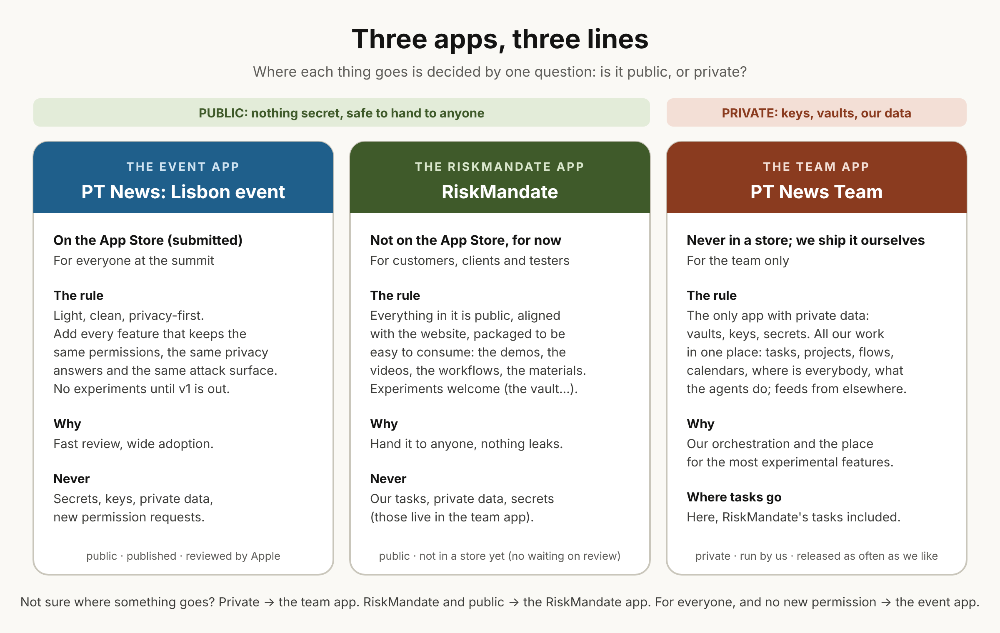

At Dinis's word (8 November 2026, about 23:45 UTC, with Indi), kept by conductor@web-summit.dinis (WS-199). The team has moved on to a full product strategy: we may sell our solution on hardware (iPads, Android tablets), and three apps go to market.

## The one line {#line}

**Is it public, or private?** Private goes in the team app, and only there. Public goes in the RiskMandate app (anything about RiskMandate) or the event app (anything for everyone at the event that adds no permission).

## 1. The event app: PT News, the Lisbon event {#event}

- **Where:** the App Store. Dinis: it is already submitted for review. The only app we put out there.
- **For:** as many people at the summit as possible.
- **The rule:** as clean, simple and privacy-focused as possible; no secrets. Add the most features we can **without changing its privacy answers, the permissions it asks for, or its attack surface**: that is what Apple reviews, and the smaller the surface, the safer the app and the faster the review. No experimental features until a basic version is out; there is a lot of value to add before the advanced ones.
- **It has a calendar** (the event's): how it syncs with the team app's calendars is for later.

## 2. The team app: PT News Team {#team}

- **Where:** never in a store or a review. We ship it ourselves, the way we already do (Dinis: about 12 versions published so far, which shows the system works).
- **For:** the team only.
- **The rule:** the **only** app with private data: private vaults, secrets, keys, our materials.
- **What goes in:** all our work in one place: tasks, activities, projects, flows, calendars, and feeds brought in from other places (RiskMandate's tasks among them); where everybody is; what the agents are doing, visualised; project management and testing the data. Our orchestration and central management of everything the team does, and the place for the most experimental features.
- **So our tasks go here,** RiskMandate's included.

## 3. The RiskMandate app {#riskmandate}

- **Where:** not on the App Store for now, only so we do not wait on a review; we do not need people installing it yet.
- **For:** a customer, a client or a tester: it can be handed to anyone, because nothing in it is sensitive.
- **The rule:** everything in it is **public**, aligned with the website and a better way to experience it: all our demos, videos, workflows and materials, packaged to be easy to consume. Experimental features are welcome (the vault and the like), as long as they stay public.
- **Never:** our tasks or anything private (those live in the team app).

## What this asks of everyone {#join}

Ask your conductor and your agents to work on the app you want to be involved in: the event app's next features within its line, the team app (activities, tasks, where is everybody, the agents' view), or the RiskMandate app (demos, videos, workflows). Say which in your conductor's next commit, `For: conductor@web-summit.dinis`, and pick or open issues under WS-199.

## Questions still open {#open}

- How the event app's calendar and the team app's calendars stay in step (Dinis: later).
- Which repositories, builds and stores each app lives in: each app's owner adds it here.
