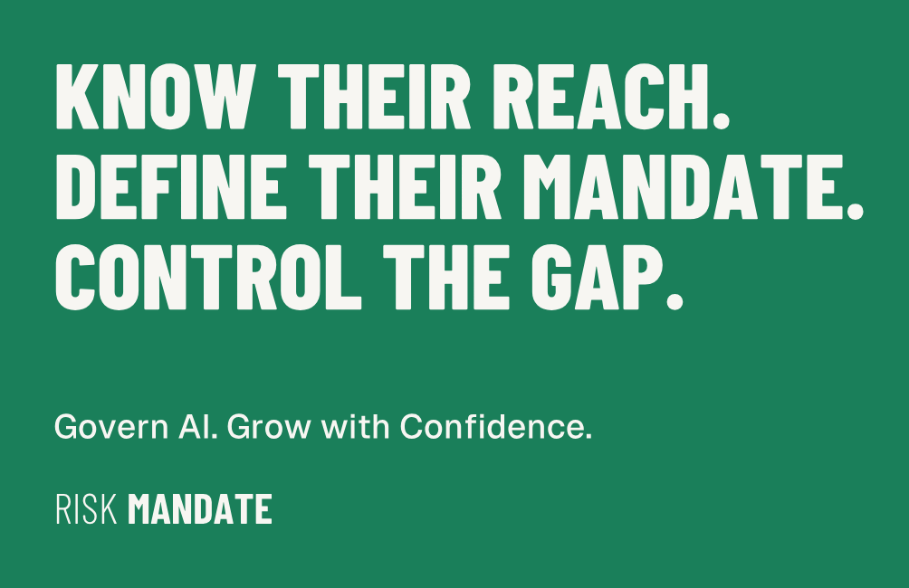
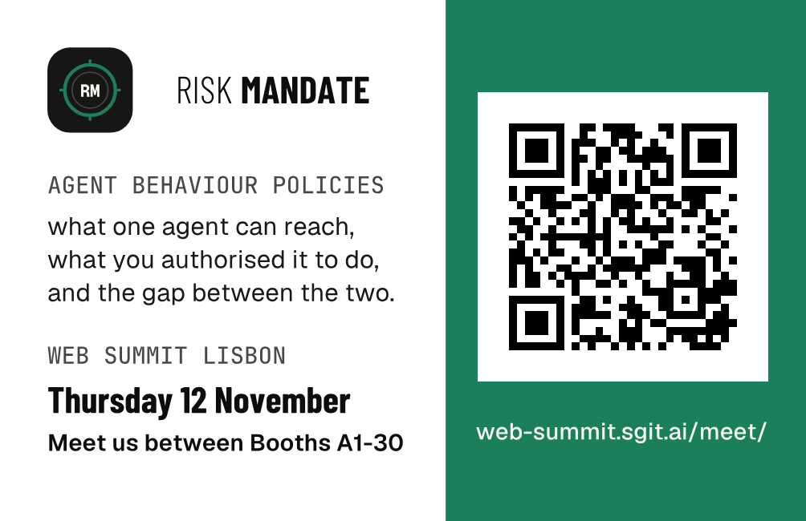

**Show this screen, or let them scan the QR on the back.** It is the green card, the team-wide one with no names: the same design as the printed cards ([all three](../cards/index.html)).

The QR opens [web-summit.sgit.ai/meet/](../meet/index.html), where they find each of us. Our website: [riskmandate.ai](https://riskmandate.ai).

## Keep it one tap away {#save}

**On an iPhone, now (about 10 seconds):**
1. Open this page in **Safari**: web-summit.sgit.ai/card/
2. Tap **Share** (the square with the arrow), then **Add to Home Screen**, then **Add**.
3. The card is now an icon on your Home Screen. One tap shows it.

**Even quicker, as a picture:** press and hold the back of the card above, then **Save to Photos**. Mark it as a favourite, so it is at the top of Photos.

**On Android:** open this page in Chrome, tap the three dots, then **Add to Home screen**.

## Apple Wallet {#wallet}

The card is ready as an Apple Wallet pass: the dark card, the line "Know their reach. Define their mandate. Control the gap.", Thursday 12 November between Booths A1-30, and the QR to the meet page. Its files and the builder are in the repository (`team/designer/wallet/`).

**Not on your phone yet:** Apple Wallet only accepts a pass signed with a certificate from an Apple Developer account. Ours is Dinis's (the one that ships the PrompTugal apps). Once he makes a Pass Type ID and its certificate, the pass is built and signed in one command, and a link to it appears here. Until then, use the Home Screen above: it is just as fast.
