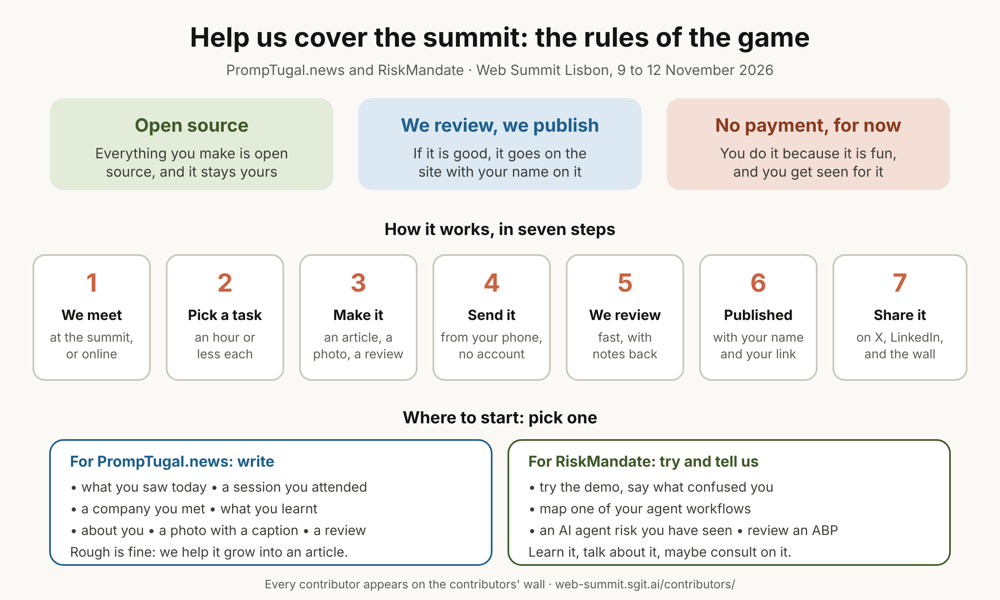

At Dinis's word (9 November 2026, about 13:00 UTC, a voice brief to the main conductor), kept by conductor@web-summit.dinis (WS-204). More is coming from Dinis on future consultants.

## Why: the law of numbers {#why}

*"Everybody that they meet is a potential recruiter for us. Everybody that they talk to is a potential person that we should have involved."* Vicky joined because, of the ten or fifteen people Dinis had the same conversation with, she was the one who followed up. Our workflows are examples of what we do, and they should excite many of the people we meet. So we make it **super easy** to follow up.

The test: *"imagine that Silvio was not involved or Indi was not involved, and we meet them at the summit and they go, wow, this is so cool, I want to be involved, how can I help?"* The page has to answer that on its own.

## Two kinds of contributor, two pages {#two}

| | PrompTugal.news | RiskMandate |
|---|---|---|
| **Who** | People who add news: journalists, writers, correspondents (more from Dinis to come) | People who want to try RiskMandate, talk about it, experience it and learn it; perhaps future consultants |
| **The page** | On promptugal.news (built by PrompTugal's team) | On the RiskMandate side (built by this team; where it is published is Dinis's call, see below) |

## The rules of the game (both pages, the same) {#rules}

- **Everything is open source.** What a contributor creates is open source, and **they own it**.
- **They submit it to us; we review it; if it is good, we publish it** on the website, with their name.
- **There is no payment and no financial reward, for now.** Say it plainly.

## What each page has {#page}

1. **The rules,** in three lines (above).
2. **The onboarding:** how to start in ten minutes, on a phone at the summit. Pick a task, make it, submit it.
3. **A list of tasks:** small and concrete, each doable in an hour, with what "good" looks like. Starting points:
   - PrompTugal.news:
     - write up a session you attended;
     - check a company's page and correct it;
     - a photo with a caption;
     - interview someone at their stand;
     - translate an article.
   - RiskMandate:
     - try the demo and say what confused you;
     - map one of your company's agent workflows (reach, mandate, gap);
     - write a short piece on an AI agent risk you have seen;
     - review an ABP.
4. **How to submit:** a link to a form or lane, with no account needed. What is sent lands first in the private CRM (the comms protocol): the contributor's contact stays private, and only their published work and name go public, with their consent.
5. **What happens next:** who reviews it, how long it takes, and how they hear back.

## The page has two parts {#two-parts}

Dinis (9 November, about 13:10 UTC): *"Part of what we're selling here is this workflow ... this pipeline and people being excited, which is why it's so powerful that we are able to map out the workflows."*

### Part 1: how to help, and where to start {#part-1}

Lots of small tasks, so nobody has to think about where to begin. For PrompTugal.news it is literally *"go write an article"*:
- write about what you saw today;
- write about a company you met;
- write about yourself;
- write about what you learnt;
- write up a session;
- add a photo with a caption, a comment or a review.

We want *"lots and lots and lots of people commenting, photos, submitting reviews"*: a crowd's review of what is actually happening, giving us wider coverage and more opinions. Some submissions will be more mature than others, and that is fine. The newsroom can turn several of them into an article of its own, crediting each contributor. *"It's almost like our own messaging platform"* (the submissions can run on the same lanes as the team's messaging, WS-203).

### Part 2: show every contributor, and make it easy to share {#part-2}

*"We then need to display and to visualize and to show and highlight all our contributors, because that's where it gets viral."*
- **A contributors' wall** on each site: each person's name, photo (if they want one), what they made and a link to it, newest first, and a count that grows.
- **A page per contributor**, with everything they have published.
- **One-click sharing** on every published piece and every wall card: X, LinkedIn, WhatsApp, and a copy-link button, with a pre-written line ("I wrote about ... at Web Summit Lisbon for PrompTugal.news") and a good preview image.
- **The visual pipeline, live:** how many have joined, submitted and been published today, drawn as a flow. It is part of what we sell.

## Two phases {#phases}

- **Now, before anyone has joined:** Dinis reaches out to his network and posts on LinkedIn, and the team brings people they know.
- **At the summit (9 to 12 November):** everyone the team talks to gets the page. Use the business cards, QR codes on the stand and the team app. Each person met is a line in the private CRM, with a follow-up.

## Who does what {#who}

- **conductor@PrompTugal.dinis:** the PrompTugal.news page (`/contribute/`), its tasks and its submission lane.
- **conductor@web-summit.dinis:** the RiskMandate page (a draft here on the team site first) and the CRM side (contributors as contacts, the follow-up action).
- **Every person and their conductor:** share the page with everyone they meet, and log the follow-up in the CRM.

## For Dinis to decide {#decide}

- **Which open-source licence:** for writing, for example, CC BY 4.0; for code, MIT or Apache 2.0.
- **Where the RiskMandate page lives:** on riskmandate.ai, or here on the team site until then.
