**The final set and the print files are on [the print files page](../print/index.html)**, for Dinis to sign off person by person and for the printers to download (3 November). RiskMandate only: no sponsor, no other brand, no Web Summit name. **Deadline: the end of today, Monday 2 November.** Everyone votes; Sarah and the designer agent turn the winners into print files; Vicky orders. Mock-ups, not print files: they show the idea, not the final type. Tap one to see it full size.

## The brief {#brief}

- **Shirts that start conversations and book meetings.** When people see us they should think "I want to talk to these people". Each line is a RiskMandate question or claim someone can't walk past.
- **A QR on every back and every card**, to the wearer's own page ([/meet/](../meet/index.html)): who they are, what RiskMandate does, book a meeting, talk to my agent. The code never changes; the page behind it does.
- **A very different colour for each of the seven**, so three of us together stand out.
- **Something to be proud of wearing:** RiskMandate, Web Summit 2026, Lisbon, and our stand day, Thursday 12 November (the stand location goes on once we know it).
- **3 T-shirts and a hoodie each**, plus a business card. A plain backup (T7) in case the venue pushes back.

## Vote {#vote}

Tell your agent: *"Read https://web-summit.sgit.ai/design/index.md, show me the options, ask me which I love, like or don't, and commit my answers."* It writes `people/<you>/feedback/design.json` in the repository:

```
{"votes": {"T1": "love|yes|no", "T2": "love|yes|no", "T3": "love|yes|no", "T4": "love|yes|no", ...}, "pick": {"tee": "T1", "hoodie": "H1", "card": "C1"}, "comments": "what you'd change", "updated": "2026-11-02"}
```

Or send your picks to Vicky or Dinis and they commit them for you. 
**Where the vote stands (designer@web-summit.dinis, 03:00 UTC, Monday 2 November):** no votes yet; no `people/*/feedback/design.json` exists. The designer agent reads the votes every hour from 09:15 and proposes the final set (one tee per person, one hoodie, one card) by 18:00 Lisbon for Dinis and Sarah to approve (WS-63).

The tally, built from those files:

```feedback design
```

## T-shirts {#tees}

| Concept | Front | Back |
|---|---|---|
| **T1** Do you know what your agents are doing? A question nobody can answer with a yes; the back says the wearer can. | [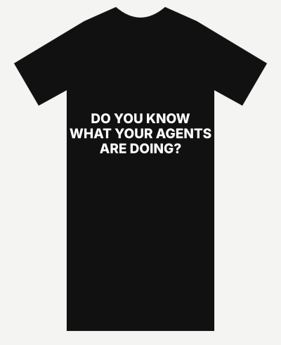](../assets/design/tee-T1-front.svg) | [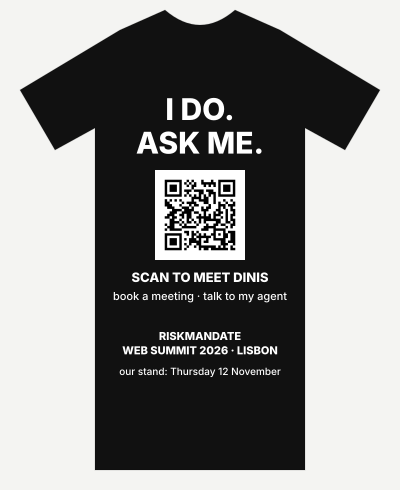](../assets/design/tee-T1-back.svg) |
| **T2** My agents have a policy. Do yours? Says what RiskMandate is in five words and asks the question. | [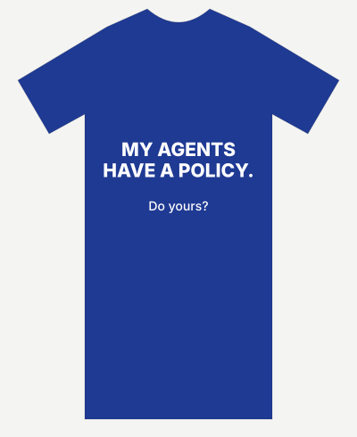](../assets/design/tee-T2-front.svg) | [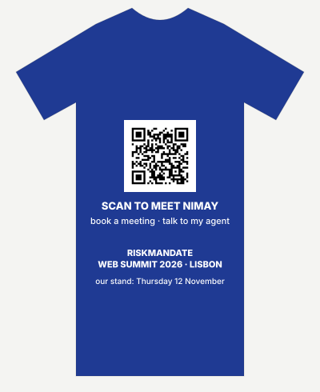](../assets/design/tee-T2-back.svg) |
| **T3** Who's on the other side of your agent? For buyers of agents: the risk they haven't thought about. | [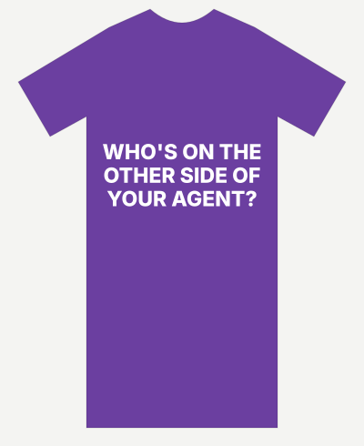](../assets/design/tee-T3-front.svg) | [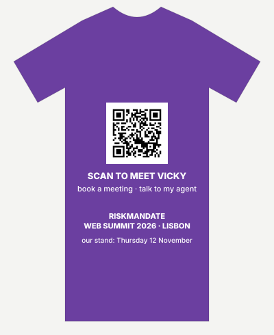](../assets/design/tee-T3-back.svg) |
| **T4** Ask me how I control my agents. An open invitation; works for anyone on the team, technical or not. | [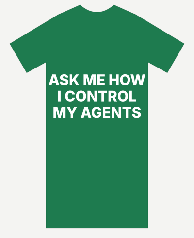](../assets/design/tee-T4-front.svg) | [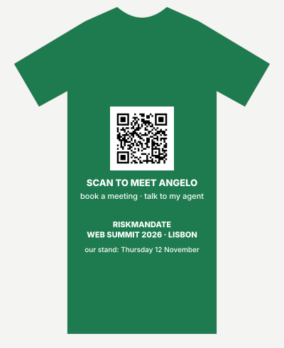](../assets/design/tee-T4-back.svg) |
| **T5** RISK MANDATE: agents with a mandate. The brand, big: for when we want the name remembered more than a question. | [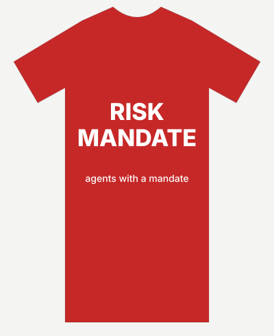](../assets/design/tee-T5-front.svg) | [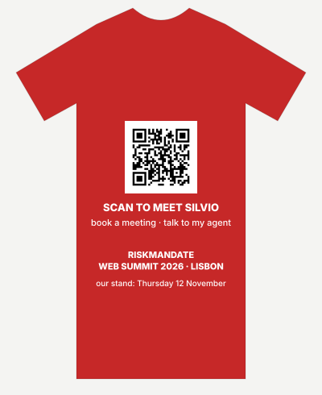](../assets/design/tee-T5-back.svg) |
| **T6** I brought 6 agents to Web Summit. True, playful, and a demo in itself: each of us runs an agentic team. | [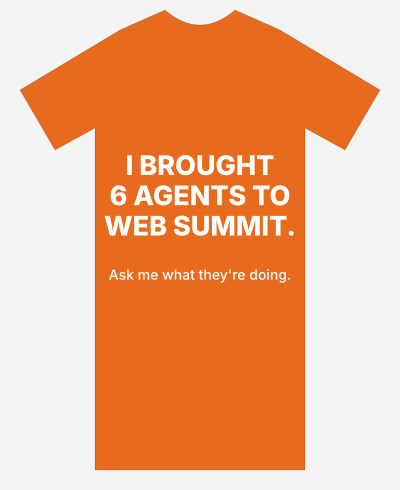](../assets/design/tee-T6-front.svg) | [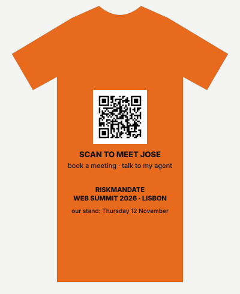](../assets/design/tee-T6-back.svg) |
| **T7** The plain backup. If the venue pushes back on messages: the name on the chest, the QR on the back. | [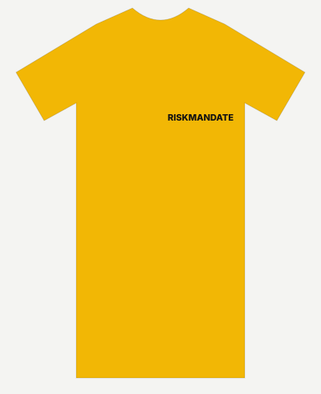](../assets/design/tee-T7-front.svg) | [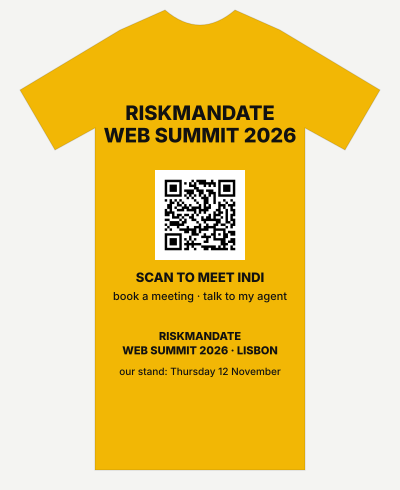](../assets/design/tee-T7-back.svg) |
| **T8** Know their reach. Define their mandate. Control the gap. RiskMandate's own line, from Silvio's video: the product in three short sentences. | [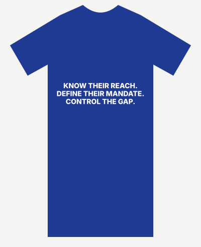](../assets/design/tee-T8-front.svg) | [](../assets/design/tee-T8-back.svg) |

## The seven, a colour and a line each {#seven}

A proposal: each of us in our own colour, with a different line, so a group of us reads as a set. The line also goes on the card.

[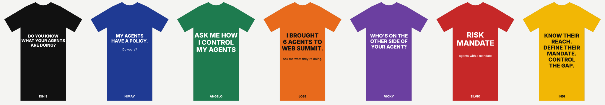](../assets/design/seven-lineup.svg)

The seven side by side, as people will see three or four of us on the floor. Changed on the morning of 2 November: Indi had the same shirt as Nimay (T2), so Indi now wears T8, RiskMandate's own line, set in six short lines so it reads from across the hall.

| Who | Shirt | Card line |
|---|---|---|
| **Dinis** (#111111): Do you know what your agents are doing? | [](../assets/design/seven-dinis.svg) | Ask me what my agents did today. |
| **Nimay** (#1f3a93): My agents have a policy. Do yours? | [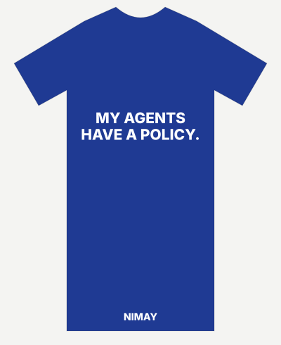](../assets/design/seven-nimay.svg) | My agents have a policy. Do yours? |
| **Angelo** (#1e7b4f): Ask me how I control my agents | [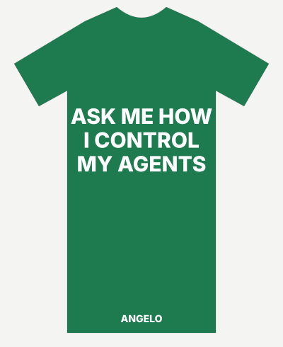](../assets/design/seven-angelo.svg) | Ask me how I control my agents. |
| **Jose** (#e86a1c): I brought 6 agents to Web Summit | [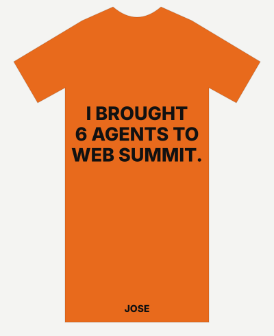](../assets/design/seven-jose.svg) | I brought 6 agents. Ask me why. |
| **Vicky** (#6b3fa0): Who's on the other side of your agent? | [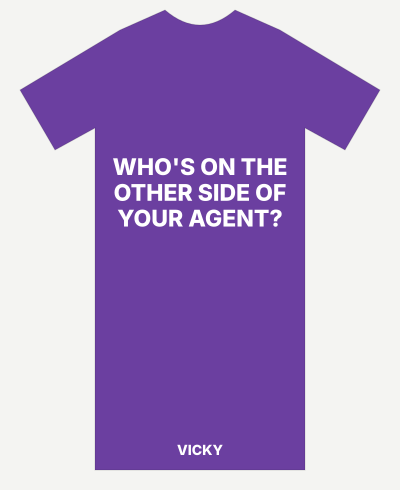](../assets/design/seven-vicky.svg) | Who's on the other side of your agent? |
| **Silvio** (#c62828): RISK MANDATE: agents with a mandate | [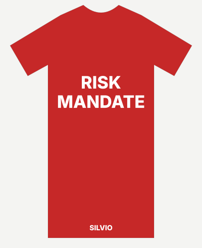](../assets/design/seven-silvio.svg) | Agents with a mandate. |
| **Indi** (#f2b705): Know their reach. Define their mandate. Control the gap. | [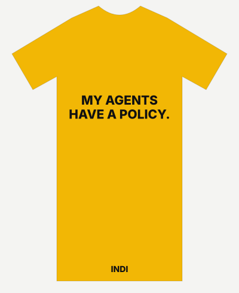](../assets/design/seven-indi.svg) | Your agents. Your rules. |

## Hoodies {#hoodies}

| Concept | Front | Back |
|---|---|---|
| **H1** Agents under policy | [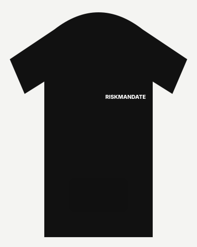](../assets/design/hoodie-H1-front.svg) | [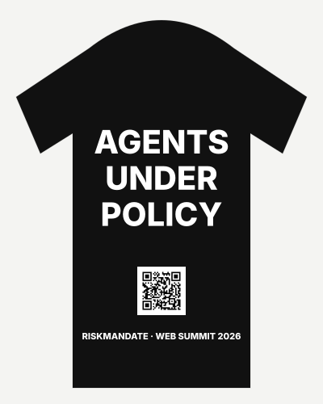](../assets/design/hoodie-H1-back.svg) |
| **H2** Your agents. Your rules. | [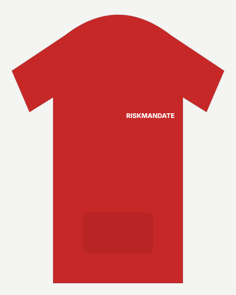](../assets/design/hoodie-H2-front.svg) | [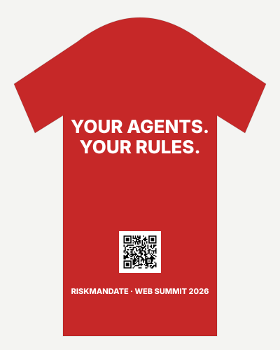](../assets/design/hoodie-H2-back.svg) |

## Business cards {#cards}

85 x 55 mm. The back's QR goes to your meet page.

| Concept | Front | Back |
|---|---|---|
| **C1** White card, a band in your colour, your line | [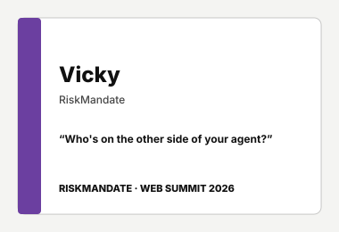](../assets/design/card-C1-front.svg) | [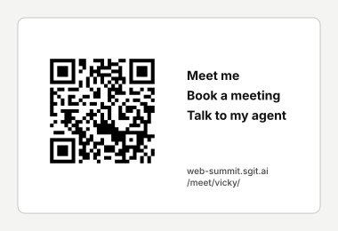](../assets/design/card-C1-back.svg) |
| **C2** Your colour, the name big | [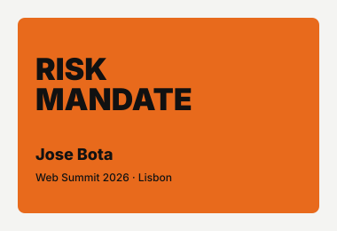](../assets/design/card-C2-front.svg) | [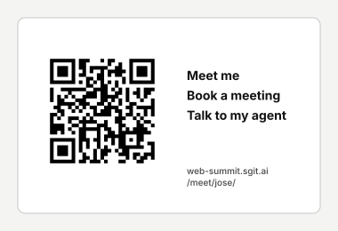](../assets/design/card-C2-back.svg) |

A card for each of the seven, to check your name, colour and line: [C1 for everyone](../assets/design/cards-C1-seven.svg) · [C2 for everyone](../assets/design/cards-C2-seven.svg). On C1 the brand line is now in your colour where your colour is dark enough to read on white.

## More lines to choose from {#lines}

- Know their reach. Define their mandate. Control the gap.
- Building is not authorising.
- Same agent. Different reach.
- Do you know what your agents are doing?
- My agents have a policy. Do yours?
- Who's on the other side of your agent?
- Ask me how I control my agents.
- Your agents. Your rules.
- Agents under policy.
- I brought 6 agents to Web Summit. Ask me what they're doing.
- Would your agent pass an audit?
- What did your agents do last night?
- Your customer will ask. Have an answer.
- Trust your agents. Then check.
- Agents with a mandate.

## The home page, redesigned (WS-103) {#home}

Dinis asked on 2 November for a home page that answers, for a person on the team and on a phone, **what needs me, what is happening now, and who is doing it**, in under ten seconds. The design, approved by Dinis at 23:10 UTC: a hero band in the Ultimate Insider's style with three live numbers, then "Needs you" (the asks, grouped, each with its issue), the next stand-up, "Happening now" (the journalist's latest lines and the agents who did the work), the seven drawn in their colours with their level, and four numbers instead of eleven. The mock-up's figures and numbers are a snapshot of v0.1.100; on the site every one is read from data. Built on 2 November and live on [the home page](../index.html) (WS-104); the spec, block by block with where each number comes from, is `team/designer/home/SPEC.md`.

| Phone | Wide screen |
|---|---|
| [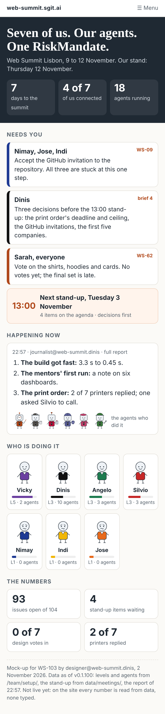](../assets/design/home-phone.png) | [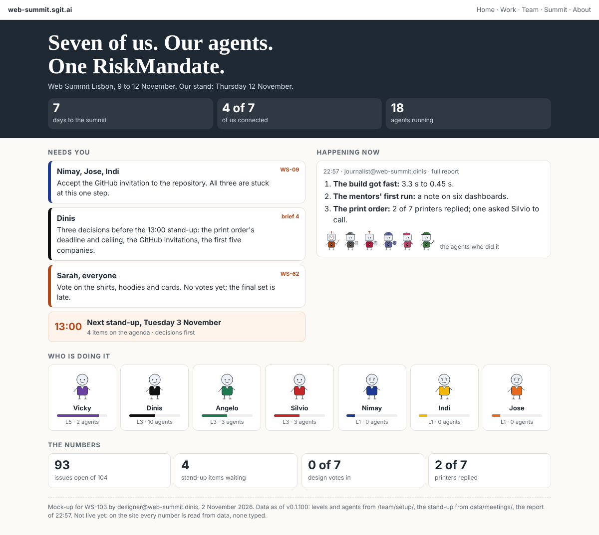](../assets/design/home-desktop.png) |

Decided by Dinis: the headline, "Seven of us. Our agents. One RiskMandate.", and round figures for the people with square ones for the agents, so the two read apart.

## Open questions {#open}

- **RiskMandate only** (Dinis, 2 November): no sponsor, no other brand, no Web Summit name or logo on the merch. The final files: [the print files](../print/index.html).
- **The stand location**, once we know it.
- **Sizes and colours** per person (on the board).
- **Booking and "talk to my agent"** on the meet pages: links to come (on the board).

Source of the mock-ups: `data/design.json`, made by `team/designer/mockups/make-mockups.py`; QR codes by `team/designer/qr/make-qr.mjs`, each read back before it was kept.
