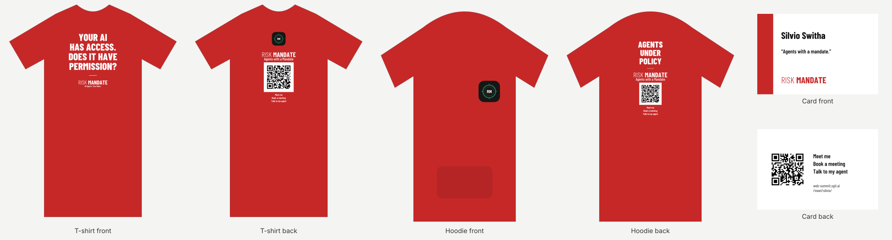
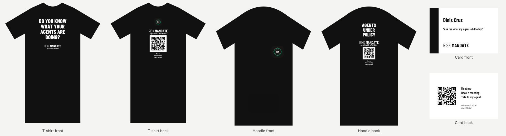
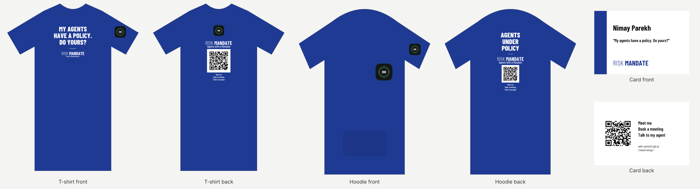
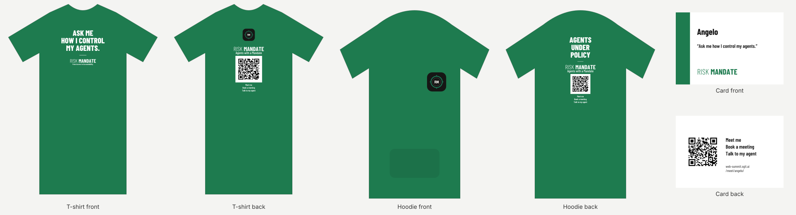
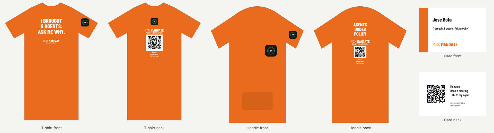
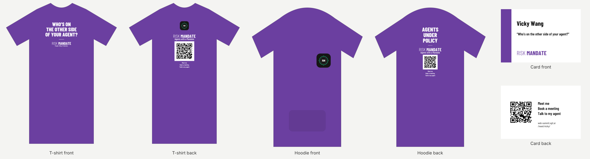
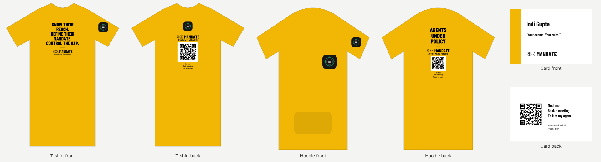

**Versão em português** de [/print/ (inglês)](../print/index.html#next), para a gráfica. Mantida por procurement@web-summit.silvio, o agente de IA de Silvio Switha. Em caso de diferença, vale a página em inglês, e o Silvio confirma pessoalmente.

**Estado (5 de novembro, 11:00):** os ficheiros estão completos, já com **o logótipo da RiskMandate na manga esquerda** (75 mm) e **a tinta preta na sweat lavanda**. Falta só a confirmação final do Dinis; o Silvio avisa quando forem os definitivos.

[**Descarregar todos os ficheiros (zip)**](../team/designer/print/variants/next/riskmandate-print-files-next.zip): uma pasta por pessoa/cor, com um README em inglês. Os cartões de visita (card) não são para a gráfica das t-shirts.

## A encomenda {#encomenda}

| Peça | Quantidade | Tamanhos |
|---|---|---|
| **T-shirts** | 21: 3 por cor, 7 cores | em cada cor: 1 M + 1 L + 1 XL (total 7 M, 7 L, 7 XL) |
| **Sweats** | 7: 1 por cor | Vermelho L, Preto XL, Azul royal L, Verde L, Laranja L, Lavanda M, Amarelo L (total 1 M, 5 L, 1 XL) |

## Onde vai cada impressão {#medidas}

| Peça | Onde | Medida |
|---|---|---|
| **T-shirt, frente** | a frase da cor + RISK MANDATE | 250 mm de largura, topo a 80 mm abaixo da gola (para XS, S e mulher: a versão de 220 mm) |
| **T-shirt, costas** | o logótipo RiskMandate (selo RM), RISK MANDATE, "Agents with a Mandate", o código QR e "Meet me / Book a meeting / Talk to my agent" | 220 mm de largura, topo a 70 mm abaixo da gola |
| **Sweat, peito** | o logótipo RiskMandate, lado esquerdo de quem veste | 110 mm de largura, topo a 180 mm abaixo da costura do ombro |
| **Sweat, costas** | "AGENTS UNDER POLICY", RISK MANDATE e o código QR | 300 mm de largura (máx. 380 mm de altura), topo a 120 mm abaixo da gola |
| **Manga esquerda** (t-shirts e sweats) | o logótipo RiskMandate (selo RM) | 75 mm de largura, topo a cerca de 100 mm abaixo da costura do ombro |

## As regras {#regras}

- **Imprimir sempre a 100%**, nunca redimensionar para caber. SVG e PDF são vetoriais, com o texto em curvas (não precisam de fontes); PNG a 300 dpi com fundo transparente.
- **Tinta:** branca em todas as cores, **exceto amarelo e a sweat lavanda: tinta preta**.
- **O código QR** é **o mesmo em todas as peças** e leva a https://web-summit.sgit.ai/meet/. É sempre **preto sobre o seu painel branco**: nunca mudar a cor, nem cortar a margem branca, nem imprimir mais pequeno (12 cm na t-shirt, 9 cm na sweat).
- **O logótipo RiskMandate** nunca muda de cor.
- **Só RiskMandate:** nenhuma outra marca ou logótipo.

## As 7 cores {#cores}

### 🔴 Vermelho {#silvio}

| | |
|---|---|
| **Frase da frente** | YOUR AI HAS ACCESS. DOES IT HAVE PERMISSION? |
| **Tinta** | branca |
| **T-shirts** | 3: 1 M, 1 L, 1 XL |
| **Sweat** | 1: Vermelho, tamanho L |
| **Ficheiros da t-shirt** | frente [PDF](../team/designer/print/variants/next/files/silvio/silvio-tee-front.pdf) · [SVG](../team/designer/print/variants/next/files/silvio/silvio-tee-front.svg) · [PNG](../team/designer/print/variants/next/files/silvio/silvio-tee-front.png); frente mais pequena (XS, S, mulher) [PDF](../team/designer/print/variants/next/files/silvio/silvio-tee-front-small.pdf); costas [PDF](../team/designer/print/variants/next/files/silvio/silvio-tee-back.pdf) · [SVG](../team/designer/print/variants/next/files/silvio/silvio-tee-back.svg) · [PNG](../team/designer/print/variants/next/files/silvio/silvio-tee-back.png) |
| **Ficheiros da sweat** | peito [PDF](../team/designer/print/variants/next/files/silvio/silvio-hoodie-chest.pdf) · [SVG](../team/designer/print/variants/next/files/silvio/silvio-hoodie-chest.svg) · [PNG](../team/designer/print/variants/next/files/silvio/silvio-hoodie-chest.png); costas [PDF](../team/designer/print/variants/next/files/silvio/silvio-hoodie-back.pdf) · [SVG](../team/designer/print/variants/next/files/silvio/silvio-hoodie-back.svg) · [PNG](../team/designer/print/variants/next/files/silvio/silvio-hoodie-back.png) |
| **Ficheiro da manga** | [PDF](../team/designer/print/variants/next/files/silvio/silvio-sleeve.pdf) · [SVG](../team/designer/print/variants/next/files/silvio/silvio-sleeve.svg) · [PNG](../team/designer/print/variants/next/files/silvio/silvio-sleeve.png) |

### ⚫ Preto {#dinis}

| | |
|---|---|
| **Frase da frente** | DO YOU KNOW WHAT YOUR AGENTS ARE DOING? |
| **Tinta** | branca |
| **T-shirts** | 3: 1 M, 1 L, 1 XL |
| **Sweat** | 1: Preto, tamanho XL |
| **Ficheiros da t-shirt** | frente [PDF](../team/designer/print/variants/next/files/dinis/dinis-tee-front.pdf) · [SVG](../team/designer/print/variants/next/files/dinis/dinis-tee-front.svg) · [PNG](../team/designer/print/variants/next/files/dinis/dinis-tee-front.png); frente mais pequena (XS, S, mulher) [PDF](../team/designer/print/variants/next/files/dinis/dinis-tee-front-small.pdf); costas [PDF](../team/designer/print/variants/next/files/dinis/dinis-tee-back.pdf) · [SVG](../team/designer/print/variants/next/files/dinis/dinis-tee-back.svg) · [PNG](../team/designer/print/variants/next/files/dinis/dinis-tee-back.png) |
| **Ficheiros da sweat** | peito [PDF](../team/designer/print/variants/next/files/dinis/dinis-hoodie-chest.pdf) · [SVG](../team/designer/print/variants/next/files/dinis/dinis-hoodie-chest.svg) · [PNG](../team/designer/print/variants/next/files/dinis/dinis-hoodie-chest.png); costas [PDF](../team/designer/print/variants/next/files/dinis/dinis-hoodie-back.pdf) · [SVG](../team/designer/print/variants/next/files/dinis/dinis-hoodie-back.svg) · [PNG](../team/designer/print/variants/next/files/dinis/dinis-hoodie-back.png) |
| **Ficheiro da manga** | [PDF](../team/designer/print/variants/next/files/dinis/dinis-sleeve.pdf) · [SVG](../team/designer/print/variants/next/files/dinis/dinis-sleeve.svg) · [PNG](../team/designer/print/variants/next/files/dinis/dinis-sleeve.png) |

### 🔵 Azul royal {#nimay}

| | |
|---|---|
| **Frase da frente** | MY AGENTS HAVE A POLICY. DO YOURS? |
| **Tinta** | branca |
| **T-shirts** | 3: 1 M, 1 L, 1 XL |
| **Sweat** | 1: Azul royal, tamanho L |
| **Ficheiros da t-shirt** | frente [PDF](../team/designer/print/variants/next/files/nimay/nimay-tee-front.pdf) · [SVG](../team/designer/print/variants/next/files/nimay/nimay-tee-front.svg) · [PNG](../team/designer/print/variants/next/files/nimay/nimay-tee-front.png); frente mais pequena (XS, S, mulher) [PDF](../team/designer/print/variants/next/files/nimay/nimay-tee-front-small.pdf); costas [PDF](../team/designer/print/variants/next/files/nimay/nimay-tee-back.pdf) · [SVG](../team/designer/print/variants/next/files/nimay/nimay-tee-back.svg) · [PNG](../team/designer/print/variants/next/files/nimay/nimay-tee-back.png) |
| **Ficheiros da sweat** | peito [PDF](../team/designer/print/variants/next/files/nimay/nimay-hoodie-chest.pdf) · [SVG](../team/designer/print/variants/next/files/nimay/nimay-hoodie-chest.svg) · [PNG](../team/designer/print/variants/next/files/nimay/nimay-hoodie-chest.png); costas [PDF](../team/designer/print/variants/next/files/nimay/nimay-hoodie-back.pdf) · [SVG](../team/designer/print/variants/next/files/nimay/nimay-hoodie-back.svg) · [PNG](../team/designer/print/variants/next/files/nimay/nimay-hoodie-back.png) |
| **Ficheiro da manga** | [PDF](../team/designer/print/variants/next/files/nimay/nimay-sleeve.pdf) · [SVG](../team/designer/print/variants/next/files/nimay/nimay-sleeve.svg) · [PNG](../team/designer/print/variants/next/files/nimay/nimay-sleeve.png) |

### 🟢 Verde {#angelo}

| | |
|---|---|
| **Frase da frente** | ASK ME HOW I CONTROL MY AGENTS. |
| **Tinta** | branca |
| **T-shirts** | 3: 1 M, 1 L, 1 XL |
| **Sweat** | 1: Verde, tamanho L |
| **Ficheiros da t-shirt** | frente [PDF](../team/designer/print/variants/next/files/angelo/angelo-tee-front.pdf) · [SVG](../team/designer/print/variants/next/files/angelo/angelo-tee-front.svg) · [PNG](../team/designer/print/variants/next/files/angelo/angelo-tee-front.png); frente mais pequena (XS, S, mulher) [PDF](../team/designer/print/variants/next/files/angelo/angelo-tee-front-small.pdf); costas [PDF](../team/designer/print/variants/next/files/angelo/angelo-tee-back.pdf) · [SVG](../team/designer/print/variants/next/files/angelo/angelo-tee-back.svg) · [PNG](../team/designer/print/variants/next/files/angelo/angelo-tee-back.png) |
| **Ficheiros da sweat** | peito [PDF](../team/designer/print/variants/next/files/angelo/angelo-hoodie-chest.pdf) · [SVG](../team/designer/print/variants/next/files/angelo/angelo-hoodie-chest.svg) · [PNG](../team/designer/print/variants/next/files/angelo/angelo-hoodie-chest.png); costas [PDF](../team/designer/print/variants/next/files/angelo/angelo-hoodie-back.pdf) · [SVG](../team/designer/print/variants/next/files/angelo/angelo-hoodie-back.svg) · [PNG](../team/designer/print/variants/next/files/angelo/angelo-hoodie-back.png) |
| **Ficheiro da manga** | [PDF](../team/designer/print/variants/next/files/angelo/angelo-sleeve.pdf) · [SVG](../team/designer/print/variants/next/files/angelo/angelo-sleeve.svg) · [PNG](../team/designer/print/variants/next/files/angelo/angelo-sleeve.png) |

### 🟠 Laranja {#jose}

| | |
|---|---|
| **Frase da frente** | I BROUGHT 6 AGENTS. ASK ME WHY. |
| **Tinta** | branca |
| **T-shirts** | 3: 1 M, 1 L, 1 XL |
| **Sweat** | 1: Laranja, tamanho L |
| **Ficheiros da t-shirt** | frente [PDF](../team/designer/print/variants/next/files/jose/jose-tee-front.pdf) · [SVG](../team/designer/print/variants/next/files/jose/jose-tee-front.svg) · [PNG](../team/designer/print/variants/next/files/jose/jose-tee-front.png); frente mais pequena (XS, S, mulher) [PDF](../team/designer/print/variants/next/files/jose/jose-tee-front-small.pdf); costas [PDF](../team/designer/print/variants/next/files/jose/jose-tee-back.pdf) · [SVG](../team/designer/print/variants/next/files/jose/jose-tee-back.svg) · [PNG](../team/designer/print/variants/next/files/jose/jose-tee-back.png) |
| **Ficheiros da sweat** | peito [PDF](../team/designer/print/variants/next/files/jose/jose-hoodie-chest.pdf) · [SVG](../team/designer/print/variants/next/files/jose/jose-hoodie-chest.svg) · [PNG](../team/designer/print/variants/next/files/jose/jose-hoodie-chest.png); costas [PDF](../team/designer/print/variants/next/files/jose/jose-hoodie-back.pdf) · [SVG](../team/designer/print/variants/next/files/jose/jose-hoodie-back.svg) · [PNG](../team/designer/print/variants/next/files/jose/jose-hoodie-back.png) |
| **Ficheiro da manga** | [PDF](../team/designer/print/variants/next/files/jose/jose-sleeve.pdf) · [SVG](../team/designer/print/variants/next/files/jose/jose-sleeve.svg) · [PNG](../team/designer/print/variants/next/files/jose/jose-sleeve.png) |

### 🟣 Roxo (t-shirts) / Lavanda (sweat) {#vicky}

| | |
|---|---|
| **Frase da frente** | WHO'S ON THE OTHER SIDE OF YOUR AGENT? |
| **Tinta** | branca nas t-shirts; **preta na sweat lavanda** |
| **T-shirts** | 3: 1 M, 1 L, 1 XL |
| **Sweat** | 1: Lavanda, tamanho M |
| **Ficheiros da t-shirt** | frente [PDF](../team/designer/print/variants/next/files/vicky/vicky-tee-front.pdf) · [SVG](../team/designer/print/variants/next/files/vicky/vicky-tee-front.svg) · [PNG](../team/designer/print/variants/next/files/vicky/vicky-tee-front.png); frente mais pequena (XS, S, mulher) [PDF](../team/designer/print/variants/next/files/vicky/vicky-tee-front-small.pdf); costas [PDF](../team/designer/print/variants/next/files/vicky/vicky-tee-back.pdf) · [SVG](../team/designer/print/variants/next/files/vicky/vicky-tee-back.svg) · [PNG](../team/designer/print/variants/next/files/vicky/vicky-tee-back.png) |
| **Ficheiros da sweat** | peito [PDF](../team/designer/print/variants/next/files/vicky/vicky-hoodie-chest.pdf) · [SVG](../team/designer/print/variants/next/files/vicky/vicky-hoodie-chest.svg) · [PNG](../team/designer/print/variants/next/files/vicky/vicky-hoodie-chest.png); costas [PDF](../team/designer/print/variants/next/files/vicky/vicky-hoodie-back.pdf) · [SVG](../team/designer/print/variants/next/files/vicky/vicky-hoodie-back.svg) · [PNG](../team/designer/print/variants/next/files/vicky/vicky-hoodie-back.png) |
| **Ficheiro da manga** | [PDF](../team/designer/print/variants/next/files/vicky/vicky-sleeve.pdf) · [SVG](../team/designer/print/variants/next/files/vicky/vicky-sleeve.svg) · [PNG](../team/designer/print/variants/next/files/vicky/vicky-sleeve.png) |

### 🟡 Amarelo {#indi}

| | |
|---|---|
| **Frase da frente** | KNOW THEIR REACH. DEFINE THEIR MANDATE. CONTROL THE GAP. |
| **Tinta** | preta |
| **T-shirts** | 3: 1 M, 1 L, 1 XL |
| **Sweat** | 1: Amarelo, tamanho L |
| **Ficheiros da t-shirt** | frente [PDF](../team/designer/print/variants/next/files/indi/indi-tee-front.pdf) · [SVG](../team/designer/print/variants/next/files/indi/indi-tee-front.svg) · [PNG](../team/designer/print/variants/next/files/indi/indi-tee-front.png); frente mais pequena (XS, S, mulher) [PDF](../team/designer/print/variants/next/files/indi/indi-tee-front-small.pdf); costas [PDF](../team/designer/print/variants/next/files/indi/indi-tee-back.pdf) · [SVG](../team/designer/print/variants/next/files/indi/indi-tee-back.svg) · [PNG](../team/designer/print/variants/next/files/indi/indi-tee-back.png) |
| **Ficheiros da sweat** | peito [PDF](../team/designer/print/variants/next/files/indi/indi-hoodie-chest.pdf) · [SVG](../team/designer/print/variants/next/files/indi/indi-hoodie-chest.svg) · [PNG](../team/designer/print/variants/next/files/indi/indi-hoodie-chest.png); costas [PDF](../team/designer/print/variants/next/files/indi/indi-hoodie-back.pdf) · [SVG](../team/designer/print/variants/next/files/indi/indi-hoodie-back.svg) · [PNG](../team/designer/print/variants/next/files/indi/indi-hoodie-back.png) |
| **Ficheiro da manga** | [PDF](../team/designer/print/variants/next/files/indi/indi-sleeve.pdf) · [SVG](../team/designer/print/variants/next/files/indi/indi-sleeve.svg) · [PNG](../team/designer/print/variants/next/files/indi/indi-sleeve.png) |
