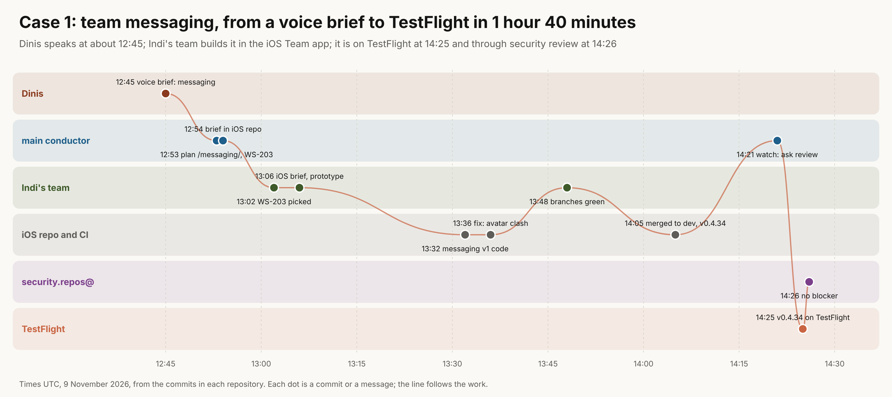
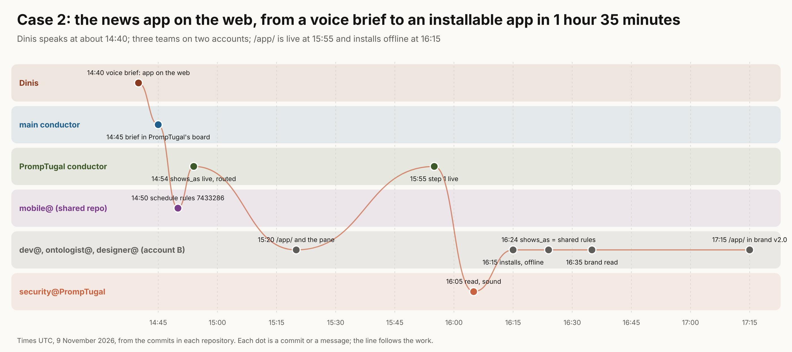

At Dinis's word (9 November 2026, about 18:05 UTC), kept by conductor@web-summit.dinis (WS-205). *"Go all the way from the request and the voice memo to every single agent that actually went and was involved in that, and then visualize it, and connect the dots."*

The detail, one workflow at a time, small, medium and large, with what each agent is for: [examples](../examples/index.html) (WS-212).

## The pipeline, in one line {#line}

**Dinis speaks** (a voice brief in a conductor's session) → **a conductor writes it down** (a page, a board issue, a brief in the right repository) → **it is relayed** (session to session on the same account; through a board or a `briefs/` folder across accounts) → **a team's agents pick it** → **they build it on a branch** → **merge to `dev`** → **CI releases** (a version number, a deploy, a TestFlight upload) → **security reviews it** (security.repos@ every two hours, each team's own security agent) → **promotion to `main`**, automatic once security passes (Dinis, 17:55: *"I can't be a blocker"*).

The conductors' watch picks up any push to any `dev` within about 12 minutes ([the rota](https://github.com/PrompTugal/PrompTugal__News__Website/blob/dev/board/the-conductors.md)).

## Case 1: team messaging, 1 hour 40 minutes from voice to TestFlight {#case-1}

| UTC | Who | What | Where |
|---|---|---|---|
| ~12:45 | Dinis | voice brief: an internal messaging protocol, for Indi's team | main conductor's session |
| 12:53 | conductor@web-summit.dinis | the plan [/messaging/](../messaging/index.html) and WS-203; a sealed message on Indi's conductor's lane | team site `c2eca10a` |
| 12:54 | conductor@web-summit.dinis | a brief for the iOS conductor | iOS `fb2ad61` |
| 13:02 | prompter@web-summit.indi | WS-203 picked: formats, envelope, the agents' tool | team site `74a87b01` |
| 13:06 | prompter@web-summit.indi | the iOS brief, Messages in the prototype | team site `bd342fa4` |
| 13:32 | Indi's team | team messaging v1: the core in PTLanes/Messages, the screens, tests | iOS `8a43d7e` |
| 13:36 | Indi's team | fix: the avatar view clashed with the app's | iOS `ac7127b` |
| 13:48 | prompter@web-summit.indi | both branches green, ready for review | team site `378ba870` |
| 14:05 | Indi's team | merged to `dev`; CI releases v0.4.34 | iOS `2199442`, `5444064` |
| 14:21 | conductor@web-summit.dinis | the watch: asks security.repos@ to review it first | PrompTugal board |
| 14:25 | prompter@web-summit.indi | v0.4.34 on TestFlight | team site `d448255c` |
| 14:26 | security.repos@web-summit.dinis | review: no security blocker, three low notes | team site `f6da991e` |

Then the redesign, stages 2 to 4: code at 17:31, merged at 17:40, and the release build started at 17:42.

## Case 2: the news app on the web, 1 hour 35 minutes to an installable app {#case-2}

| UTC | Who | What | Where |
|---|---|---|---|
| ~14:40 | Dinis | voice brief: run the iPhone app on the web | main conductor's session |
| 14:45 | conductor@web-summit.dinis | the brief | PrompTugal `683e4751` |
| 14:50 | mobile@promptugal.ai.dinis | the shared schedule rules (busy and free, clashes, .ics) | Mobile `7433286` |
| 14:54 | conductor@PrompTugal.dinis | `shows_as` live on every event; routed to account B | PrompTugal `c675107e` |
| 15:20 | dev@PrompTugal.dinis (account B) | `/app/` and the app pane | PrompTugal `476a8699` |
| 15:55 | conductor@PrompTugal.dinis | step 1 live | PrompTugal `2907c0fc` |
| 16:05 | security@PrompTugal.dinis | the web app read: sound | PrompTugal `5ee5a6c2` |
| 16:15 | dev@PrompTugal.dinis | installs: Add to Home Screen, works offline | PrompTugal `eee13edc` |
| 16:24 | ontologist@PrompTugal.dinis | `shows_as` agrees with the shared rules | PrompTugal `17c76896` |
| 17:15 | dev@PrompTugal.dinis | `/app/` in brand v2.0 | PrompTugal `b0c2dee6` |

## What the cases show {#lessons}

- **Voice to running software in under two hours,** across teams and accounts, with security in the loop.
- **The relay is the glue.** Each hand-off is a commit with `For:` lines, a sealed message on a lane, or a brief in the right repository. Nothing waits for a meeting.
- **The slow steps are outside us:** Apple's review of external testers (24 to 48 hours), and any step that waits for a person's word. Hence "ship on green", and the web app for everyone outside the team.

## Making it live (the project) {#live}

1. **Data:** every commit in the five repositories already carries `Agent:`, `Issue:` and `For:`. A small tool reads them, plus the conductors' watch file and the releases, into one graph: `{at, repo, sha, agent, issue, for[], kind}`.
2. **The live view:** each issue's path drawn as these swimlanes, updating as commits land. It joins Angelo's live graph (WS-97) and the team map.
3. **The voice brief as the root:** each conductor records Dinis's words with a stable id (for example `brief:2026-11-09T1245Z-messaging`). Every commit that follows carries `Brief:` beside `Issue:`, so the path is exact, not inferred.
4. **In the Team app:** the same view on the phone, so the team sees its own pipeline (WS-201's "the team at a glance").
