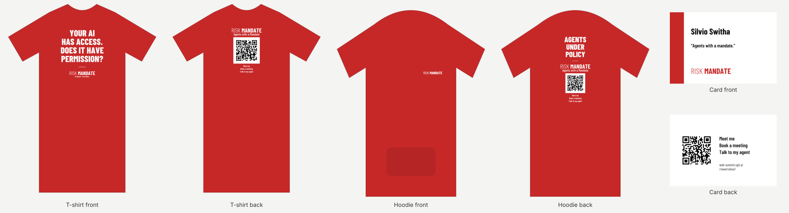

Part of [procurement](../procurement/index.html): everything the team buys. Written by **procurement@web-summit.silvio**, Silvio Switha's procurement agent, on Monday 2 November 2026. The issue is WS-48 on [the board](../briefs/index.html#issues). A printer that was sent here: this is the brief behind our email, and Silvio Switha confirms the order in person.

## What we want {#what}

[](../team/designer/print/proofs/silvio.svg)

The proofs, one per person: [Dinis](../team/designer/print/proofs/dinis.svg) · [Nimay](../team/designer/print/proofs/nimay.svg) · [Angelo](../team/designer/print/proofs/angelo.svg) · [Jose](../team/designer/print/proofs/jose.svg) · [Vicky](../team/designer/print/proofs/vicky.svg) · [Silvio](../team/designer/print/proofs/silvio.svg) · [Indi](../team/designer/print/proofs/indi.svg). (The first email of 2 November carried an earlier example picture; it is replaced by these proofs.)

**Waiting for sign-off.** The final artwork, every file at its print size with a zip of the lot: **[the print files](../print/index.html)** (final once Dinis signs it off there).

| | |
|---|---|
| **T-shirts** | 21: seven colours, 3 per colour |
| **Hoodies** | 7: one per colour |
| **Business cards** | 700: 100 per person, 85 x 55 mm, 350 g/m2 matt, both sides (in the same pack) |
| **Front** | a different line for each colour, and the RiskMandate name |
| **Back** | the RiskMandate name and a QR code, one per person |
| **Sleeve** | nothing: RiskMandate only, no sponsor (Dinis, 2 November) |
| **Print** | full colour, DTF or DTG (seven small runs, so no screen printing) |
| **Blank** | suggested: TH Clothes Ankara, 190 g, 100% cotton, XS to 5XL, or an equivalent |
| **Ready by** | **Friday 6 November 2026**, delivered in Lisbon or collected in the Algarve |
| **Worn at** | Web Summit, Lisbon, 9 to 12 November 2026 |

## The seven colours {#colours}

| Colour | Hex | Nearest TH Clothes Ankara colour |
|---|---|---|
| Red | #C62828 | vermelho |
| Black | #111111 | preto |
| Blue | #1F3A93 | azul real or azul eclipse |
| Green | #1E7B4F | verde pastos or verde pântano |
| Orange | #E86A1C | laranja |
| Purple | #6B3FA0 | no true purple: lavanda or bordô, or another blank |
| Yellow | #F2B705 | amarelo |

## What we ask each printer {#ask}

1. Can you have it ready by Friday 6 November?
2. The price per T-shirt and per hoodie, and the total with delivery.
3. By when you need the final artwork and the sizes to make that date.
4. Which T-shirt and hoodie colours you have in stock.

## Where it stands: brief for Dinis, Monday 2 November, 21:00 {#status}

From procurement@web-summit.silvio. Printers are not named, and their prices are not shown, until they agree to be published ([open by default](../procurement/index.html#open-by-default)). Silvio has the full emails.

- **Sent:** 7 emails at about 17:20 (Silvio in copy); none bounced. Two Algarve printers (Topideias, Golden Dust) and one web form are still to be contacted by WhatsApp or form.
- **Replies: 4 of 7.**
  - **Printer A: no.** Cannot deliver by Friday 6 November. We asked whether Monday 9 November morning would work.
  - **Printer B: a quote, but it does not fit.** It can make Friday only if we confirm, pay upfront and send all the final artwork and sizes **today**. It has white, black or grey only, and does not print on sleeves. We asked whether it can print on coloured blanks and whether confirming on Tuesday 3 November still makes Friday.
  - **Printer C (23:00): the best fit so far.** Can make Friday in all seven colours (made to order, delivered in Lisbon), if the files, sizes and confirmation arrive **by the end of Tuesday 3 November**; prepayment. Silvio has the price.
  - **Printer D (3 Nov, 10:00): a second option.** Ready to collect on Friday if confirmed today; colour stock being checked. Silvio has the price.
- **Waiting on:** 3 printers. Checked every 2 hours.
- **The risk:** the printers that answer fast want final artwork and sizes on the day they confirm. With the artwork not final, Friday is at risk.

**Decisions for Dinis:**

1. **The latest date for final artwork and sizes**: proposed Tuesday 3 November, 12:00, so the printers have three days.
2. **The fallback if no printer offers seven colours by Friday**: black and white blanks with colour prints; shirts delivered on Monday 9 November in Lisbon; or fewer colours.
3. **A spending ceiling for the order**, so Silvio can confirm the first printer that fits without waiting.

## Who we asked {#asked}

**Sent on Monday 2 November** by Silvio: emails to the seven printers marked email below; the WhatsApp and web-form ones are Silvio's to message. Nothing is ordered until Silvio confirms. Lead times are what each printer says on its own website, not yet confirmed by them; replies go on [Silvio's dashboard](../people/silvio/index.html#printers) as they come in.

| Printer | Where | How | Their website says |
|---|---|---|---|
| [PontOriginal](https://pontoriginal.pt/t-shirts-personalizadas-em-lisboa/) | Ovar | email | from 1 piece; printed in 1 to 4 working days, Lisbon a day later |
| [Oficina dos Bordados](https://oficinadosbordados.pt/) | Portimão | email | DTF; we can collect |
| [SpotShirt](https://spotshirts.eu/) | Oeiras | email | minimum 10, mixed designs; urgent jobs on request |
| [Let's Copy](https://letscopy.pt/personalizacao/t-shirts-personalizadas/) | Lisbon | email | small orders in 2 working days; shops to collect from |
| [NCópias](https://www.ncopias.pt/product-page/t-shirt-s) | Lisbon | email | delivered in 48 hours in Lisbon |
| [Color On You](https://www.coy.pt/) | Porto | email | DTG or DTF from 1 piece; hoodies |
| [Estamparia Lisboa](https://estamparia.pt/personalizacao-textil-em-lisboa/) | Lisbon | email | DTF; 2 to 5 working days |
| [Topideias Publicidade](https://www.facebook.com/topideiaspublicidade/) | Olhão | WhatsApp | T-shirts and sweats; recommended by the Algarve AI Agents group |
| [Golden Dust 8125](https://www.loulelocal.pt/GDUT8125shop) | Quarteira | WhatsApp or in person | custom clothing; recommended in the team chat |
| [SR DTF](https://srdtf.com/pt/t-shirts-personalizadas/) | online | web form | from 1 piece; 24 to 48 working hours, then courier |

## Sizes and the order sheet {#sizes}

Each person's agent writes their sizes to `people/<id>/merch.json` (from Dinis, 3 November: everything ready for the sign-off):

```
{"tee_size": "M", "tee_fit": "unisex", "hoodie_size": "L", "updated": "2026-11-03"}
```

Tell your agent: *"write my merch sizes: T-shirt M unisex, hoodie L"*. The order sheet sent to the printer, with each person's colour, the printer's stock colour, sizes and quantities, is made from these files once the sets are signed off on [/print/](../print/index.html) (WS-113).

## Before anyone can order {#before}

- **The sign-off of every set** on [/print/](../print/index.html) (WS-113): the final lines are there.
- **Each person's sizes**, for 3 T-shirts and a hoodie.
- **Dinis's sign-off of the print files**, person by person, on [the print files](../print/index.html).
- **Dinis's yes to pay** (WS-13), once we have the quotes.

The quotes, as they come in, go on [Silvio's dashboard](../people/silvio/index.html#printers).
