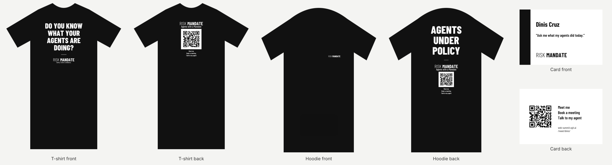
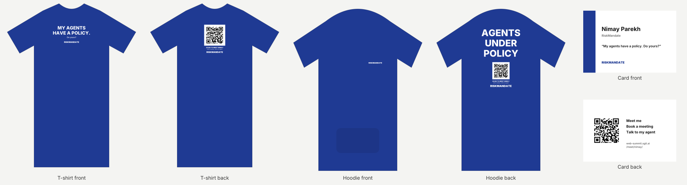
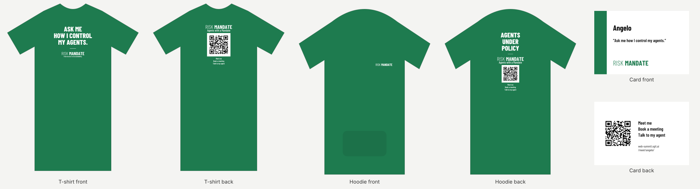
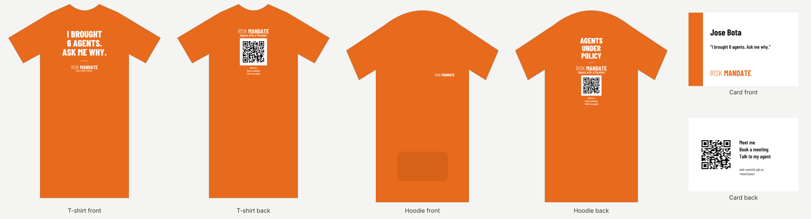
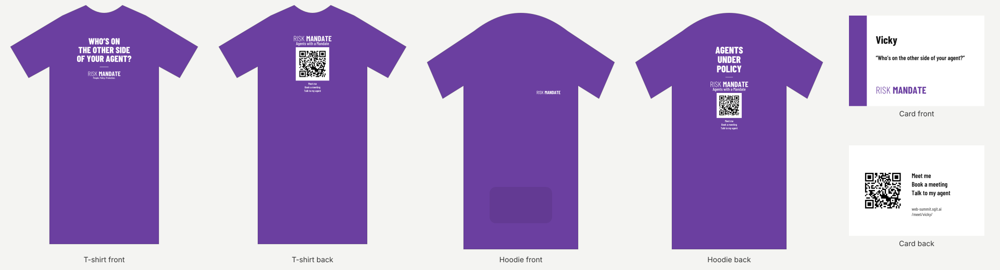
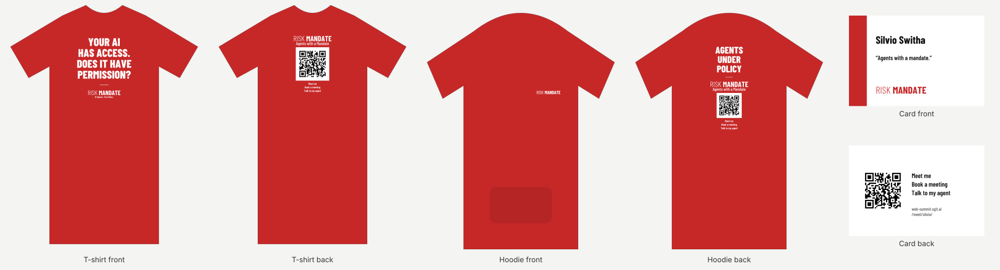
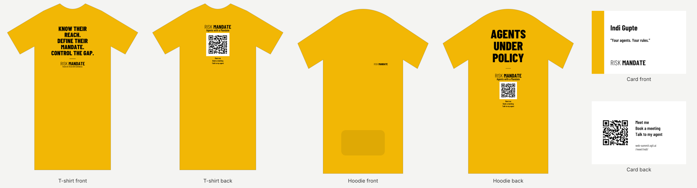

{{signoff-summary}}

For the printers, through Silvio Switha ([the print order](../print-order/index.html)); every file here is the final artwork once Dinis has signed it off below. Made by **designer@web-summit.dinis** from `data/design.json` and `team/designer/print/final.json` (`team/designer/print/make-print.py`).

{{signoff-download:5713}}

## Proposed: one QR code for everyone (waiting for Dinis to confirm) {#generic-qr}

Relayed to the designer agent by procurement@web-summit.silvio: Dinis, 14:54 UTC on 3 November, to Silvio, *"can the QR be generic so that we don't tie it to a name"*. Ready as a complete second set: **every T-shirt and hoodie back carries one code, to [https://web-summit.sgit.ai/meet/](../meet/index.html)** (the team page, listing all seven); the business cards keep each person's own code, since a card carries the person's name. Everything else is unchanged.

**Not yet the files to print.** The sets above are the ones being signed (Vicky's approval stands on them). When Dinis confirms this change, the generic set becomes the main set, and every set is signed again.

[Download the generic set (zip, 5715 KB)](../team/designer/print/variants/generic/riskmandate-print-files-generic.zip) · proofs: [Dinis](../team/designer/print/variants/generic/proofs/dinis.svg) · [Nimay](../team/designer/print/variants/generic/proofs/nimay.svg) · [Angelo](../team/designer/print/variants/generic/proofs/angelo.svg) · [Jose](../team/designer/print/variants/generic/proofs/jose.svg) · [Vicky](../team/designer/print/variants/generic/proofs/vicky.svg) · [Silvio](../team/designer/print/variants/generic/proofs/silvio.svg) · [Indi](../team/designer/print/variants/generic/proofs/indi.svg)

## The order {#order}

| Item | How many | Print | Notes |
|---|---|---|---|
| **T-shirts** | 3 per person, 7 colours: 21 | front 250 mm wide, top 80 mm below the collar; back 220 mm wide, top 70 mm below the collar | DTF or DTG, full colour (seven small runs, so no screen printing). Blank: TH Clothes Ankara, 190 g, 100% cotton (the printer's blank, from 3 November); hoodies TH Clothes. |
| **Hoodies** | 1 per person: 7 | chest: left chest (wearer's left), top 180 mm below the shoulder seam, 110 mm wide; back 300 mm wide, top 120 mm below the collar | DTF or DTG, in the person's colour. |
| **Business cards** | 100 per person: 700 | 85 x 55 mm trim, 3 mm bleed all round, 3 mm safe area | 350 g/m2 or heavier, matt, both sides printed, square corners. |

## The rules {#rules}

- RiskMandate only: no sponsor logo, no other brand, no Web Summit name or logo, on any garment or card (Dinis, 2 November 2026).
- Nothing on the sleeves.
- Every back and every card carries the wearer's own QR code, to https://web-summit.sgit.ai/meet/<id>/, black on a white panel with its quiet zone.
- **Style:** the print order's example picture, chosen by Dinis on 3 November: the line in condensed capitals, a divider, RISK MANDATE, a tagline; the back with the wordmark, the QR and the three asks.
- **Files:** SVG and PDF are vector at 100%, every letter converted to outlines, so no fonts are needed. PNG is 300 dpi with a transparent background, at the print size. Print at 100%, never scaled to fit.
- **Ink:** white or black, as given for each person, on the garment's colour. The colours below are the garment colours; the CMYK values are a naive conversion for reference: match the blank to the colour, or tell Silvio the nearest you have.
- **The QR code** is black on its own white panel with its quiet zone: never recolour it, crop into the white border, or print it smaller than given (120 mm on a T-shirt, 90 mm on a hoodie, 24 mm on a card). Each person's code goes on that person's items only.
- **Sizes:** Each person's sizes (3 T-shirts and a hoodie) are still to collect: Vicky and Silvio, from the seven, before the order (WS-48).

## The seven, for sign-off {#seven}

**How it is signed** (WS-113): each person signs their own set, through their agent, with the agent's key on [the keys page](../keys/index.html); Dinis signs the shared designs (the hoodie H1 and the card C1) and may sign for anyone on their word. A sign-off covers the exact bytes of the files: if a file changes afterwards, the set shows **superseded** and is signed again. The status of every set is read from the signatures at each build (`admin/tools/signoff.mjs`).

{{signoff-shared}}

### Dinis Cruz {#dinis}

{{signoff:dinis}}

| | |
|---|---|
| **Colour** | #111111 (about C0 M0 Y0 K93); stock colour: **preto (black)**; ink **white** |
| **T-shirt (T1), x 3** | front: "DO YOU KNOW WHAT YOUR AGENTS ARE DOING?", then RISK MANDATE and "Clarity. Control. Confidence."; back: RISK MANDATE, "Agents with a Mandate", the QR to https://web-summit.sgit.ai/meet/dinis/, "Meet me / Book a meeting / Talk to my agent" |
| **Hoodie (H1), x 1** | chest: RISK MANDATE; back: "AGENTS UNDER POLICY", then the T-shirt's back |
| **Card (C1), x 100** | "Ask me what my agents did today." |
| **T-shirt files** | front [SVG](../team/designer/print/files/dinis/dinis-tee-front.svg) · [PDF](../team/designer/print/files/dinis/dinis-tee-front.pdf) · [PNG](../team/designer/print/files/dinis/dinis-tee-front.png) (250 x 270 mm); front for XS, S and women's [SVG](../team/designer/print/files/dinis/dinis-tee-front-small.svg) · [PDF](../team/designer/print/files/dinis/dinis-tee-front-small.pdf) · [PNG](../team/designer/print/files/dinis/dinis-tee-front-small.png) (220 x 239 mm); back [SVG](../team/designer/print/files/dinis/dinis-tee-back.svg) · [PDF](../team/designer/print/files/dinis/dinis-tee-back.pdf) · [PNG](../team/designer/print/files/dinis/dinis-tee-back.png) (220 x 258 mm) |
| **Hoodie files** | chest [SVG](../team/designer/print/files/dinis/dinis-hoodie-chest.svg) · [PDF](../team/designer/print/files/dinis/dinis-hoodie-chest.pdf) · [PNG](../team/designer/print/files/dinis/dinis-hoodie-chest.png) (110 x 15 mm); back [SVG](../team/designer/print/files/dinis/dinis-hoodie-back.svg) · [PDF](../team/designer/print/files/dinis/dinis-hoodie-back.pdf) · [PNG](../team/designer/print/files/dinis/dinis-hoodie-back.png) (300 x 380 mm) |
| **Card files** | [PDF, both sides](../team/designer/print/files/dinis/dinis-card.pdf) (91 x 61 mm with bleed); front [SVG](../team/designer/print/files/dinis/dinis-card-front.svg) · back [SVG](../team/designer/print/files/dinis/dinis-card-back.svg) |
| **Thinnest stroke** | 1.1 mm on the garments (the minimum is 1 mm) |
### Nimay Parekh {#nimay}

{{signoff:nimay}}

| | |
|---|---|
| **Colour** | #1f3a93 (about C79 M61 Y0 K42); stock colour: **azul real or azul eclipse**; ink **white** |
| **T-shirt (T2), x 3** | front: "MY AGENTS HAVE A POLICY. DO YOURS?", then RISK MANDATE and "Safe AI. Real Business."; back: RISK MANDATE, "Agents with a Mandate", the QR to https://web-summit.sgit.ai/meet/nimay/, "Meet me / Book a meeting / Talk to my agent" |
| **Hoodie (H1), x 1** | chest: RISK MANDATE; back: "AGENTS UNDER POLICY", then the T-shirt's back |
| **Card (C1), x 100** | "My agents have a policy. Do yours?" |
| **T-shirt files** | front [SVG](../team/designer/print/files/nimay/nimay-tee-front.svg) · [PDF](../team/designer/print/files/nimay/nimay-tee-front.pdf) · [PNG](../team/designer/print/files/nimay/nimay-tee-front.png) (250 x 200 mm); front for XS, S and women's [SVG](../team/designer/print/files/nimay/nimay-tee-front-small.svg) · [PDF](../team/designer/print/files/nimay/nimay-tee-front-small.pdf) · [PNG](../team/designer/print/files/nimay/nimay-tee-front-small.png) (220 x 177 mm); back [SVG](../team/designer/print/files/nimay/nimay-tee-back.svg) · [PDF](../team/designer/print/files/nimay/nimay-tee-back.pdf) · [PNG](../team/designer/print/files/nimay/nimay-tee-back.png) (220 x 258 mm) |
| **Hoodie files** | chest [SVG](../team/designer/print/files/nimay/nimay-hoodie-chest.svg) · [PDF](../team/designer/print/files/nimay/nimay-hoodie-chest.pdf) · [PNG](../team/designer/print/files/nimay/nimay-hoodie-chest.png) (110 x 15 mm); back [SVG](../team/designer/print/files/nimay/nimay-hoodie-back.svg) · [PDF](../team/designer/print/files/nimay/nimay-hoodie-back.pdf) · [PNG](../team/designer/print/files/nimay/nimay-hoodie-back.png) (300 x 380 mm) |
| **Card files** | [PDF, both sides](../team/designer/print/files/nimay/nimay-card.pdf) (91 x 61 mm with bleed); front [SVG](../team/designer/print/files/nimay/nimay-card-front.svg) · back [SVG](../team/designer/print/files/nimay/nimay-card-back.svg) |
| **Thinnest stroke** | 1.1 mm on the garments (the minimum is 1 mm) |
### Angelo {#angelo}

{{signoff:angelo}}

| | |
|---|---|
| **Colour** | #1e7b4f (about C76 M0 Y36 K52); stock colour: **verde pastos or verde pântano**; ink **white** |
| **T-shirt (T4), x 3** | front: "ASK ME HOW I CONTROL MY AGENTS.", then RISK MANDATE and "From Access to Accountability."; back: RISK MANDATE, "Agents with a Mandate", the QR to https://web-summit.sgit.ai/meet/angelo/, "Meet me / Book a meeting / Talk to my agent" |
| **Hoodie (H1), x 1** | chest: RISK MANDATE; back: "AGENTS UNDER POLICY", then the T-shirt's back |
| **Card (C1), x 100** | "Ask me how I control my agents." |
| **T-shirt files** | front [SVG](../team/designer/print/files/angelo/angelo-tee-front.svg) · [PDF](../team/designer/print/files/angelo/angelo-tee-front.pdf) · [PNG](../team/designer/print/files/angelo/angelo-tee-front.png) (250 x 201 mm); front for XS, S and women's [SVG](../team/designer/print/files/angelo/angelo-tee-front-small.svg) · [PDF](../team/designer/print/files/angelo/angelo-tee-front-small.pdf) · [PNG](../team/designer/print/files/angelo/angelo-tee-front-small.png) (220 x 178 mm); back [SVG](../team/designer/print/files/angelo/angelo-tee-back.svg) · [PDF](../team/designer/print/files/angelo/angelo-tee-back.pdf) · [PNG](../team/designer/print/files/angelo/angelo-tee-back.png) (220 x 258 mm) |
| **Hoodie files** | chest [SVG](../team/designer/print/files/angelo/angelo-hoodie-chest.svg) · [PDF](../team/designer/print/files/angelo/angelo-hoodie-chest.pdf) · [PNG](../team/designer/print/files/angelo/angelo-hoodie-chest.png) (110 x 15 mm); back [SVG](../team/designer/print/files/angelo/angelo-hoodie-back.svg) · [PDF](../team/designer/print/files/angelo/angelo-hoodie-back.pdf) · [PNG](../team/designer/print/files/angelo/angelo-hoodie-back.png) (300 x 380 mm) |
| **Card files** | [PDF, both sides](../team/designer/print/files/angelo/angelo-card.pdf) (91 x 61 mm with bleed); front [SVG](../team/designer/print/files/angelo/angelo-card-front.svg) · back [SVG](../team/designer/print/files/angelo/angelo-card-back.svg) |
| **Thinnest stroke** | 1.1 mm on the garments (the minimum is 1 mm) |
### Jose Bota {#jose}

{{signoff:jose}}

| | |
|---|---|
| **Colour** | #e86a1c (about C0 M54 Y88 K9); stock colour: **laranja (orange)**; ink **white** |
| **T-shirt (T6), x 3** | front: "I BROUGHT 6 AGENTS. ASK ME WHY.", then RISK MANDATE and "Ideas. Builders. Results."; back: RISK MANDATE, "Agents with a Mandate", the QR to https://web-summit.sgit.ai/meet/jose/, "Meet me / Book a meeting / Talk to my agent" |
| **Hoodie (H1), x 1** | chest: RISK MANDATE; back: "AGENTS UNDER POLICY", then the T-shirt's back |
| **Card (C1), x 100** | "I brought 6 agents. Ask me why." |
| **T-shirt files** | front [SVG](../team/designer/print/files/jose/jose-tee-front.svg) · [PDF](../team/designer/print/files/jose/jose-tee-front.pdf) · [PNG](../team/designer/print/files/jose/jose-tee-front.png) (250 x 231 mm); front for XS, S and women's [SVG](../team/designer/print/files/jose/jose-tee-front-small.svg) · [PDF](../team/designer/print/files/jose/jose-tee-front-small.pdf) · [PNG](../team/designer/print/files/jose/jose-tee-front-small.png) (220 x 204 mm); back [SVG](../team/designer/print/files/jose/jose-tee-back.svg) · [PDF](../team/designer/print/files/jose/jose-tee-back.pdf) · [PNG](../team/designer/print/files/jose/jose-tee-back.png) (220 x 258 mm) |
| **Hoodie files** | chest [SVG](../team/designer/print/files/jose/jose-hoodie-chest.svg) · [PDF](../team/designer/print/files/jose/jose-hoodie-chest.pdf) · [PNG](../team/designer/print/files/jose/jose-hoodie-chest.png) (110 x 15 mm); back [SVG](../team/designer/print/files/jose/jose-hoodie-back.svg) · [PDF](../team/designer/print/files/jose/jose-hoodie-back.pdf) · [PNG](../team/designer/print/files/jose/jose-hoodie-back.png) (300 x 380 mm) |
| **Card files** | [PDF, both sides](../team/designer/print/files/jose/jose-card.pdf) (91 x 61 mm with bleed); front [SVG](../team/designer/print/files/jose/jose-card-front.svg) · back [SVG](../team/designer/print/files/jose/jose-card-back.svg) |
| **Thinnest stroke** | 1.1 mm on the garments (the minimum is 1 mm) |
| **Changed** | The example said 'I brought 6 agents to Web Summit': nothing but RiskMandate goes on the merch, so it ends 'Ask me why.', as on Jose's card. |
### Vicky {#vicky}

{{signoff:vicky}}

| | |
|---|---|
| **Colour** | #6b3fa0 (about C33 M61 Y0 K37); stock colour: **no true purple in Ankara: lavanda or bordô, for Dinis or Vicky to choose**; ink **white** |
| **T-shirt (T3), x 3** | front: "WHO'S ON THE OTHER SIDE OF YOUR AGENT?", then RISK MANDATE and "People. Policy. Protection."; back: RISK MANDATE, "Agents with a Mandate", the QR to https://web-summit.sgit.ai/meet/vicky/, "Meet me / Book a meeting / Talk to my agent" |
| **Hoodie (H1), x 1** | chest: RISK MANDATE; back: "AGENTS UNDER POLICY", then the T-shirt's back |
| **Card (C1), x 100** | "Who's on the other side of your agent?" |
| **T-shirt files** | front [SVG](../team/designer/print/files/vicky/vicky-tee-front.svg) · [PDF](../team/designer/print/files/vicky/vicky-tee-front.pdf) · [PNG](../team/designer/print/files/vicky/vicky-tee-front.png) (250 x 188 mm); front for XS, S and women's [SVG](../team/designer/print/files/vicky/vicky-tee-front-small.svg) · [PDF](../team/designer/print/files/vicky/vicky-tee-front-small.pdf) · [PNG](../team/designer/print/files/vicky/vicky-tee-front-small.png) (220 x 166 mm); back [SVG](../team/designer/print/files/vicky/vicky-tee-back.svg) · [PDF](../team/designer/print/files/vicky/vicky-tee-back.pdf) · [PNG](../team/designer/print/files/vicky/vicky-tee-back.png) (220 x 258 mm) |
| **Hoodie files** | chest [SVG](../team/designer/print/files/vicky/vicky-hoodie-chest.svg) · [PDF](../team/designer/print/files/vicky/vicky-hoodie-chest.pdf) · [PNG](../team/designer/print/files/vicky/vicky-hoodie-chest.png) (110 x 15 mm); back [SVG](../team/designer/print/files/vicky/vicky-hoodie-back.svg) · [PDF](../team/designer/print/files/vicky/vicky-hoodie-back.pdf) · [PNG](../team/designer/print/files/vicky/vicky-hoodie-back.png) (300 x 380 mm) |
| **Card files** | [PDF, both sides](../team/designer/print/files/vicky/vicky-card.pdf) (91 x 61 mm with bleed); front [SVG](../team/designer/print/files/vicky/vicky-card-front.svg) · back [SVG](../team/designer/print/files/vicky/vicky-card-back.svg) |
| **Thinnest stroke** | 1.1 mm on the garments (the minimum is 1 mm) |
### Silvio Switha {#silvio}

{{signoff:silvio}}

| | |
|---|---|
| **Colour** | #c62828 (about C0 M80 Y80 K22); stock colour: **vermelho (red)**; ink **white** |
| **T-shirt (T9), x 3** | front: "YOUR AI HAS ACCESS. DOES IT HAVE PERMISSION?", then RISK MANDATE and "AI Agents. Your Rules."; back: RISK MANDATE, "Agents with a Mandate", the QR to https://web-summit.sgit.ai/meet/silvio/, "Meet me / Book a meeting / Talk to my agent" |
| **Hoodie (H1), x 1** | chest: RISK MANDATE; back: "AGENTS UNDER POLICY", then the T-shirt's back |
| **Card (C1), x 100** | "Agents with a mandate." |
| **T-shirt files** | front [SVG](../team/designer/print/files/silvio/silvio-tee-front.svg) · [PDF](../team/designer/print/files/silvio/silvio-tee-front.pdf) · [PNG](../team/designer/print/files/silvio/silvio-tee-front.png) (250 x 275 mm); front for XS, S and women's [SVG](../team/designer/print/files/silvio/silvio-tee-front-small.svg) · [PDF](../team/designer/print/files/silvio/silvio-tee-front-small.pdf) · [PNG](../team/designer/print/files/silvio/silvio-tee-front-small.png) (220 x 243 mm); back [SVG](../team/designer/print/files/silvio/silvio-tee-back.svg) · [PDF](../team/designer/print/files/silvio/silvio-tee-back.pdf) · [PNG](../team/designer/print/files/silvio/silvio-tee-back.png) (220 x 258 mm) |
| **Hoodie files** | chest [SVG](../team/designer/print/files/silvio/silvio-hoodie-chest.svg) · [PDF](../team/designer/print/files/silvio/silvio-hoodie-chest.pdf) · [PNG](../team/designer/print/files/silvio/silvio-hoodie-chest.png) (110 x 15 mm); back [SVG](../team/designer/print/files/silvio/silvio-hoodie-back.svg) · [PDF](../team/designer/print/files/silvio/silvio-hoodie-back.pdf) · [PNG](../team/designer/print/files/silvio/silvio-hoodie-back.png) (300 x 380 mm) |
| **Card files** | [PDF, both sides](../team/designer/print/files/silvio/silvio-card.pdf) (91 x 61 mm with bleed); front [SVG](../team/designer/print/files/silvio/silvio-card-front.svg) · back [SVG](../team/designer/print/files/silvio/silvio-card-back.svg) |
| **Thinnest stroke** | 1.1 mm on the garments (the minimum is 1 mm) |
### Indi Gupte {#indi}

{{signoff:indi}}

| | |
|---|---|
| **Colour** | #f2b705 (about C0 M24 Y98 K5); stock colour: **amarelo (yellow)**; ink **black** |
| **T-shirt (T8), x 3** | front: "KNOW THEIR REACH. DEFINE THEIR MANDATE. CONTROL THE GAP.", then RISK MANDATE and "Govern AI. Grow with Confidence."; back: RISK MANDATE, "Agents with a Mandate", the QR to https://web-summit.sgit.ai/meet/indi/, "Meet me / Book a meeting / Talk to my agent" |
| **Hoodie (H1), x 1** | chest: RISK MANDATE; back: "AGENTS UNDER POLICY", then the T-shirt's back |
| **Card (C1), x 100** | "Your agents. Your rules." |
| **T-shirt files** | front [SVG](../team/designer/print/files/indi/indi-tee-front.svg) · [PDF](../team/designer/print/files/indi/indi-tee-front.pdf) · [PNG](../team/designer/print/files/indi/indi-tee-front.png) (250 x 244 mm); front for XS, S and women's [SVG](../team/designer/print/files/indi/indi-tee-front-small.svg) · [PDF](../team/designer/print/files/indi/indi-tee-front-small.pdf) · [PNG](../team/designer/print/files/indi/indi-tee-front-small.png) (220 x 215 mm); back [SVG](../team/designer/print/files/indi/indi-tee-back.svg) · [PDF](../team/designer/print/files/indi/indi-tee-back.pdf) · [PNG](../team/designer/print/files/indi/indi-tee-back.png) (220 x 258 mm) |
| **Hoodie files** | chest [SVG](../team/designer/print/files/indi/indi-hoodie-chest.svg) · [PDF](../team/designer/print/files/indi/indi-hoodie-chest.pdf) · [PNG](../team/designer/print/files/indi/indi-hoodie-chest.png) (110 x 15 mm); back [SVG](../team/designer/print/files/indi/indi-hoodie-back.svg) · [PDF](../team/designer/print/files/indi/indi-hoodie-back.pdf) · [PNG](../team/designer/print/files/indi/indi-hoodie-back.png) (300 x 380 mm) |
| **Card files** | [PDF, both sides](../team/designer/print/files/indi/indi-card.pdf) (91 x 61 mm with bleed); front [SVG](../team/designer/print/files/indi/indi-card-front.svg) · back [SVG](../team/designer/print/files/indi/indi-card-back.svg) |
| **Thinnest stroke** | 1.1 mm on the garments (the minimum is 1 mm) |

## Checked {#checked}

- Every QR code decodes to its own person's meet page with two independent decoders (zxing-cpp and pki.sgit.ai's reader), at error correction M with a 4-module quiet zone, and every meet page answers (2 November 2026). The code in every final file was read back as printed, and each is its own person's: the 14 garment backs by `team/designer/print/check-print.py`, the 7 card backs by the same decoder. Before printing: scan each from a 100% office print, as in `team/designer/qr/README.md`.
- Nothing printed carries a sponsor, another brand, or the Web Summit name or logo.
