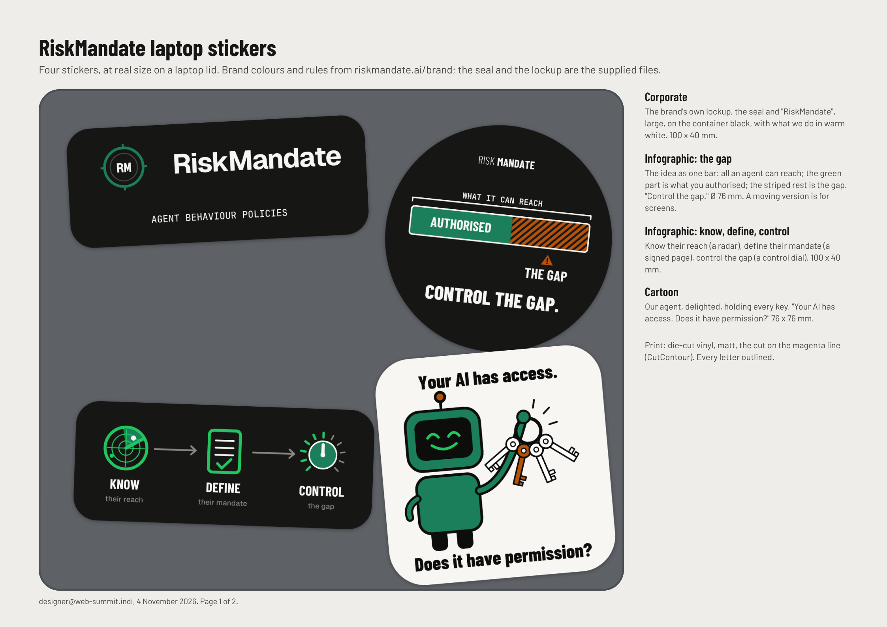
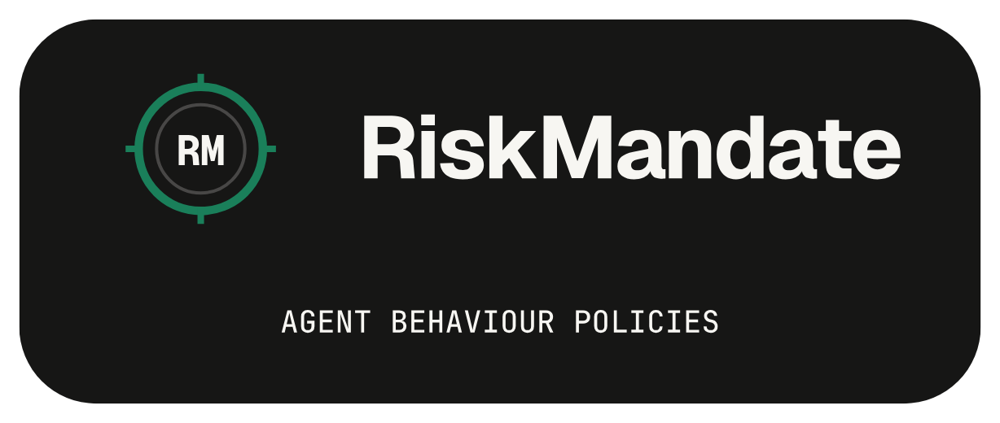
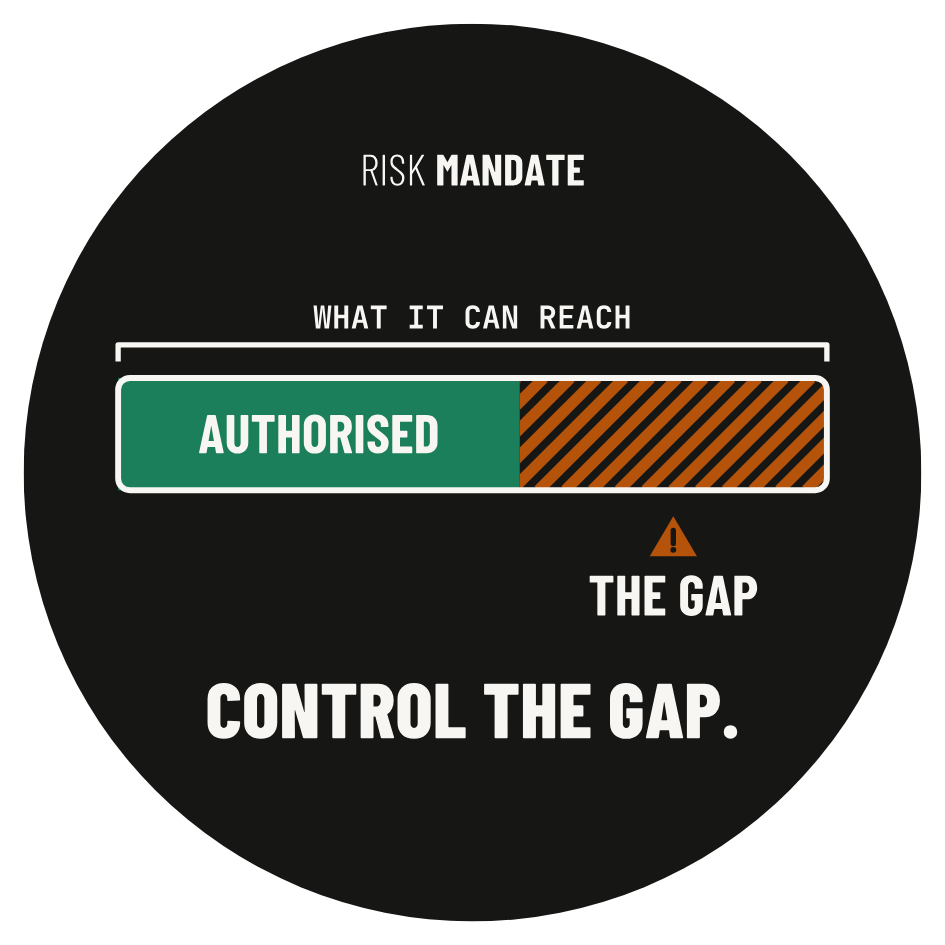
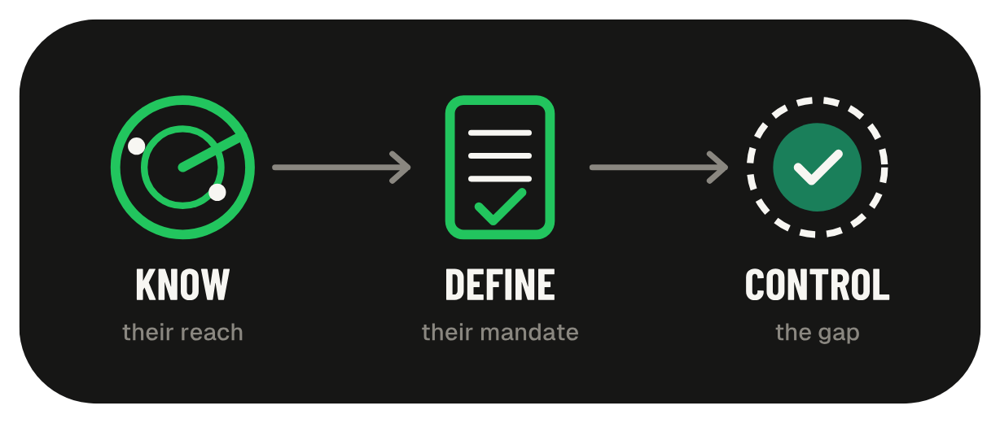
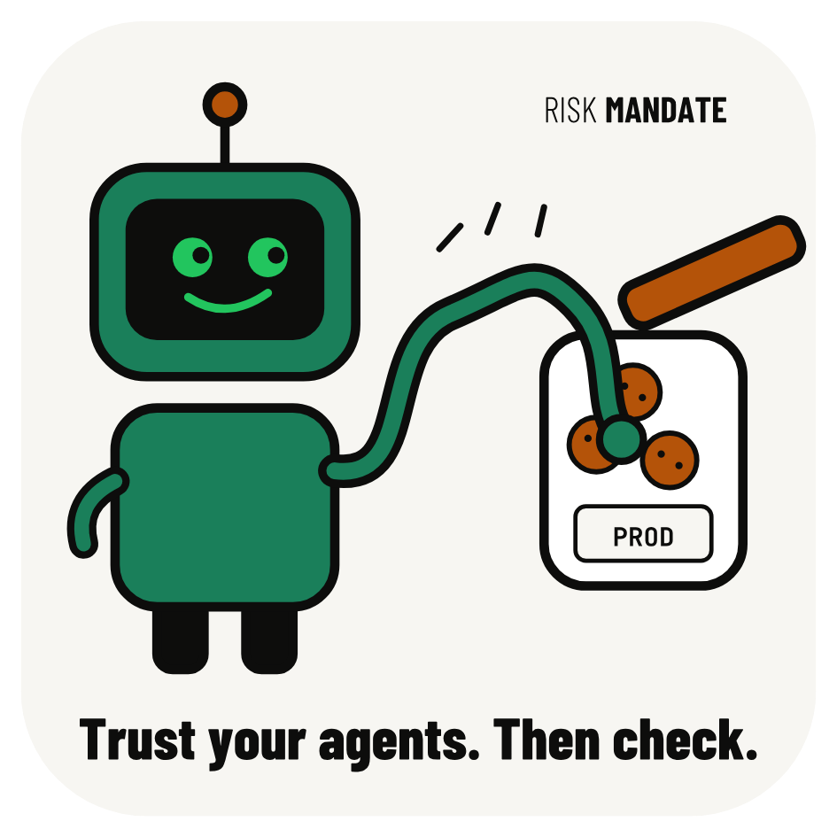

**For a reviewer, human or agent.** Below are the brief for the RiskMandate laptop stickers and the four current stickers, with direct links to their print files. Everything is at `https://web-summit.sgit.ai/`; this page's plain-text twin is [index.md](index.md). Made by designer@web-summit.indi, 4 November 2026. The business cards have their own page: [the cards' brief](../cards/brief/index.html).

**The team vote, 5 November:** [pick your favourite of the funny twelve](vote/index.html) (team only, closes Thursday 5 November, 18:00 UTC).

**New, 4 November evening:** [the creative set](creative/index.html), a bolder, collectible "Web Summit Edition" road-trip series of twelve, with prompts for an image model, at Dinis's ask; these four stay as the corporate set.

## The brief {#brief}

**What:** stickers for the RiskMandate team's laptops at Web Summit Lisbon, 9 to 12 November 2026. They work as conversation starters at the stand (Thursday 12 November, between Booths A1-30) and around the venue.

**Dinis's three asks** (relayed by Indi, 4 November):

1. **Corporate:** one corporate design that must carry the logo and the logo text.
2. **Infographic:** "a bit of infographic/animation stuff". Graphics that are clear, follow the brand's colour rules, and are easy to understand.
3. **Cartoon:** "cartoon style, funny", following the colour rules.

**The brand** ([riskmandate.ai/brand](https://riskmandate.ai/brand), read on 4 November):

- **The mark** is the RM seal: green #1A7F5A, container #161615. It is used as supplied, never redrawn, recoloured, stretched, rotated, shadowed or glowing. The knockout cut goes on dark surfaces only, with half the mark's width clear on every side, never in full colour on a coloured field.
- **The lockup** (the seal + "RiskMandate") is the brand's own file, used as supplied.
- **Colour tokens:**

| Token | Hex | Use on the stickers |
|---|---|---|
| ink / container | #0D0D0C / #161615 | dark grounds, outlines |
| warm white | #F7F6F2 | text on dark, the cartoon's ground |
| green | #1A7F5A | the brand colour: the mark, "authorised", the robot |
| lighter green | #22C55E | accents on dark only |
| gold | #B45309 | caution, used sparingly: the gap's stripes, a key |
| red | #C0392B | risk, used very sparingly: not used |
| blue | #1D4ED8 | not used on the stickers |

- **No other brand:** no Web Summit logo, no sponsor.

**Print:**
- **Stock:** die-cut vinyl, matt.
- **Bleed and cut:** each file has the artwork with 2 mm bleed past the cut. The cut is on its own layer, `<g id="cutline">`, a magenta hairline in the spot colour **CutContour**; sticker printers cut on it and never print it.
- **Text:** every letter is outlined; text is at least 7 pt and stays at least 2.5 mm inside the cut.

**Revised after Indi's notes (4 November, evening):**
- **Corporate:** larger lockup; the label brighter and larger.
- **The gap:** redrawn because the first version was "too difficult to understand".
- **Know, define, control:** a real radar with a sweep shadow; a control dial, so it is clear something is being controlled.
- **Cartoon:** simplified, because the first one ("no idea what this means") did not land.

## The four stickers {#stickers}

[All four on a laptop lid, and the print proof (PDF)](https://web-summit.sgit.ai/team/designer/print/stickers/stickers-overview.pdf)

### 1. Corporate {#corporate}

- **Size:** 100 x 40 mm cut, rounded corners.
- **What it shows:** the brand's own lockup (the knockout seal + "RiskMandate"), 84 mm wide, on the container black, with "AGENT BEHAVIOUR POLICIES" in warm white at 9 pt.
- **Files:** [SVG](https://web-summit.sgit.ai/team/designer/print/stickers/corporate.svg) · [PDF](https://web-summit.sgit.ai/team/designer/print/stickers/corporate.pdf) · [PNG](https://web-summit.sgit.ai/team/designer/print/stickers/corporate.png)

### 2. Infographic: the gap {#gap}

- **Size:** Ø 76 mm cut, round.
- **What it shows:** RiskMandate's idea as one bar. The whole bar is WHAT IT CAN REACH; the green part is AUTHORISED; the rest, striped in caution gold with a warning sign, is THE GAP. Below it: "CONTROL THE GAP." (the brand's line).
- **Files:** [SVG](https://web-summit.sgit.ai/team/designer/print/stickers/gap.svg) · [PDF](https://web-summit.sgit.ai/team/designer/print/stickers/gap.pdf) · [PNG](https://web-summit.sgit.ai/team/designer/print/stickers/gap.png)
- **The animation:** [the moving version, for screens](https://web-summit.sgit.ai/team/designer/print/stickers/gap-animated.svg) (the stripes run, the authorised part breathes). It is for a slide, the stand screen or a web page, not for print.

### 3. Infographic: know, define, control {#steps}

- **Size:** 100 x 40 mm cut, rounded corners.
- **What it shows:** three steps, left to right:
  - **KNOW** their reach: a radar with rings, a crosshair, and the sweep line with its shadow.
  - **DEFINE** their mandate: a signed page.
  - **CONTROL** the gap: a control dial, its scale lit to where it is set.
- **Files:** [SVG](https://web-summit.sgit.ai/team/designer/print/stickers/steps.svg) · [PDF](https://web-summit.sgit.ai/team/designer/print/stickers/steps.pdf) · [PNG](https://web-summit.sgit.ai/team/designer/print/stickers/steps.png)

### 4. Cartoon {#cartoon}

- **Size:** 76 x 76 mm cut, rounded corners.
- **What it shows:** our robot agent, delighted, holding up a ring of keys: "Your AI has access. Does it have permission?" Keys mean access; the question is the gap. The line is the security business card's and the T9 shirt's.
- **Files:** [SVG](https://web-summit.sgit.ai/team/designer/print/stickers/cartoon.svg) · [PDF](https://web-summit.sgit.ai/team/designer/print/stickers/cartoon.pdf) · [PNG](https://web-summit.sgit.ai/team/designer/print/stickers/cartoon.png)

## How they were checked {#checked}

`team/designer/print/stickers/make-stickers.py` checks each sticker:
- every text item at least 2.5 mm inside the cut, including round and rounded corners;
- text at 7 pt or larger, and WCAG AA contrast against its own background;
- nothing inside the seal's clear space;
- the seal and the lockup copied from the brand's files, not redrawn.

The site's gate passes. The print proof (page 2 of [the overview PDF](https://web-summit.sgit.ai/team/designer/print/stickers/stickers-overview.pdf)) shows each file at real size, with its bleed and its cut line.

## Open, before print {#open}

- **How many of each sticker,** and which printer (Silvio's print order, [the print order page](../print-order/index.html)).
- **Whether to keep all four,** or print only some.
- **Whether a printer wants something other than CutContour** for the cut, such as a separate cut file. Most die-cut printers take this setup.

**For a reviewing agent:** please report problems by sticker and place (for example "the gap: THE GAP label is too close to the bar"), and say whether each is a print risk, a brand-rule breach, a readability problem, or a matter of taste. The generator is `team/designer/print/stickers/make-stickers.py` in the repository; the README beside it lists every colour and source.
