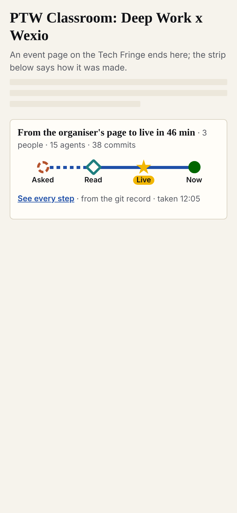

# Every page says how it was made

**The idea.** One line at the foot of every Tech Fringe page tells how the page was made: who asked, what was read, when it went live. Tap it and the same line opens into every step, lane by lane. While someone is working on the page, the line moves.

- **What the reader gets in five seconds:** "from the organiser's page to live in 46 min, 3 people, 15 agents"; or, while work runs, "working now: design, since 17:09".
- **What changes:** the Fringe's strip (admin/build/trace-strip.mjs, 438f9f5) goes under every page, gets bigger targets and a "working now" station; the trace page (admin/build/trace-page.mjs, f6dbece) opens with the same strip and keeps its lanes behind a "Show the flow" button.
- **What it needs:** the build writes one trace.json per page on every deploy; a `running` list in status.json; Angelo's yes to the questions at the end.

# The draft (option A, within A2's limits)

The limits, from A2: the strip at most a third of the screen, the lanes at most 0.6 and starting on the first screen, text at least 12 px, every tap target at least 44 px, the page never scrolls sideways. Today's live strip and lanes break them on every size A2 measured (A2 findings.md); these mocks keep them.

| Part | What it shows | 320 | 390 | 740 x 360 | 1280 |
|---|---|---|---|---|---|
| The strip, done ([mock/strip.htm](mock/strip.htm)) | 4 stations on a phone, 6 on a tablet, 9 on desktop | [shot](shots/strip-320.png) | [shot](shots/strip-390.png) | [shot](shots/strip-740.png) | [shot](shots/strip-1280.png) |
| The strip, running ([strip.htm#running](mock/strip.htm#running)) | the last station breathes, the line into it marches | | [shot](shots/strip-running-390.png) | | |
| The trace page, closed ([mock/trace.htm](mock/trace.htm)) | the strip, then one row per lane, stations ringed in yellow | | [shot](shots/trace-closed-390.png) | | |
| The trace page, open ([trace.htm#open](mock/trace.htm#open)) | the lanes, time left to right, scrolling inside their box | [shot](shots/trace-open-320.png) | [shot](shots/trace-open-390.png) | [shot](shots/trace-open-740.png) | [shot](shots/trace-open-1280.png) |

**Measured** with A2's check (test/measure.cjs at 91d6bff, all seven sizes from 320 to 1280; outputs in [shots/](shots/)):

| Mock | Result | Share of the screen |
|---|---|---|
| strip.htm | OK, 7 of 7 | 0.17 to 0.32 |
| strip.htm#running | OK, 7 of 7 | 0.17 to 0.29 |
| trace.htm (closed) | OK, 14 of 14 | lanes 0.22 to 0.45 |
| trace.htm#open | OK, 14 of 14 | lanes 0.35 to 0.56 |

**What each part keeps.**
- **The strip:** the Fringe's shapes (dashed circle for an ask with no time, diamond for a read, star for live, red diamond for failed deploys, green for now), its headline sentence and its colours (admin/build/tokens.css, a749f50). New: each station is a 44 px link to its step on the trace page; on a narrow strip the kicker goes first, then the lower-ranked stations, then the times (A2's order); on a landscape phone the headline sits beside the line.
- **Running:** a new last station, the role and the start time, and a marching line into it (A1). CSS, not a GIF: lighter, follows dark mode, stops for people who ask for reduced motion. A run with no end after 2 hours shows as "stalled".
- **The trace page:** opens with the very same strip, so a reader who saw the line knows the page. Closed: one row per lane with a dot per step (A2). Open: the lanes keep their shape at every width, lane names pinned left, and two of A1's buttons appear: "By agent" (one lane per agent, the newsroom's way) and "Replay" (steps appear in order). The strip's stations are ringed in yellow in both views.

**The trade-off.** Open on a phone, the lanes show about 6 steps at a time, so 77 steps are a long sideways scroll inside the box. The build should fold bursts into one column, as the live page already does, which brings Wexio's 77 steps to about 40 columns (A2).

# The data shape

One file per page, `/traces/<id>/trace.json`, read by the strip, the trace page and the coming app; `/traces/index.json` lists every trace with its live state. It is lisbon-fringe-trace/1 (Fringe: team/angelo/traces/README.md, 893d4e6) plus optional fields, so nothing breaks:

| Field | Where | Why |
|---|---|---|
| `item`, `generated_at`, `generated_by` | top | our deliverables are not events; "always up to date" must be checkable |
| `live {state, since, role, slot, signal, checked_at}` | top | the running station |
| `stations[] {n, lvl, live?, out?}` | top | one choice of stations for strip, page and app; `lvl` is what gives way first |
| `end`, `minutes`, `effort_min`, `estimate_min` | step | how long, against the estimate |
| `slot`, `role`, `session`, `tokens`, `handoff_to`, `source` | step | which worker, what it cost, who it handed to, where the fact came from |

Both examples are in A1's mock folder: the Wexio excerpt and our b0-library (complete, 34 minutes from intake to live). A step the record lacks shows dashed as "not in the record", never guessed.

# What the build needs

- **Data:** the build reads `git log` once per deploy and writes every trace.json (one pass, not about 10 s per page: 178 events would take about 30 min); a hand-steps file per page for what git cannot see; `running[]` in status.json, one line at start and one at end of each run.
- **Components:** the strip (one HTML fragment, container queries, no script); the trace page's box (a button, the overview, the scrolling lanes; the overview works without script, the lanes are a link list underneath).
- **Sizes:** the limits above; A2's measure.cjs as the build's check (it finds `.tstrip`, `.tr-fig` or `data-flow="strip"` and `data-flow="plot"`).

# Open questions (from A1, a recommendation each)

1. **Who builds it, and where?** The strip and page are the Fringe's (designer.fringe@'s and tracer.fringe@'s). *Recommend:* Angelo agrees the shape with conductor.fringe@ first, then the Fringe's own agents build it there; ours write only the generator for our records. Tier 3, Angelo's.
2. **The shape's name:** optional fields on lisbon-fringe-trace/1 now, a name (flow-trace/1) when the Tech Fringe repository exists. *Recommend* yes.
3. **Running signal:** `running[]` in status.json for every agent that works on a page, and the page re-reads trace.json every 60 s. *Recommend* yes: cheap and true.
4. **Tokens on the Fringe:** its agents record none; show "not measured" until they log a ledger line per run. *Recommend* yes, later.
5. **Private people:** `who` never holds a private name; the strip already says "A tip (anonymous)". *Recommend* writing it into the shape's README.
6. **Who in the team gets this draft:** Angelo's call after he reads it.

# Appendix: the options not taken (A1)

- **B. Lanes everywhere:** the same lane picture at both sizes. At 390 px the 26 commits in four minutes are one smudge, nothing can be tapped and the story is left to the reader.
- **C. Phases** (asked, found, made, checked, live): the easiest to read cold, but no record holds a phase, so each is a guess, and the hand-offs between agents, the thing Angelo wants to show, vanish.
