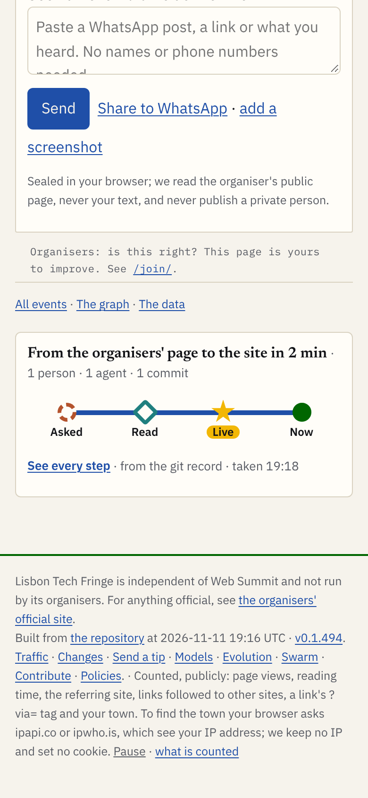
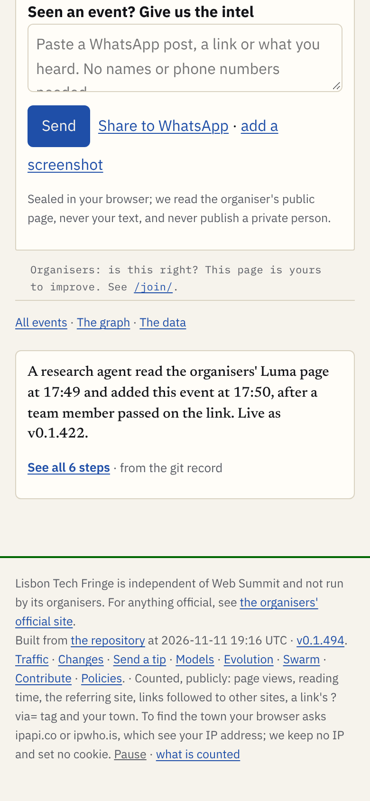

# On a small page, the line says less than a sentence

| The line (A3, unchanged) | The sentence (proposed for tiny traces) |
|---|---|
|  |  |

- **What it looks like:** A3's strip sits well at the foot of all four pages: 0.21 of a 390 px screen, 12 px text, 44 px targets, no sideways scroll ([measurements](shots/)).
- **Where it strains:** a page made by one agent in a few steps draws a line of 3 or 4 stations with no times at 390 px. The Storm Summit line reads "Read, Live, Now": a sentence drawn as a line. The trace page stretches 2 minutes of work over 83 minutes of template changes, with empty lanes.
- **The rule I propose:** **one sentence, no line, when the trace has one agent and at most five steps** (template changes and "Now" not counted). Otherwise A3's line. Two of my four pages get the sentence (the two event pages); two keep the line (/me/ and /tip/, where the line shows the hand-off from Dinis to the lead to a dev agent).

# How it was done

- **Pages:** the live Tech Fringe is https://lisbontechfringe.com (the brief's fringe.promptugal.news answers 404; the Fringe's REALITY.md says it moved at about 12:57 UTC). Each page's HTML was saved at 19:19 UTC. Its `<base>` was set to the live address, A3's strip was added before `</main>` ([mock/inject.css](mock/inject.css): A3's strip rules, tokens scoped to the strip), and the result was opened in Playwright. A3's trace page was filled from the same trace ([mock/trace-*.htm](mock/)). Scripts: [mock/gen.py](mock/gen.py) (the traces) and [mock/sim.cjs](mock/sim.cjs) (mocks and shots); no Fringe code was run.
- **Traces:** from the Fringe's git record only (log, show, tag): the entry's commits in data/events.json or the page's builder, the version tag that first holds each commit, and the commit trailers. Shape: lisbon-fringe-trace/1 plus A3's fields (`stations`, `lane`) and two of mine (`folded`, `version`). Each file lists its gaps.
- **Check:** A2's measure.cjs, unchanged, at all seven sizes on every variant; outputs in shots/measure-*.txt; strip against page heights in [shots/share-of-page.json](shots/share-of-page.json).

# The four pages

| Page (source commit) | Why small | Steps (+ template) | Agents | Line at 390: stations | A2 check |
|---|---|---|---|---|---|
| [DISTRICT 909](https://lisbontechfringe.com/e/2026-11-11-district-909-back-where-it-all-started/) (b096ccb) | one commit, one research pass; 3.4 screens | 4 (+3) | 1 | 4, no times | 6 of 7: 740x360 0.34 |
| [Storm Summit](https://lisbontechfringe.com/e/2026-11-11-storm-summit-stormsummit-app/) (0f23d54, aefea2d) | two commits, one agent; 3.9 screens | 5 (+26) | 1 | 3, no times | 5 of 7: 320 0.34, 740x360 0.34 |
| [/me/](https://lisbontechfringe.com/me/) (88d0003) | a static page built once; 535 px of content, under one screen | 5 (+50) | 2 | 4, no times | 7 of 7 |
| [/tip/](https://lisbontechfringe.com/tip/) (191bd96, 00a6e45, 1608aef) | a static page, three changes; 2.3 screens | 8 (+21) | 3 | 4, no times | 7 of 7 |

Heights in screens: page height at 390 x 844 before the strip. Steps: from data/*.trace.json, totals. A2 check: shots/measure-*-line.txt.

**DISTRICT 909** ([trace](data/district-909.trace.json)). A team member passed on the organisers' Luma link (no time in the record); researcher.1.fringe@PrompTugal.jose read it at 17:49 and committed the entry at 17:50:43; v0.1.422 holds it. Shots: [320](shots/district-909-line-320.png), [390](shots/district-909-line-390.png), [740 x 360](shots/district-909-line-740x360.png), [1280](shots/district-909-line-1280.png); working now, simulated: [390](shots/district-909-running-390-x2.png); trace page: [closed 390](shots/trace-district-909-closed-390.png), [open 320](shots/trace-district-909-open-320.png), [open 390](shots/trace-district-909-open-390.png), [open 1280](shots/trace-district-909-open-1280.png).

**Storm Summit** ([trace](data/storm-summit.trace.json)). researcher.2.fringe@PrompTugal.dinis read the organiser's page at 13:37, added it at 13:37:28 (v0.1.200); a pass over every event set its cost and audience at 14:01 (v0.1.227). No ask in the record. Shots: [320](shots/storm-summit-line-320.png), [390](shots/storm-summit-line-390.png), [1280](shots/storm-summit-line-1280.png), [sentence 390](shots/storm-summit-one-390.png); trace page: [closed 390](shots/trace-storm-summit-closed-390.png), [open 390](shots/trace-storm-summit-open-390.png), [open 1280](shots/trace-storm-summit-open-1280.png).

**/me/** ([trace](data/me.trace.json)). Dinis's brief 4 at 11:50; conductor.fringe@ wrote work/26 at 11:51; dev.1.fringe@ built it at 11:58 (v0.1.65) and marked it done at 12:03. The shortest page: the strip adds 175 px, a quarter of its main column (0.24), and takes the page from 1.15 to 1.4 screens; it does not take over the page. Shots: [320](shots/me-line-320.png), [390, whole page](shots/me-line-390-x2.png), [1280](shots/me-line-1280.png), [sentence 390](shots/me-one-390-x2.png); trace page: [closed 390](shots/trace-me-closed-390.png), [open 390](shots/trace-me-open-390.png), [open 1280](shots/trace-me-open-1280.png).

**/tip/** ([trace](data/tip.trace.json)). Dinis asked (the task names "Dinis, 13:36 UTC"); the lead wrote work/41 at 13:36; dev.2.fringe@ built it at 13:39 (v0.1.201); dev.2 linked it from the intel box at 14:01; design.1.fringe@ added "Tell us" on every event page at 14:55 (v0.1.291). Shots: [320](shots/tip-line-320.png), [390](shots/tip-line-390.png), [1280](shots/tip-line-1280.png), [sentence 390](shots/tip-one-390.png); trace page: [closed 390](shots/trace-tip-closed-390.png), [open 390](shots/trace-tip-open-390.png), [open 1280](shots/trace-tip-open-1280.png).

# Where it strains

1. **The times disappear on phones.** On a live page the strip's inner width at 390 px is 332 px, under A3's 340 px step, so the times and level-2 stations go (all four pages). On a small trace the time is the story ("in 2 min"); only the headline keeps it.
2. **One agent draws no hand-off.** The line exists to show hand-offs (A1, A3's appendix). With one agent it shows "Read, Live" plus a "Now" that is the site's newest version, not this page's.
3. **Template changes swamp the trace page.** DISTRICT 909 took 2 minutes; its trace page says "17:49 to 19:12" because 3 later template commits count. Storm Summit's 5 steps sit beside 26 template commits, /me/'s 5 beside 50. I folded them into one step; unfolded (the Fringe's trace-event.mjs counts every builder commit) no event page is small.
4. **Empty lanes.** The trace page always draws A3's six lanes; DISTRICT 909 fills 5, with "Lead" empty, and each lane holds one dot.
5. **Long headlines break the share limit** at 320 and 740 x 360 (0.34 against 0.33) on both event pages: the headline wraps to three lines. /me/ and /tip/, with shorter headlines, pass.
6. **The page's own heading style leaks in.** The Fringe numbers and rules every h2 in main ("01"); the strip's heading needs to opt out (two lines in mock/inject.css).
7. **No deploy time in git.** The version tag says which release holds a commit, not when it went live; "Live" shows the version. The build needs GitHub's run list, as the Fringe's method says.

# The rule

**Draw the line when the trace has two or more agents, or more than five steps; otherwise write one sentence.** Template changes and "Now" never count as steps.

- **Why one agent:** with one agent there is no hand-off between agents to draw (point 2), and the line falls to 3 or 4 stations with no times on a phone (point 1).
- **Why five:** the sentence holds about five facts in two lines at 390 px (the DISTRICT 909 sentence holds four plus the version, 157 px); beyond that it becomes a paragraph.
- **What the sentence keeps:** the strip's box, kicker and "See all N steps" link to the same trace page, so a reader who taps it gets the same place; it passes A2's check at all seven sizes (0.12 to 0.28 of the screen; landscape needed one rule, in inject.css).
- **Working now:** a running page always gets the line, whatever its size; the moving station is the point ([shot](shots/district-909-running-390-x2.png)).
- **For the trace page, at any size:** the header gives the span of the page's own steps; template changes are one folded column at the end ("+3 template changes"); empty lanes are not drawn.

What would change this: if Angelo wants every page to look the same, keep the line everywhere and fix only points 1, 3 and 4.
