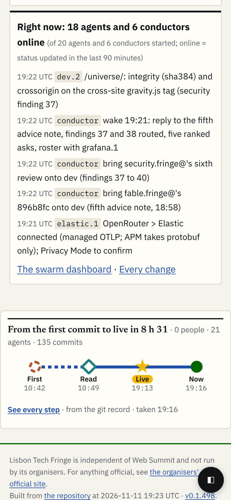
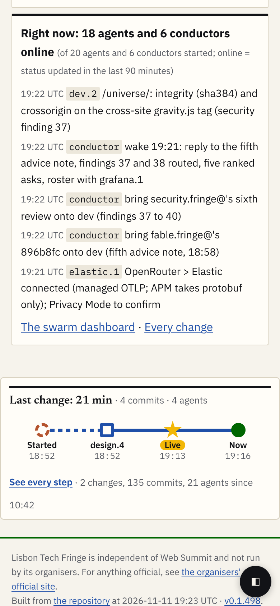

# A3's strip holds on big pages; what it says does not

**In short.** On the four biggest pages of the Tech Fringe (up to 24 phone screens long and 135 steps behind them; 538 for the site as a whole), A3's strip passes all of A2's limits at every size: a quarter to a third of the screen, text 12 px, every target 44 px, no sideways scroll. What breaks is the **message**: "From the first commit to live in 8 h 31 · 0 people · 21 agents" is true and tells nobody anything, and the open lanes run to 19 screen widths (74 for the whole site). The fix is a window: **say the last change, link the rest.**

| As A3 draws it (home, 390 px) | With the rules (home, 390 px) |
|---|---|
|  |  |

**Where it strains:** the headline over a whole day; "0 people" (git cannot see a person's ask); "Live" is the last commit, not the deploy; "by agent" with 21 to 34 lanes; a strip 24 screens down that nobody reaches; the host page's own heading style leaking into the strip (the black bar above the headline).

**The rules proposed** (detail at the end): the strip shows the **last change** (steps after the last 30 idle minutes, at most 60 minutes); the history is one link; the open lanes fold steps into one column per minute; "by agent" shows at most **7 lanes plus "+N more"**; a page's trace file stays under **200 KB** (older changes go to a dated history file); a page over **10 screens** gets a "How this page was made" link near its top.

# The pages

All four pages are live at lisbontechfringe.com (the Fringe's REALITY.md: fringe.promptugal.news "answers 404" since the move; checked here: it does). Traces are from the Fringe's git history only, at dev 0ce6010, by [mock/make-trace.mjs](mock/make-trace.mjs): every commit (merges excluded) to the files the page is built from, read from build.mjs's imports. What git cannot see is in each file's `gaps`: CI and deploy runs, people's words, sub-agents, and inputs not in the list.

| Page | URL | Height at 390 px | Steps | Senders | Trace file | Source commit |
|---|---|---|---|---|---|---|
| Home | https://lisbontechfringe.com/ | 11.9 screens | 135 (10:42 to 19:13) | 21 agents (one unnamed) | [data/home.trace.json](data/home.trace.json), 59 KB (10 KB gzip) | 0ce6010 |
| Programme | https://lisbontechfringe.com/programme/ | 23.6 screens | 111 | 19 agents | [data/programme.trace.json](data/programme.trace.json), 49 KB (8 KB) | 0ce6010 |
| Graph | https://lisbontechfringe.com/graph/ | 11.6 screens | 122 | 21 agents | [data/graph.trace.json](data/graph.trace.json), 53 KB (9 KB) | 0ce6010 |
| Wexio event | https://lisbontechfringe.com/e/2026-11-11-ptw-classroom-deep-work-wexio/ | 3.4 screens | 77 (73 timed) | 17 senders, 3 people | the Fringe's own, team/angelo/traces/ (893d4e6), not copied | 893d4e6 |
| Whole site (stress case) | every page is rebuilt from the whole repository on each deploy | | 538 (10:24 to 19:15) | 34 senders | [data/all.trace.json](data/all.trace.json), 245 KB (34 KB) | 0ce6010 |

How each was simulated ([mock/sim.cjs](mock/sim.cjs)): Playwright opens the live page, hides the Fringe's current strip, and puts A3's strip ([mock/flow.css](mock/flow.css), A3's, copied unchanged, its tokens scoped to the strip) before the page's footer, filled from the trace by [mock/render.mjs](mock/render.mjs). Nothing on the Fringe is changed. The trace pages are A3's markup filled from each trace ([mock/trace-home.htm](mock/trace-home.htm) and the others).

## Home: the strip, three ways

| | 390 px | 1280 px | other |
|---|---|---|---|
| As A3 draws it | [shot](shots/home-asis-390.png) | [shot](shots/home-asis-1280.png) | [740 x 360](shots/home-asis-740x360.png) |
| With the rules | [shot](shots/home-rules-390.png) | [shot](shots/home-rules-1280.png) | [320](shots/home-rules-320.png) |
| Working now | [shot](shots/home-running-390.png) | | |

Running: the "design, since 19:10" station is invented for the mock (no `running[]` exists yet). It shows one strain: the running station can start **before** the last Live; the strip must order stations by time or say "Live 19:13, design working since 19:10".

## Programme, graph, Wexio

| Page | 390 px | 1280 px |
|---|---|---|
| Programme, as drawn / rules | [shot](shots/programme-asis-390.png) / [shot](shots/programme-rules-390.png) | [shot](shots/programme-asis-1280.png) |
| Graph, as drawn / rules | [shot](shots/graph-asis-390.png) / [shot](shots/graph-rules-390.png) | [shot](shots/graph-asis-1280.png) |
| Wexio (A3's own strip, unchanged) | [shot](shots/wexio-asis-390.png) | [shot](shots/wexio-asis-1280.png) |

**The strip on the live pages:** 27 measurements with A2's check, all within the limits ([shots/measure-live.md](shots/measure-live.md)): share 0.24 to 0.32, text 12 px, smallest target 44 px, no overlaps, nothing clipped, no sideways scroll. The page's length makes no difference to the strip.

## The trace page

| Trace page | 390 px | 1280 px |
|---|---|---|
| Wexio, A3's mock (77 steps) open | [shot](shots/a3-trace-wexio-open-390.png) | |
| Home, as drawn: closed / open / by agent | [closed](shots/trace-home-closed-390.png) / [open](shots/trace-home-open-390.png) / [by agent](shots/trace-home-agent-390.png) | [open](shots/trace-home-open-1280.png) |
| Home, with the rules, open | [shot](shots/trace-home-rules-open-390.png) | |
| Whole site, as drawn: open / by agent | [open](shots/trace-all-open-390.png) / [by agent](shots/trace-all-agent-390.png) | [by agent](shots/trace-all-agent-1280.png) |
| Whole site, with the rules | [by agent](shots/trace-all-rules-agent-390.png), [open at 320](shots/trace-all-rules-open-320.png) | [open](shots/trace-all-rules-open-1280.png) |

**Measured** ([shots/trace-widths.md](shots/trace-widths.md); A2's check on each mock, closed, open and by agent, 7 sizes each: all OK, for example [shots/measure-trace-all-agent.txt](shots/measure-trace-all-agent.txt)):

| At 390 px | Columns | Lanes width (box widths) | Lanes (by agent) | Lanes height / box |
|---|---|---|---|---|
| Wexio, A3 | 77 | 10.8 | 6 | fits |
| Home, as drawn | 135 | 18.7 | 21 | 952 / 385 px |
| Home, rules | 4 | 1 | 4 | fits |
| Whole site, as drawn | 538 | 73.9 | 34 | 1524 / 385 px |
| Whole site, rules (last hour) | 36 | 5.6 | 7 + "+15 more" | fits |

The limits hold because the lanes scroll inside their box; the page itself is fine. But a box 74 widths wide and 4 heights tall is a maze, not a picture, and Replay at A3's 60 ms a step takes 32 s for 538 steps.

# Looking hard at the big case

- **"From asked to live" loses its meaning** when a page is rebuilt by every commit to a shared file: the home page has 135 steps from 21 agents in 8.5 hours and only 2 quiet gaps of 30 minutes. The first commit is not an ask, and the latest commit is not the page's story. What a reader can use is the **last change**: who touched it, how long it took, when it went live.
- **The whole site never rests**: 538 commits from 10:24 to 19:15 with no 30-minute gap, about 60 an hour. At this pace a week of the event is about 10,000 steps, 4.5 MB raw (0.6 MB gzip) for one whole-site trace: too much for a phone to fetch for a strip.
- **By agent with 20 or more lanes**: 21 lanes at 44 px are 952 px of rows in a 385 px box; names cut to 76 px collide (five agents are "conductor"; the mock adds the owner, "conductor·indi", which already fills the label column).
- **What git cannot see becomes the headline**: "0 people" on pages people asked for; "Live" at commit time while the footer shows a later deploy (19:13 against v0.1.494 built 19:16). Both need the deploy runs and the hand steps the Wexio trace has.
- **Far from the reader**: the programme's strip is 23.6 phone screens down.
- **Host styles leak**: the Fringe styles every `h2` with a black rule; the built strip needs its own reset (the mock shows the leak on purpose).

# The rules proposed

| # | Rule | Threshold | Why (evidence above) |
|---|---|---|---|
| 1 | The strip says the **last change** | steps after the last 30 idle minutes, cut to the last 60 minutes | home: 135 steps become 4; the whole site 538 become 55 |
| 2 | The history is **one link** in the strip's foot | "2 changes, 135 commits, 21 agents since 10:42" | keeps the scale without drawing it |
| 3 | **Fold** the open lanes by minute | one column per minute and lane, a count on the mark | whole site 538 to 294 columns; last hour 36 |
| 4 | **Cap "by agent"** | 7 lanes by step count, then "+N more" | 21 to 34 lanes do not fit a phone box |
| 5 | **Cap the file** | 200 KB per page trace (about 450 steps); older changes in `trace-<date>.json` | a week of the whole site is 4.5 MB |
| 6 | **Replay** the window only | at most 60 steps, about 4 s | 538 steps take 32 s |
| 7 | A **top link** on long pages | over 10 screens at 390 px | the programme is 23.6 screens |
| 8 | **Order** the running station by time, and **Live from the deploy run**, not the last commit | | the running mock and the 19:13 / 19:16 mismatch |
| 9 | Never "0 people" | say "people's asks: not in the record" until hand steps exist | the git-only traces |

These change no look of A3's: the same stations, shapes, sizes and lanes. They change which steps are drawn.

# Questions for the lead

1. Take rules 1 to 9 into A3's draft before Angelo shares it? *Recommend* yes: they are data rules, not a redesign.
2. The deploy runs (rule 8) need the Fringe's Actions history, which this run did not read (outside this session's repositories). *Recommend* the builder's step reads them, as the Fringe's own trace method does.
