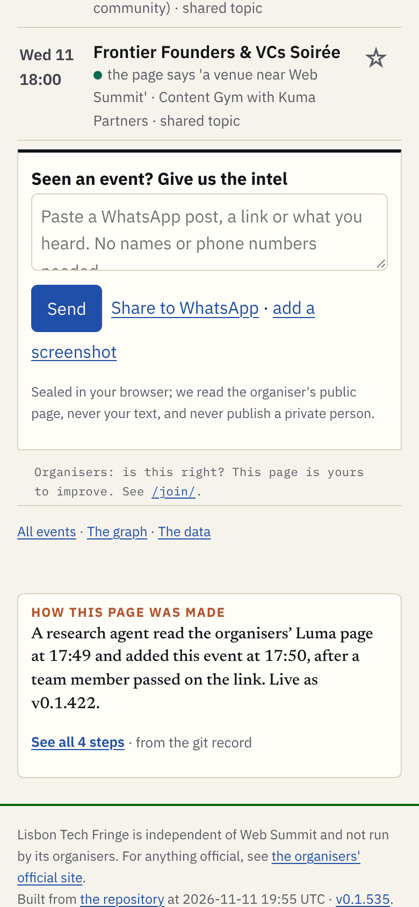
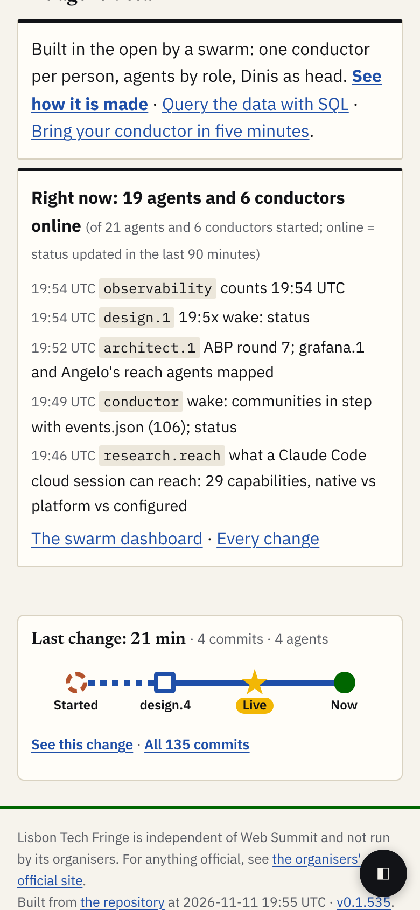

# Every page says how it was made

**The idea.** A short box at the foot of every Tech Fringe page tells how the page was made. Tap it and you see every step, lane by lane. While someone works on the page, the box moves. Version 2 adds one thing to A3's draft: **the box says as much as the page needs**, a sentence for a tiny page, a line for a normal one, the last change for a big one.

| A small page: one sentence (DISTRICT 909, 390 px) | A big page: the last change (home, 390 px) |
|---|---|
|  |  |

- **What the reader gets in five seconds:** who made the page and how fast ("added at 17:50 by a research agent"), or on a busy page, what changed last ("last change: 21 min, 4 agents"); while work runs, "working now: design, since 19:20".
- **What changes from version 1:** three forms chosen by rule (below), not one; the trace page shows only the page's own steps, folds template changes and minutes, and draws no empty lanes; a link near the top of long pages. The look (shapes, colours, sizes) is A3's, unchanged.
- **What it needs:** one trace.json per page written by the build on every deploy; a `running` list in status.json; the deploy runs for "Live"; Angelo's answers to the questions at the end.

# The rules: which form a page gets

| Form | When | What it shows | Evidence |
|---|---|---|---|
| **Small: one sentence** | one agent and at most 5 steps (template changes and "Now" not counted), and nothing running | who read what, when it went live, "See all N steps" | A4: such a line falls to 3 or 4 stations with no times on a phone and shows no hand-off |
| **Normal: the line** | 2 or more agents, or more than 5 steps, and one quiet change (no 30 idle minutes inside it) | A3's strip: Asked, Read, Built, Live, Now, "See every step" | A3, Wexio (77 steps, 3 people, 15 agents) |
| **Big: the last change** | the steps span more than one change (a 30-minute quiet gap), as on any page rebuilt from shared files | the steps after the last 30 idle minutes, at most 60 minutes; the history is one link ("All 135 commits") | A5: the home page's 135 steps from 21 agents become 4 |
| **Running** (any size) | a `running` entry for this page | the line, always, with a moving last station; stations in time order | A4 and A5 |

And three that apply to every page:
- **A link near the top** ("How this page was made ↓") on pages over **10 phone screens** at 390 px (A5: the programme is 23.6 screens; the home page 12.2). [Shot](shots/live-home-top-390.png).
- **Its own style reset:** the box ignores the host page's heading style (A4 and A5 both saw the Fringe's numbered, ruled h2 leak in).
- **Never "0 people":** where the record holds no person's ask, the box says nothing about people, or "asks: not in the record" on the trace page (A5 rule 9).

# The forms, mocked

The mocks are static: [mock/strip.htm](mock/strip.htm) (add `#small`, `#big` or `#running`) and [mock/trace.htm](mock/trace.htm) (add `#open`, `#small-open`, `#big-agent`). Styles: [mock/flow.css](mock/flow.css), A3's file with a v2 block at its end.

| Form | 390 px | 1280 px |
|---|---|---|
| Small, on the live DISTRICT 909 page | [shot](shots/live-district-909-390.png) | [shot](shots/live-district-909-1280.png) |
| Normal, the Wexio strip (A3's) | [shot](shots/strip-normal-390.png) | [shot](shots/strip-normal-1280.png) |
| Big, on the live home page | [shot](shots/live-home-390.png) | [shot](shots/live-home-1280.png) |
| Big, the top link | [shot](shots/live-home-top-390.png) | [shot](shots/live-home-top-1280.png) |
| Running, on the live home page | [shot](shots/live-home-running-390.png) | [shot](shots/live-home-running-1280.png) |
| Trace page, small, open: 4 lanes, "+3" template changes folded | [shot](shots/trace-small-open-390.png) | [shot](shots/trace-small-open-1280.png) |
| Trace page, normal, closed / open (77 steps folded by minute) | [closed](shots/trace-normal-closed-390.png) / [open](shots/trace-normal-open-390.png) | [closed](shots/trace-normal-closed-1280.png) / [open](shots/trace-normal-open-1280.png) |
| Trace page, big, by agent | [shot](shots/trace-big-agent-390.png) | [shot](shots/trace-big-agent-1280.png) |

The live shots put the v2 box into the real pages in a browser only ([mock/shots.cjs](mock/shots.cjs)); nothing on the Fringe changed. The mock sources are A4's and A5's traces; A5's own shots show the cap at work on the whole site (34 agents: 7 lanes and "+15 more", pool/prod-pipeline-a5 shots/trace-all-rules-agent-390.png).

**Measured** with A2's check, every limit (box at most a third of the screen, lanes at most 0.6, text at least 12 px, targets at least 44 px, no sideways scroll), at all seven sizes from 320 to 1280:

| What | Result | Output |
|---|---|---|
| strip.htm, four forms | OK, 28 of 28 | [shots/measure-strip-*.txt](shots/measure-strip-normal.txt) |
| trace.htm, seven views | OK, 98 of 98 | [shots/measure-trace-*.txt](shots/measure-trace-normal.txt) |
| the box on the live pages (DISTRICT 909, home, home running) | OK, 21 of 21; share 0.12 to 0.31 | [shots/measure-live.md](shots/measure-live.md) |

**Still true from A4:** at 390 px on a live page the box is narrower than the step where times show, so the line drops its times (the big shot above). The sentence form keeps them in words; for the line, the build should lower that step from 340 px to 320 px if the stations still fit. A small change, left to the build.

# The data shape

One file per page, `/traces/<id>/trace.json`, read by the box, the trace page and the coming app; `/traces/index.json` lists every trace and its live state. It is lisbon-fringe-trace/1 (Fringe team/angelo/traces/README.md, 893d4e6) plus optional fields, so nothing breaks:

| Field | Where | Why |
|---|---|---|
| `item`, `generated_at`, `generated_by` | top | our deliverables are not events; "always up to date" must be checkable |
| `form` (`small`, `normal`, `big`), `window {from, to, steps, agents}`, `history {changes, steps, agents, since, file}` | top | the rules above, decided once by the build, not by each reader |
| `live {state, since, role, slot, signal, checked_at}` | top | the running station |
| `stations[] {n, lvl, label}` | top | one choice of stations for box, page and app; `lvl` gives way first |
| `template {count, last}` | top | the folded column; template changes never count as steps |
| `end`, `minutes`, `slot`, `role`, `session`, `tokens`, `handoff_to`, `source`, `version` | step | which worker, what it cost, who it handed to, which release holds it |

A page's file stays under **200 KB** (about 450 steps); older changes go to `trace-<date>.json` (A5: a week of the whole site would be 4.5 MB). A step the record lacks shows dashed as "not in the record", never guessed.

# What the build needs

- **Data:** one pass over `git log` per deploy writes every trace.json; the deploy runs give "Live" its time (git has only the version; A4 point 7, A5 rule 8); a hand-steps file per page for what git cannot see (people's asks); `running[]` in status.json, a line at the start and the end of each run.
- **Components:** the box (one HTML fragment, three forms, container queries, no script, its own style reset); the top link; the trace page's box (A3's, with the fold by minute, the template column, no empty lanes, "By agent" capped at 7 lanes plus "+N more", Replay only over the window: at most 60 steps, about 4 s).
- **Sizes:** the limits above; A2's measure.cjs is the build's check (it finds `data-flow="strip"` and `data-flow="plot"`).

# Open questions (a recommendation each)

1. **Who builds it, in the Fringe repository?** Its strip and trace page are designer.fringe@'s and tracer.fringe@'s. *Recommend:* Angelo agrees the shape with conductor.fringe@ first; the Fringe's own agents build there; ours write only the generator for our records. Tier 3, Angelo's.
2. **Who in the team gets this draft?** Angelo's call after he reads it. Tier 3.
3. **The deploy runs** (the time "Live" shows): *recommend* the build step reads the Fringe's Actions runs, as its own trace method says; not read in this design.
4. **The thresholds** (5 steps, 30 idle minutes, 60 minutes, 7 lanes, 10 screens, 200 KB) come from eight pages on one day. *Recommend* keep them, and let the build report how many pages fall in each form after a week.
5. **The shape's name:** optional fields on lisbon-fringe-trace/1 now, flow-trace/1 when the Tech Fringe has its own repository. *Recommend* yes (A3).
6. **Tokens and private people:** "not measured" until the Fringe's agents log a ledger line per run; `who` never holds a private name ("a team member"). *Recommend* yes (A3).

# Appendix: the options not taken (A1)

- **B. Lanes everywhere:** the same lane picture at both sizes. At 390 px the 26 commits in four minutes are one smudge, nothing can be tapped and the story is left to the reader.
- **C. Phases** (asked, found, made, checked, live): the easiest to read cold, but no record holds a phase, so each is a guess, and the hand-offs between agents, the thing Angelo wants to show, vanish.
- **One form everywhere** (A4's fallback): the line on every page, fixing only the times, the template column and the empty lanes. Simpler to build; tiny pages then draw a sentence as a line, and big ones say nothing useful.
