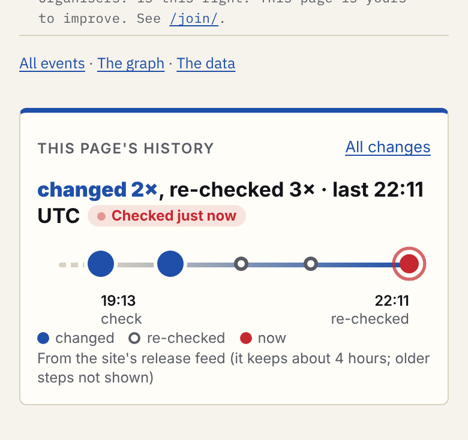

- **The picture:** a rail at the foot of each event page. Big blue dots mark changes, a green star marks when the event was added, small rings mark re-checks. The last mark pulses when it is under 15 minutes old. Each mark is a 44 px link to its release (/changes/<version>/). The rail grows from the left on load and the dots pop in ([loading frame](shots/swyb-a-track-390-loading.png)).
- **Is the data reliable?** Yes for what it holds: every A7 commit inside the feed sits in the release A7 found (7 of 7). But it holds only the **last 200 commits** (about 4 hours today), so it **misses most of each page's history**. DISTRICT 909's own "added" step has already dropped out.
- **The fix, in one line:** CI appends each release's per-event changes to a kept history file, so a page's history never drops out (about 170 KB a day once re-checks are counted, not listed).
- **Building it needs:** the kept file (releases.mjs, dev.2.fringe@PrompTugal.dinis), the timeline at the foot of event-pages.mjs (dev.lead.fringe@PrompTugal.dinis), and timeline.css from here. All of these are Dinis's agents' files, so who builds it is Angelo's call (tier 3).

## 1. Is it reliable? A7's six pages against the feed
The feed at v0.1.631 holds 112 releases and 200 commits, from 18:16:33 to 22:11:25 UTC (data/reliability.json, made by data/compare.py). "In feed" means the commit is listed in a release. "Same release" means it is the version A7 found by git tag.

| Page | A7 commit steps | In feed | Same release | What the feed has that A7 missed | Verdict |
|---|---|---|---|---|---|
| DISTRICT 909 | 7 | 5 | 5 of 5 | nothing | Right where present, but the add (b096ccb, v0.1.422) and dd871ad have dropped out. 33587a6 shows only as a re-check (seen_at), because read_at is skipped. |
| Storm Summit | 15 | 0 | none | nothing | Its whole history (13:36 to 17:57) is older than the feed. |
| /me/ | 5 | 0 | none | nothing | Not covered: the feed diffs data/events.json only. |
| /tip/ | 7 | 0 | none | one false match (0204c36, "refuses tip tasks", not this page) | Not covered. Matching on subject text misleads. |
| Home | 46 | 3 | 3 of 3 | 3 events-data releases after A7's read (20:11, 21:11, 22:11: mostly seen_at refreshes) | Events data only. Its own builder (home.mjs) is not visible, because release commits carry area counts, not file names. |
| Programme | 35 | 2 | 2 of 2 | the same 3 refreshes | As home. |

**What else the data shows** (Fringe source, read only):
- **The window is 200 commits, not 500.** `readChanges(root, max = 200)` (admin/build/changes.mjs:13) feeds releases.mjs. deploy.yml's fetch-depth 500 is a second, wider limit. At today's 40 to 51 commits an hour (activity.json totals), 200 commits is about 4 hours.
- **Re-checks look like changes.** The hourly iCal wake moves seen_at on about 108 events at a time (v0.1.631 "changed 108"). In the feed, 375 of 499 per-event entries change seen_at and nothing else. Of the 171 events with a mark, 122 have a real change.
- **A step backwards is hidden.** releases.mjs skips read_at (`skipField`, line 9: "a re-read alone is counted"). So 33587a6 moving DISTRICT 909's read time back to 13:17, which the page prints, appears nowhere.
- **"Being worked on now" from activity.json would never fire.** None of the 153 commits in its 3 hours names an event id: subjects say "seen_at refreshed" for 108 events at once. The reliable signal is the per-id diff: a release under 15 minutes old whose data lists the page's id.

## 2. The fix (a proposal for the Fringe's owners; nothing changed)
| # | Change | File, owner (from its header) | Size |
|---|---|---|---|
| 1 | **Keep the history.** After diffing, CI appends each release's per-event lines (`{v, t, id, kind, fields}`) to a kept file and builds `/api/v1/history/<event_id>.json` from it. Nothing then drops out at 200 commits. Where to keep it (committed by CI, or read back from the live site at build) is for the owners. | admin/build/releases.mjs, dev.2.fringe@PrompTugal.dinis (work/37) | 499 lines, 113 KB in 4 hours today; about 170 KB a day with fix 2 |
| 2 | **Count seen_at-only diffs as re-checks**, as read_at already is. List read_at when it moves backwards. | releases.mjs (same) | a few lines |
| 3 | **File names per commit** in the release JSON (changes.mjs already reads them, `--name-only`), so a page's own builder can be traced (/me/, /tip/, home). | admin/build/changes.mjs, dev.2.fringe@PrompTugal.dinis (work/15) | about 2 KB per release |
| 4 | **"Now" from the per-id diff**, not subject text: pulse when the newest release under 15 minutes old lists the id. | admin/build/activity.mjs, dev.1.fringe@PrompTugal.dinis (brief 10) | none |

## 3. The little timeline: three options (mocks injected into the live pages)
DISTRICT 909 and the busiest event in the feed (Show What You Build, /e/2026-11-12-show-what-you-build/, 5 releases; many events have 4). Fragments in mock/, made by mock/gen.cjs from data/timeline.json (made by data/timeline.py). Styled only with the Fringe's tokens (tokens.css). The motion is turned off under prefers-reduced-motion.

| Option | 320 | 390 | 1280 | Good | Bad |
|---|---|---|---|---|---|
| **A, the track** (recommended) | [shot](shots/swyb-a-track-320.png) | [shot](shots/swyb-a-track-390.png) | [shot](shots/swyb-a-track-1280.png) | Catches the eye (colour, growth on load, the pulse). Shows rhythm over time. One tap per release. Holds 5 marks at any width; older marks fold. | Only the first and last marks are labelled; the rest are named only for screen readers (aria-label). |
| B, release chips | [shot](shots/swyb-b-chips-320.png) | [shot](shots/swyb-b-chips-390.png) | [shot](shots/swyb-b-chips-1280.png) | Every step readable as text. | Looks like a list, not a picture. Scrolls sideways inside its box on phones. |
| C, the day strip | [shot](shots/swyb-c-day-320.png) | [shot](shots/swyb-c-day-390.png) | [shot](shots/swyb-c-day-1280.png) | Bold, and shows "today" at a glance. | Hides which release changed what. Phones show only the last 5 or 6 hours. |

DISTRICT 909 today has **one step** in the feed, so A4's rule gives it a sentence, not a line ([320](shots/d909-today-320.png), [390](shots/d909-today-390.png), [1280](shots/d909-today-1280.png)). With the kept file (fix 1, simulated from A7's git record) it gets the track: added 17:50, read time changed 19:23 ([320](shots/d909-kept-320.png), [390](shots/d909-kept-390.png), [1280](shots/d909-kept-1280.png)).

**A2's check** (measure.cjs at 91d6bff, 7 sizes from 320 to 1280, `--only strip`): all 5 variants pass, 35 of 35 measurements (shots/measure-*.txt). The share of the screen is at most 0.33; text is at least 12 px; taps are at least 44 px; no sideways page scroll. On short screens (740 x 360) the headline sits beside the rail. Below 360 px the legend is hidden.

**The pulse in the mock** fires on Show What You Build because v0.1.631 (22:11:25) was under 15 minutes old when the feed was built (22:11:49). It was a re-check, so the chip reads "Checked just now". It says "Being updated now" only for a real change.

**The build step needs:** `/api/v1/history/<id>.json` (fix 1) or, until then, the current feed. One component, about 60 lines in event-pages.mjs, ported from mock/gen.cjs's `track()` and `one()`. timeline.css (about 3 KB). Sizes: rail 74 px tall, marks 44 px, at most 5 marks.
