# The client pipeline: design

## Recommendation (one screen)

**Pick A, written by agents first.** The pipeline is a **Pipeline tab on /crm/** (our site, the site's look, opened by each person's site key through the bridge /crm/ already has). Phone: **my list by due date** (late, today, next) with a big **+ Add**; desktop: **one column per stage, the loop drawn as a loop**, won and parked as ends. Every change is **one small event file** in the private vault, so two people never clash.

Why: it answers the five-second question ("what is mine, what is late, where is every company") on the screen people already open, and the add fits in ten seconds one-handed. Until the browser can write to the vault (WS-189 question 4), the same event files are written by **an agent** (option C's path), so we are not blocked on Dinis to start.

| Phone: my day | Desktop: the board |
|---|---|
| 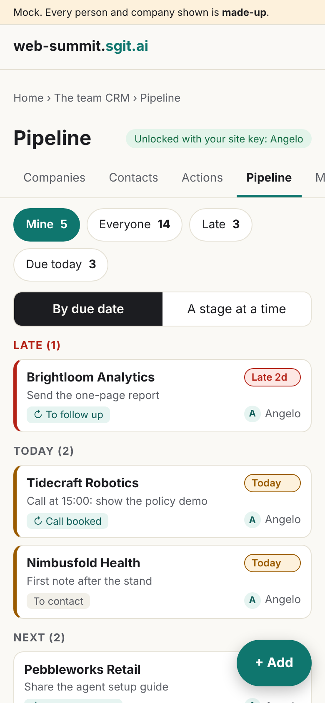 | 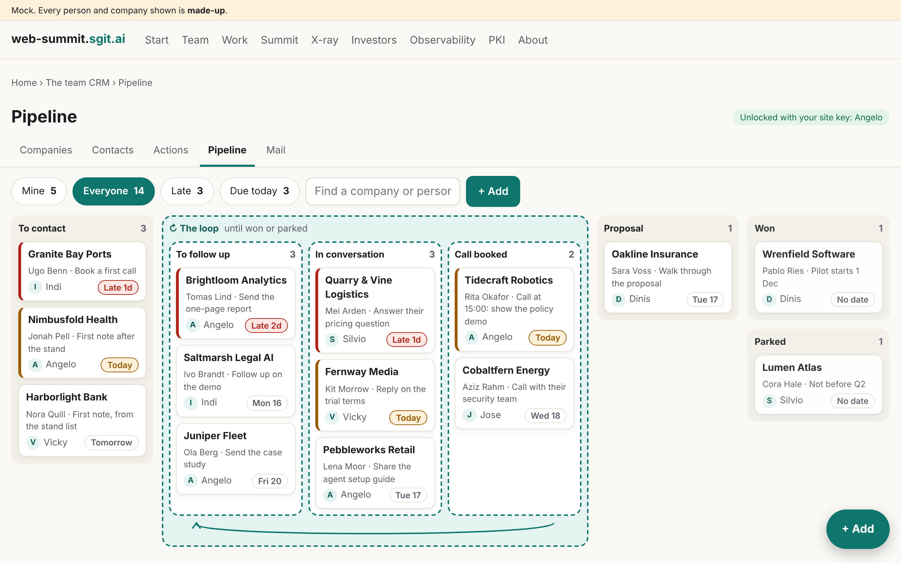 |

All mocks use **made-up** people and companies (mock/sample-pipeline.json); team members appear only as owners, by first name.

## What exists, and what we keep

- **/crm/** (site look: warm paper background, teal accent, the site's tokens in assets/site.css): keep it, palette and type unchanged; A and C read those tokens, no new palette.
- **The private CRM vault app** (admin/tools/crm_app.html.tpl: pill tabs, list and detail, green accent): B keeps its look exactly.
- **The vault layout** (companies/, contacts/, actions/, schedules/, comms/ threads; WS-170, WS-173): keep; the pipeline adds one folder, pipeline/, and links to companies/ and contacts/ rather than copying them.
- **Angelo's command centre kanban** (people/angelo/app/): its rules carry over (due and late first, a side panel on desktop, the whole screen on a phone, 44 px targets), not its dark palette.
- **The stand desk (WS-189)**: its "is anyone already talking to this company?" becomes the add's company match.

## The three options

### A. A Pipeline tab in /crm/, on our site (recommended)

| | Phone (390) | Desktop (1280) |
|---|---|---|
| Add | 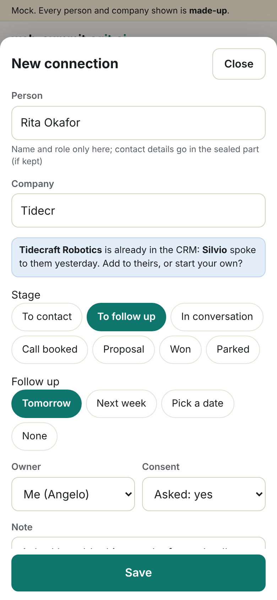 | 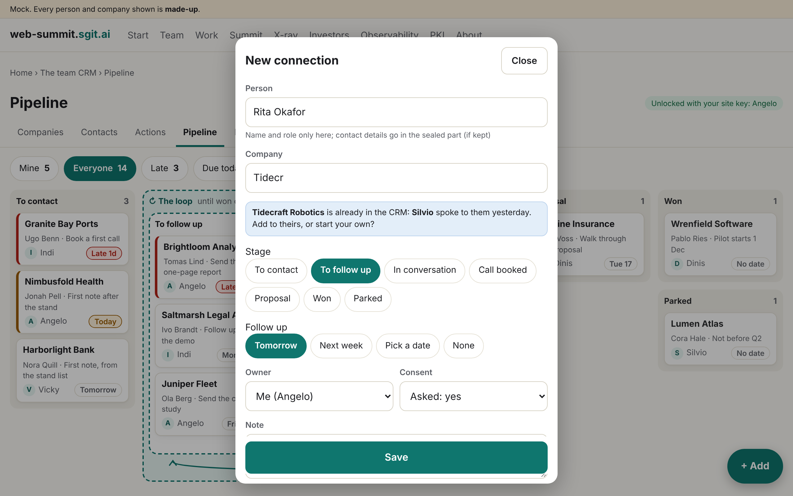 |
| Board |  |  |
| Record | 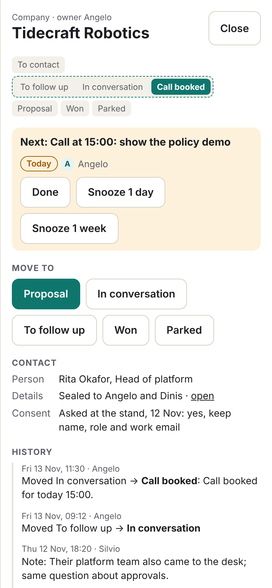 | 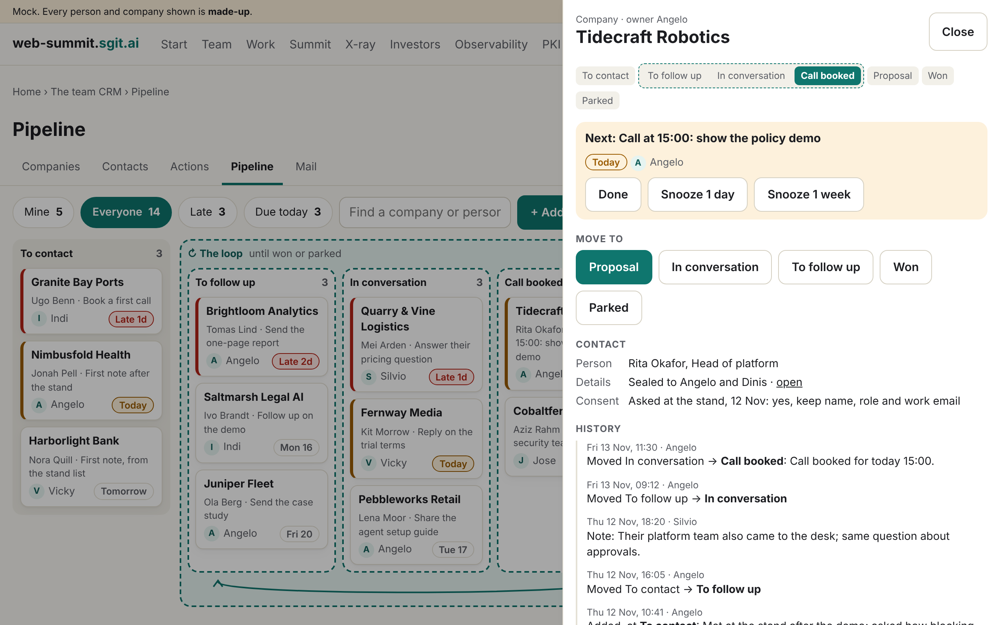 |

- **Well:** the five-second view on the page people already use; the loop is visible as a loop; the ten-second add (stage, follow-up and owner are taps, owner defaults to me); one tap to move or snooze; the company match stops two of us chasing one company.
- **Badly:** browser writing to the vault does not work yet (WS-189 q4), so at first an agent writes; /crm/ and its bridge are Dinis's files (tier 3 to change, the five steps).
- **Needs:** Dinis's go to add a tab to /crm/; a way to write (an agent's token now, the browser later).
- **Effort:** about two build sessions (page and its event writer), one for the agent writer.

### B. The pipeline as the private vault's own app

| | Phone (390) | Desktop (1280) |
|---|---|---|
| Add | 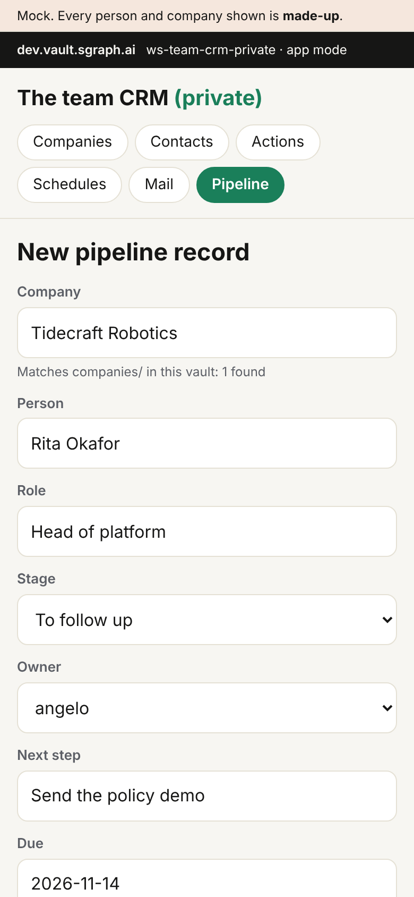 | 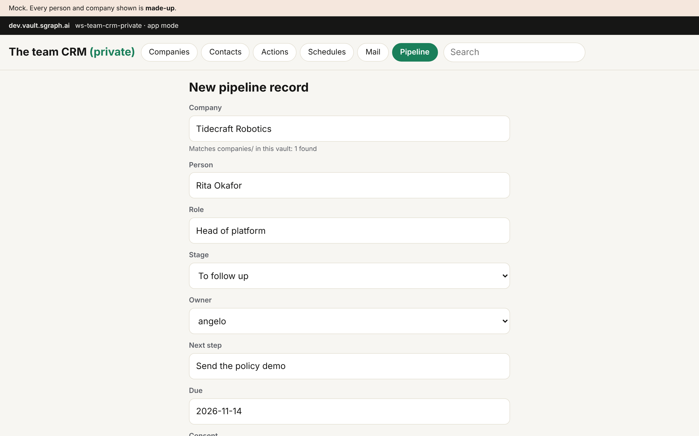 |
| Board | 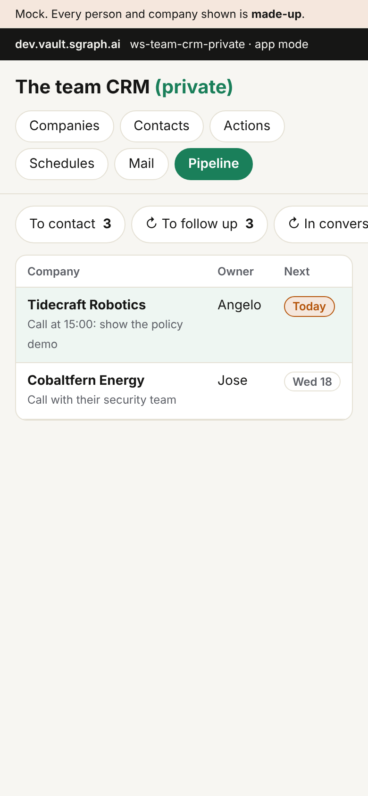 | 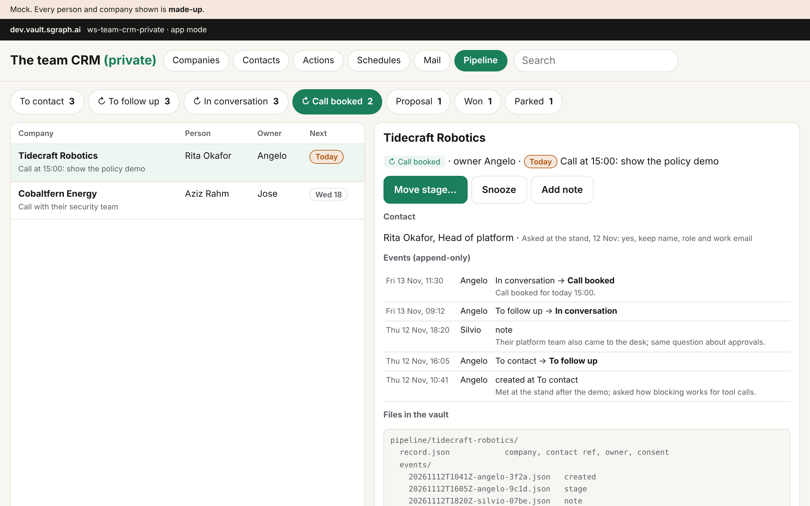 |
| Record | 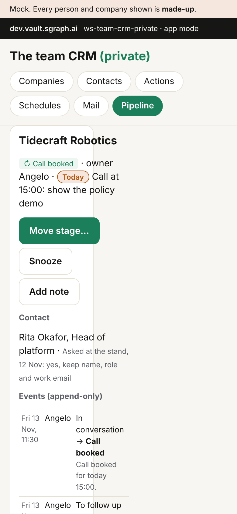 | 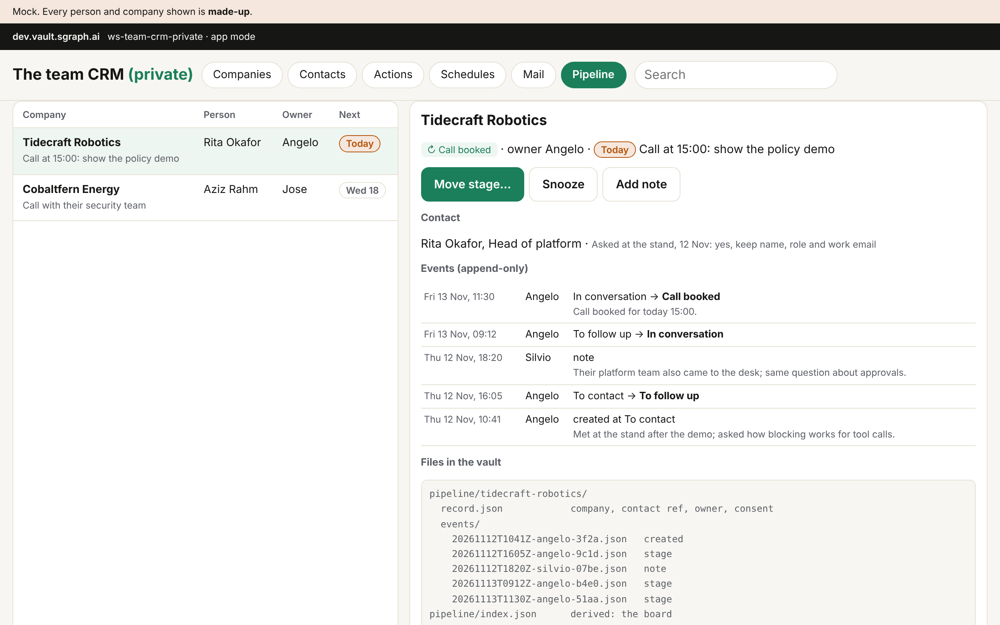 |

- **Well:** lives inside the vault, so nothing touches the public site; shows exactly what is stored (the event files), which helps the spec and audits.
- **Badly:** one stage at a time hides "where every company sits" and the loop; slow host on big vaults (WS-170: the public CRM's app hung over two minutes); worst on a phone, and the add is a long form; writing has the same browser problem as A.
- **Needs:** Dinis's go to change crm_app.html.tpl; browser writing; a token per person.
- **Effort:** about two sessions; little reuse of the site's components.

### C. Agent-first: tell your agent, the board only reads

| | Phone (390) | Desktop (1280) |
|---|---|---|
| Add | 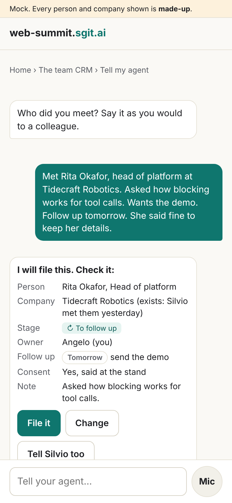 | 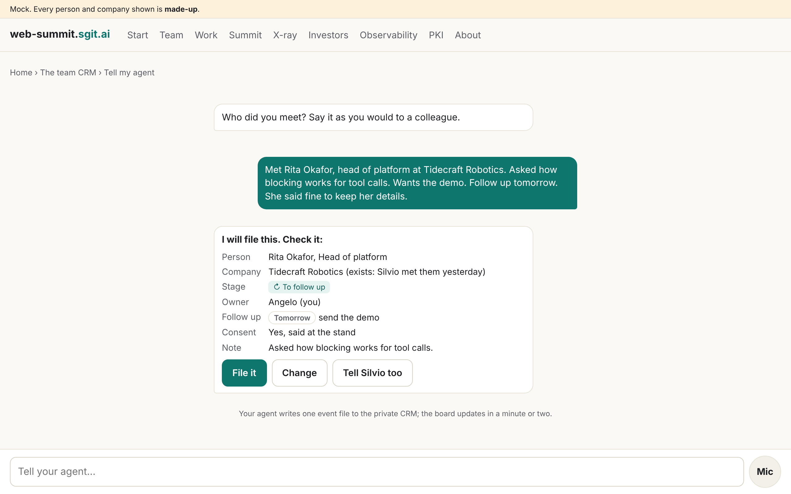 |
| Board | 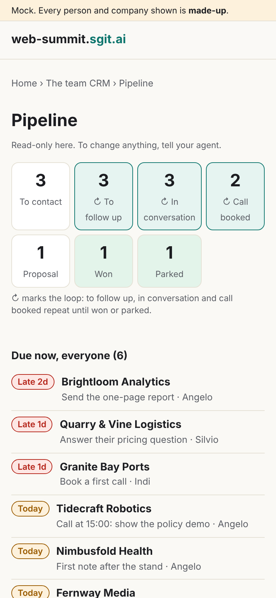 | 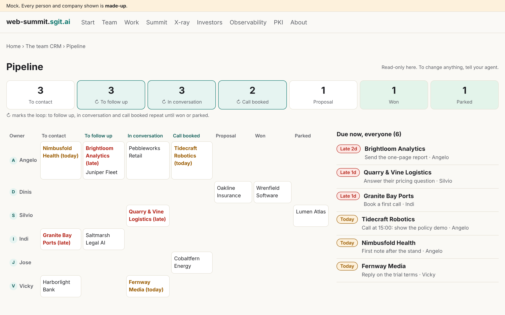 |
| Record | 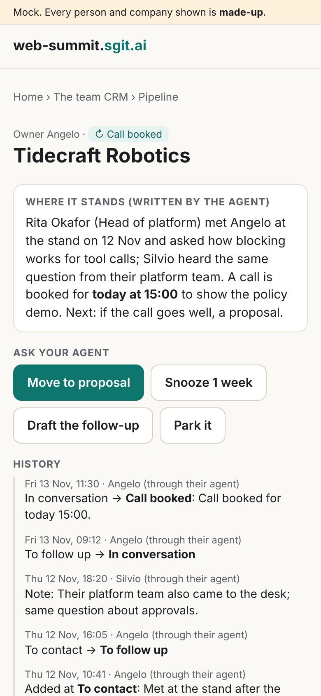 | 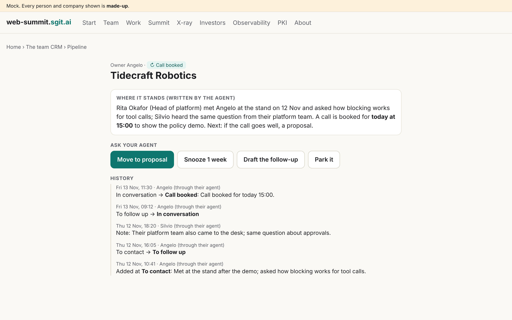 |

- **Well:** no browser write needed (agents already hold the vault key); natural after a conversation ("met X, follow up Tuesday"); fits Angelo's meetings workflow (people/angelo/meetings/README.md, step 4) and WS-96 debriefs; the owner by stage grid shows the whole team at a glance.
- **Badly:** every person needs an agent session at hand and an SG/Send token per writing agent (asked of Dinis since 5 Nov, not issued, WS-170); a minute's lag; an agent can misread a name or date, so the confirm step is required; a voice note sends speech to a service (consent and privacy).
- **Needs:** tokens; an agent tool (append an event, rebuild the index); each person's agent allowed to write.
- **Effort:** about two sessions (agent tool and read-only board).

**So:** A's screens, C's writer first, B's file layout (shown in B's record) underneath all three.

## What the spec step needs

**Records, in ws-team-crm-private only** (never in this repository): one pipeline record **per company**, because the team sells to companies and the stand desk asks "is anyone already on this company?". Not the stage on thread.json: a connection may have no email thread, and one file edited by many clashes.

```
pipeline/<company-slug>/record.json          written once
  {"v":1,"id":"<company-slug>","company":"companies/<slug>","contacts":["contacts/<slug>"],"created_at":"<iso>","created_by":"<person id>"}
pipeline/<company-slug>/events/<yyyymmddThhmmZ>-<person>-<4 hex>.json   append-only, never edited
  {"v":1,"at":"<iso>","by":"<person id>","via":"browser|<agent name>","kind":"created|stage|note|followup|done|snooze|owner|consent|redact",
   "from":"<stage>","to":"<stage>","owner":"<person id>","due":"<yyyy-mm-dd>","what":"<next step>","note":"<text>"}
pipeline/index.json                          derived (like graph/): one row per company
  {"id","company","contact","stage","owner","due","next","late":bool,"updated_at","updated_by"}
contacts/<slug>/contact.json                 existing: name, role, company; plus "consent":{"given":bool,"how","at","by"}
contacts/<slug>/contact.sealed.json          only if WS-189 q3 says keep details: ws-crm-env-1, sealed to the owner and Dinis
```

Stages: to_contact, to_follow_up, in_conversation, call_booked (the loop), proposal, won, parked. State is the fold of the events in time order; the index is rebuilt after each write (by the writing agent, or in the browser).

**Components (A):** stage chip (the loop marked with a ↻ and in words), due chip (late, today, a date: text, not colour only), owner tag (initial and first name), card, loop frame, my-day list, add sheet (company match, stage chips, follow-up quick picks), record panel (stage strip, next step with Done and Snooze, Move to, history). The mock generator: mock/render.mjs.

**Security and privacy:** the team only reads (whoever holds the private vault key: each person and their conductors, WS-170); nothing about a contact in this public repository; consent on every contact, asked before anything beyond name and role is kept; deletion: remove contacts/<slug>/, add a redact event, rebuild the index, and the vault history question below; voice and card photos only as an idea, after consent and a check of where the audio or image goes.

**Questions for Dinis (tier 3, through the lead and Angelo):**
1. May the pipeline add pipeline/ (record, append-only events, derived index) to ws-team-crm-private, and the index to crm.mjs's derive?
2. Who writes: a pipeline agent with its own SG/Send access token (which name, sealed to its key), and when can a browser write (WS-189 q4)?
3. WS-189 q3: a contact's details sealed per record (layer 2 back on for contact.sealed.json only) or kept out of the CRM?
4. Deletion: can a file be purged from a vault's history, or is the answer a new vault? Until then: keep details sealed, so a removal also drops the readers' envelopes going forward.
5. May we add a Pipeline tab to /crm/ (his page, the five steps, For: conductor@web-summit.dinis)?
6. May each person's own agents (crm@ of each person) append events, under one-token-per-agent?

**Not done here, on purpose:** no vault read or write, nothing published, no message to anyone. The mocks are rendered from mock/render.mjs into a scratch folder (*.html is generated output in this repository and gitignored); the screenshots are committed.
