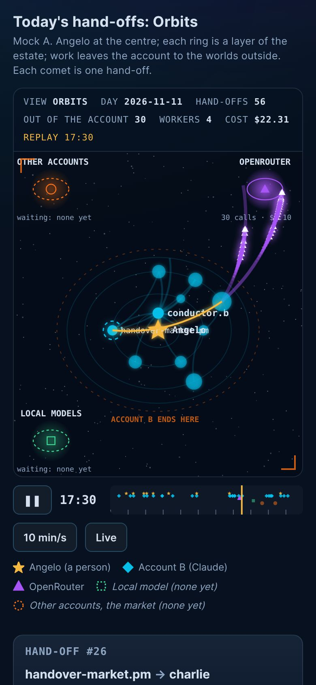
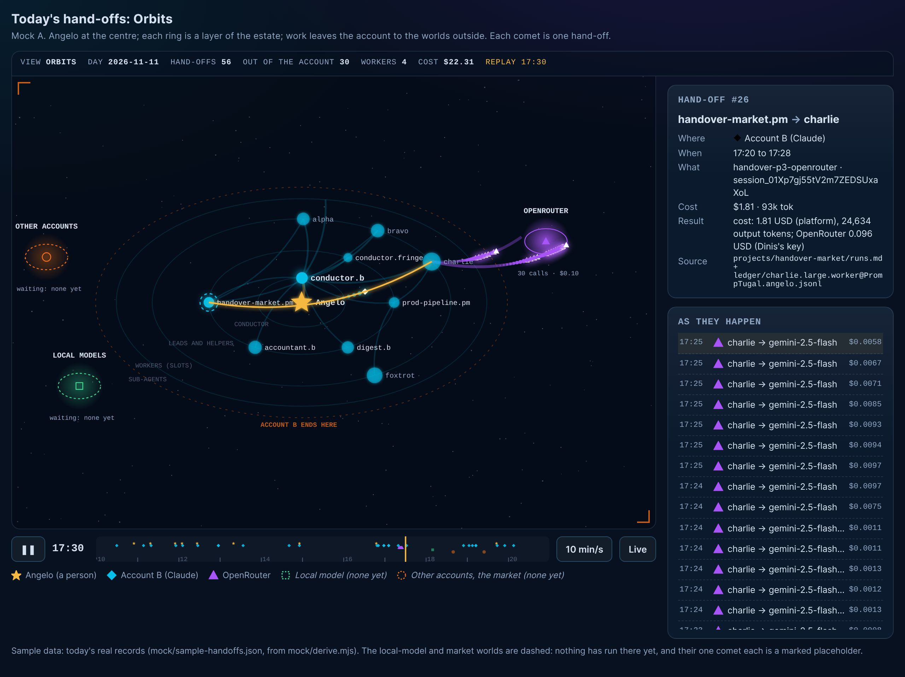
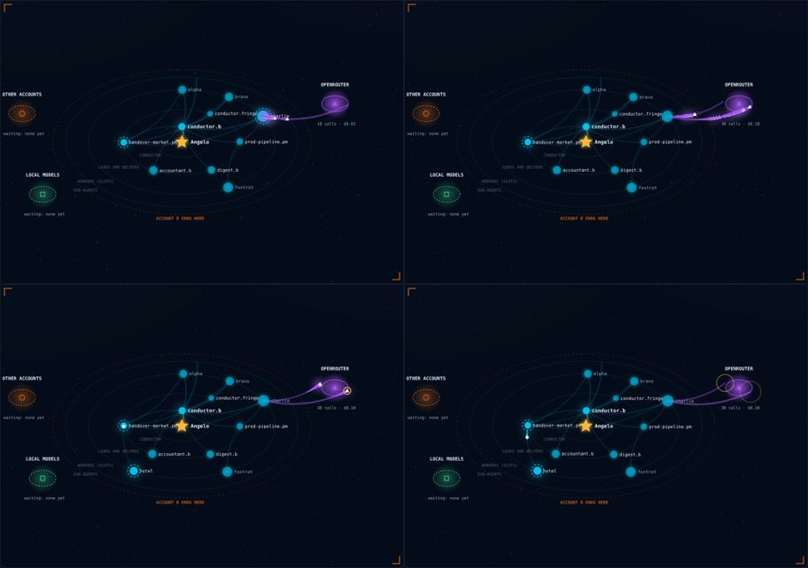
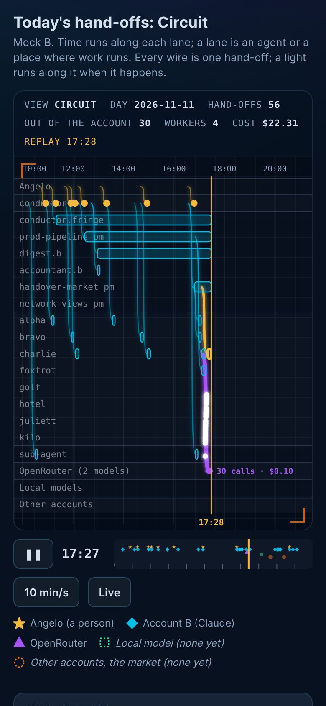
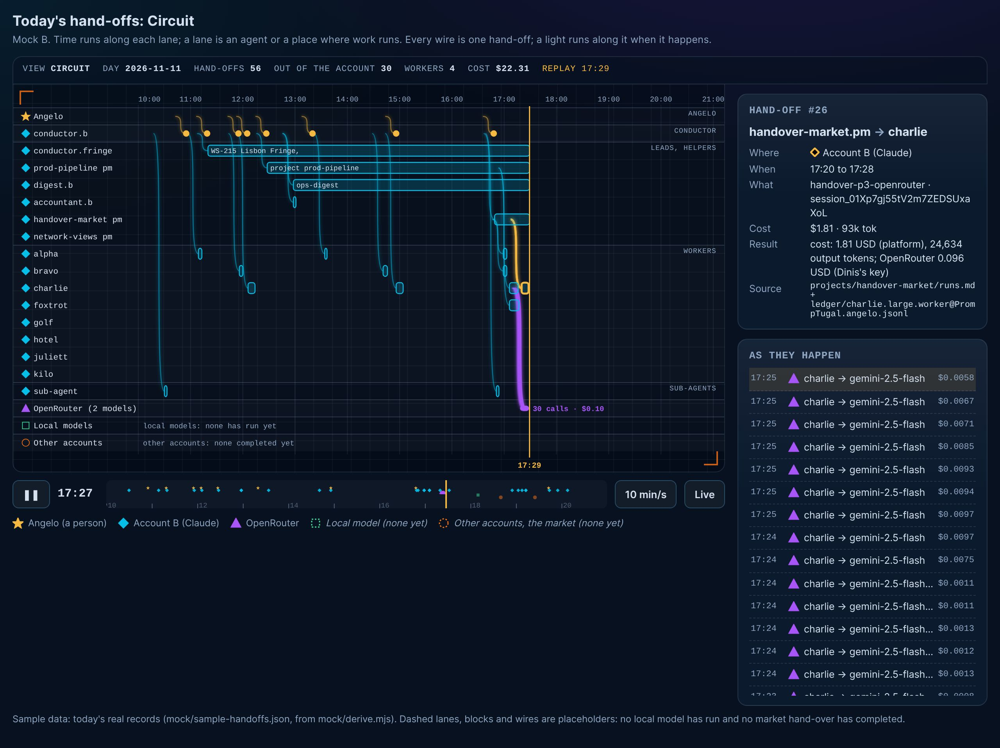
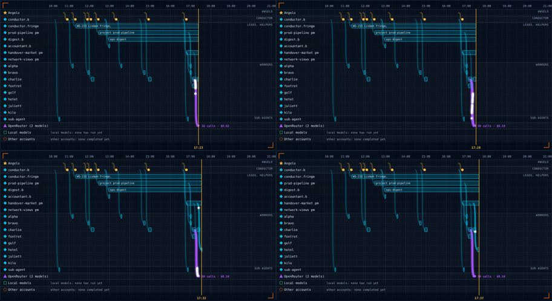
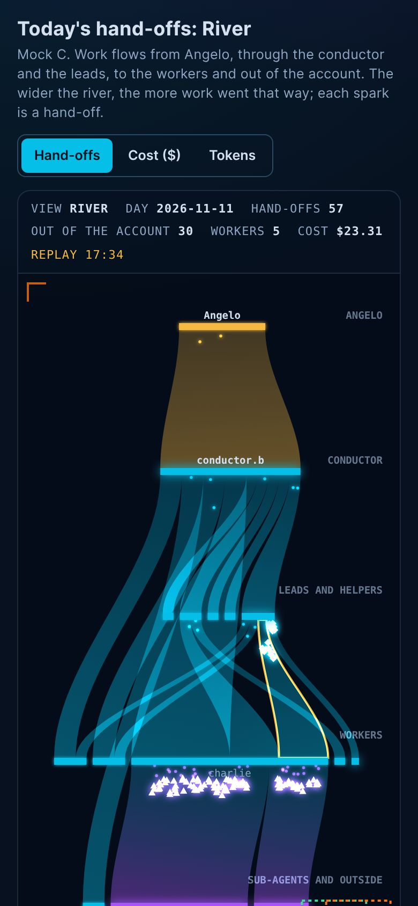
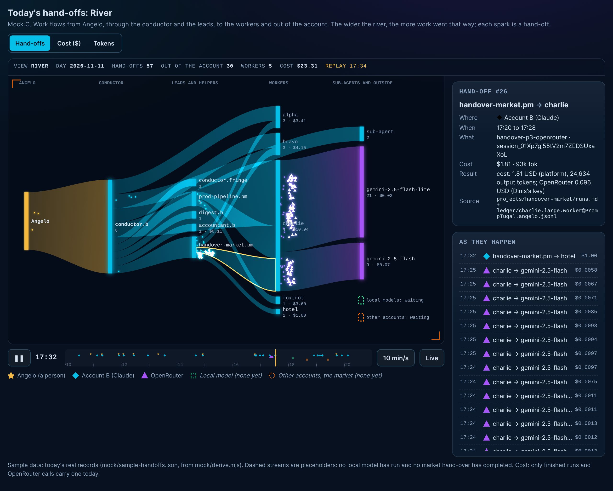
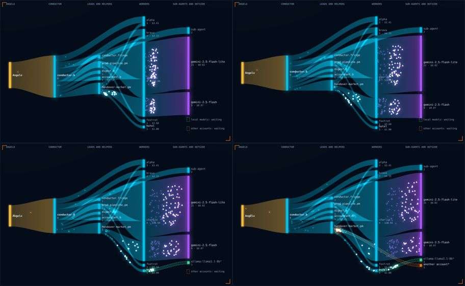

# Recommendation: A, Orbits, with B as its timeline tab

**Pick A.** In five seconds it shows the one thing the old views cannot: work leaving Angelo, going down through the conductor, the leads and the workers, and **crossing the edge of account B** to OpenRouter, while the local-model and market worlds sit there, dashed and waiting. Every comet is one real hand-off; tap it for who, where, when and cost. It is the most striking of the three and the only one that reads well on a phone.

**Add B as a second tab ("Timeline")** for the exact question "who was working when, for how long". **Take C's width switch** (hand-offs, cost, tokens) into A's filaments. One view, two tabs, not a fifth way to show the same thing.

| A at 390 px | A at 1280 px |
|---|---|
|  |  |

Mocks (open from a local server or, once on dev, the site): `mock/a/orbits.htm`, `mock/b/circuit.htm`, `mock/c/river.htm`. `?t=17:20` starts the replay at a moment; `&paused=1` freezes it; `&sel=26` opens a hand-off.

## What the bar does, and what we keep

Studied running at 1280 and 390 px: Angelo's `#live?v=work` (the dumbbell), `#collab` and `#live`; Silvio's command centre (Universe map and Circuit, `assets/cc/brain.js`, commit 92a078b).

| What makes it stunning | Where | Kept in |
|---|---|---|
| Motion with meaning: each moving thing is one real event | deliveries flying in the dumbbell | A comets, B pulses, C sparks |
| Light on a dark world: glow on #07111F, cyan, gold, violet | both | all (tokens from `assets/cc/app.css`; no new palette) |
| An instrument's frame: mono HUD bar (counts, LIVE pill, read time), orange corner brackets | Silvio's Universe and Circuit | all |
| Depth: a 3D sky, rings of people | Universe, `#collab` | A (tilted rings, nearer nodes larger) |
| Wires between boxed nodes on a grid | Silvio's Circuit | B |
| Typed destinations with icons | the dumbbell's ten destinations | A's worlds, the shape key |
| Time left to right, playback | `#replay` | B, and the scrub strip in all |

Nothing is said by colour alone: each place has a shape (star Angelo, diamond account B, triangle OpenRouter, square local, circle market), a word in the key, and placeholders are dashed and in italics.

## The sample data

`mock/sample-handoffs.json`, made by `mock/derive.mjs` from today's records: **69 hand-offs, 66 real, 3 placeholders** (one local-model call, one market hand-over out and back). Real: 9 of Angelo's words reaching conductor.b@ (pipeline/*/times.json intake, project BRIEF.md), 4 leads, 2 scheduled helpers, 18 worker runs (conductor-b/runs.md, projects/*/runs.md, estimates/), 3 sub-agent hops, 30 OpenRouter calls ($0.0955, pipeline/handover-p3-openrouter/usage.jsonl). Recorded cost $27.60; 4 running workers have no cost yet; 2 times are approximate (handover-market.pm@ has no row in conductor-b/runs.md: placed 10 minutes before its first worker).

## Concept A: Orbits (recommended)

Angelo is the sun. Rings, inner to outer: the conductor, leads and helpers, workers by slot (alpha to lima, fixed places, so a slot is always in the same spot), sub-agents. A dashed orange ellipse says **ACCOUNT B ENDS HERE**; outside it, three worlds: OpenRouter (models as moons), local models, other accounts. Each hand-off flies as a comet in its place's shape; the receiver flashes; a faint filament stays, thicker the more work went that way. Running work has a turning dashed halo; a node grows with its cost.

| 390 px | 1280 px | Motion (four frames, 0.33 s apart) |
|---|---|---|
|  |  |  |

- **Does well:** "where did the work go" at a glance; the account's edge is visible; the empty market and local places show without an apology; the most beautiful; fits a phone square.
- **Does badly:** "when" lives only in the scrub strip; overlapping labels in the centre (on a phone only Angelo and the conductor are labelled, the rest on tap); cost is a node size, not a number to compare.
- **Busy day (100+):** nodes are bounded (1 conductor, about 6 leads, 12 slots, a few outside worlds), so more hand-offs mean thicker filaments and more comets, not more clutter; a burst like 30 OpenRouter calls in 5 minutes reads as a shower, which is right.
- **Live and replay:** replay plays the day at 2, 10 or 30 minutes a second, scrub to any moment; live follows the latest records and a new row flies in as it arrives.

## Concept B: Circuit

A lane per agent and per place, grouped (Angelo, conductor, leads and helpers, workers, sub-agents, OpenRouter, local, market), on Silvio's grid. Each hand-off is a glowing wire from the giver's lane to the receiver's, and each run a block from start to end; a light runs along the wire when it happens; a gold line is now.

| 390 px | 1280 px | Motion |
|---|---|---|
|  |  |  |

- **Does well:** exact: who, when, how long, in parallel; long runs (conductor.fringe@, prod-pipeline.pm@) are obvious; closest to Silvio's look; best for a review of a past day.
- **Does badly:** less wow; at 390 px blocks are thin and labels sit under the wires; 21 lanes today and more as slots fill.
- **Busy day:** one lane per slot keeps it bounded; dense bursts become a thick bundle with a count ("30 calls · $0.10"); needs a zoom (brush the scrub strip) for an hour.
- **Live and replay:** as A; live keeps now at the right edge.

## Concept C: River

A flow from Angelo to the conductor, the leads, the workers and out; the river's width is hand-offs, cost or tokens (a switch); sparks run along it, a bright burst for each new hand-off. On a phone it runs downwards.

| 390 px | 1280 px | Motion |
|---|---|---|
|  |  |  |

- **Does well:** "how much went where": switch to cost and OpenRouter's 30 calls shrink to a thread ($0.10) beside a worker's $3; it says the cost story best.
- **Does badly:** individual hand-offs and time are lost in the totals; flows that skip a layer (conductor straight to a worker) cross the leads' column; a phone's labels are few.
- **Busy day:** scales best of the three (widths add up), but tells least about each hand-off.
- **Live and replay:** the river swells as the day plays.

## Cold read (a stranger's stumbles)

"Account B" (the key now says "Account B (Claude)"; the view needs one line: "Angelo's second Claude account, where these agents run"); "slot" (alpha to lima: name it "worker slot" on first use); "sub-agent" (a helper inside a worker's own session). The comet idea needs no words.

## What the build (d2) needs

**One row per hand-off**, appended by a collector, never by hand:

```json
{"at":"2026-11-11T17:20Z","end":"2026-11-11T17:28Z","from":"handover-market.pm@PrompTugal.angelo","to":"charlie.large.worker@PrompTugal.angelo","where":"account-b","kind":"worker","item":"handover-p3-openrouter","role":"build","cost_usd":1.81,"tokens":93325,"source":"projects/handover-market/runs.md + ledger/...","real":true}
```

| Field | Fed by |
|---|---|
| at, end | conductor-b/runs.md and projects/*/runs.md (start, end); pipeline/*/times.json; estimates/*.jsonl start and done; usage.jsonl `at` |
| from | who keeps the runs.md (conductor.b@ or `<project>.pm@`); for a call, the worker of that item |
| to | the worker or lead named in the row; the model in usage.jsonl; `sub-agent` from Sub-agent: lines (none yet) |
| where | account-b; openrouter (usage.jsonl tier cheap or strong); local (usage.jsonl tier local, none yet); market (ledger run_on or for_account, none yet); person for Angelo |
| kind | word, lead, schedule, worker, subagent, model-call, market |
| cost_usd | runs.md "USD" (finished runs only); usage.jsonl cost_usd |
| tokens | ledger/*.jsonl `session.total_without_cache_reads`, joined on agent and item; usage.jsonl prompt plus completion |
| source, real | the file it came from; false only for a placeholder |

- **Components:** the collector (`mock/derive.mjs` is the first draft: it reads every source above, 90 lines) writing `handoffs.json`, generated and gitignored, built by `build.mjs` like `live.json`; the view module (A's canvas, about 250 lines, no library); shared parts (`mock/shared.js`: clock with live and replay, the hand-off card, the live list, the shape key); B as a tab later; one hash route and one nav link in app/app.js (small, For: dashboard@, five steps).
- **Sizes:** about 150 bytes a row; today 69 rows is 30 KB pretty-printed, so one file per day, the view loads one day. Canvas 640 px high on a desktop, 400 on a phone; side panel 320 px; feed keeps the last 40.
- **Live, honestly:** the site rebuilds on every release, so "live" is as fresh as the last release (minutes); the view polls `handoffs.json` each minute and flies in new rows.
- **Gaps the data has today:** sub-agent hops (no commit carries Sub-agent: yet); running workers' cost (only at the end); a lead's start when conductor-b/runs.md has no row; no local or market record at all. The view shows each as dashed or "not recorded", never invented.
