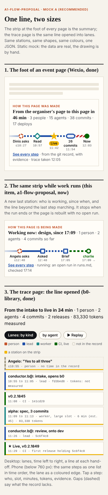

# The idea, on one screen

**Every page says how it was made, in one line at its foot; tap it and the same line opens into lanes.** One trace file per page, rebuilt on every deploy, feeds both, and the app later.

- **What the reader gets in five seconds:** "asked, read, built, live in 46 min, by 3 people and 15 agents", and, while work runs, "working now: design, since 17:09" with the line moving.
- **What changes:** the Fringe's strip (trace-strip.mjs, 438f9f5) goes under every page and gains a "working now" station; the trace page (trace-page.mjs, f6dbece) opens with that strip and draws the same stations in its lanes, with the newsroom's Replay and hand-off lines; the build writes the trace, so nobody runs a tool by hand.
- **What it needs:** a build step that writes `/traces/<id>/trace.json` for every page in one pass over git; a `running` list in `team/angelo/status.json`; a hand-steps file per page for what git cannot see; Angelo's pick of option A and of the open questions below.

# What exists, and what to keep

| | Fringe page, f6dbece | Fringe strip, 438f9f5 | Newsroom flow, newsroom: assets/newsroom/flow.js (dev at 122d2b1) |
|---|---|---|---|
| Form | swim lanes by kind of actor (6 lanes), time across; top to bottom on a phone | metro line, 6, 9 or 14 stations by the strip's own width | one lane per agent, one column per step |
| Keep | lanes by kind, folded quiet stretches and bursts, every mark a link to its evidence, works without JS | the scored stations, the shapes per kind (dot, diamond, star for live, red for failed deploys), the headline sentence, the pulse on "now" | **Replay** (steps appear in order, a dot flies along each hand-off); the thick arrow where work changes hands; lanes by agent as an option |
| Change | opens with the strip; marks the strip's stations with a yellow edge; adds a "by agent" toggle and Replay | sits under every page, not only the trace page; adds the "working now" station | not taken: its fixed-width SVG scrolls sideways at 390 px (flow.js lines 17 to 18: width grows with the step count) |

The look is the Fringe's own: colours, type and spacing from Fringe: admin/build/tokens.css (a749f50). No new palette.

# The options

**A. One line, two sizes (recommended).** Mock: [mock/a-line-and-lanes.htm](mock/a-line-and-lanes.htm), screenshots [390](mock/a-line-and-lanes-390.png), [1280](mock/a-line-and-lanes-1280.png).
- Good: the strip is already built and tested at three widths; the page and the strip share stations, so a reader who saw the line knows the page. The phone gets a list in time order with the lane as a coloured edge, never a sideways scroll. Running shows as a new last station with a marching segment.
- Bad: the strip picks about 6 stations on a phone, so most steps hide behind "See every step"; choosing stations is a scoring rule that people will argue about.

**B. Lanes everywhere.** Mock: [mock/b-mini-lanes.htm](mock/b-mini-lanes.htm), screenshots [390](mock/b-mini-lanes-390.png), [1280](mock/b-mini-lanes-1280.png) (ticks placed by hand, approximate).
- Good: literally the same picture at both sizes; honest about density.
- Bad: at 390 px the 26 commits between 11:54 and 11:58 are one smudge, nothing can be tapped, lane names do not fit, and the story is left to the reader.

**C. Phases.** Mock: [mock/c-phases.htm](mock/c-phases.htm), screenshots [390](mock/c-phases-390.png), [1280](mock/c-phases-1280.png).
- Good: the easiest to read cold (asked, found, made, checked, live); "running" is simply the phase that pulses.
- Bad: no trace records a phase, so each step's phase is a guess; hand-offs between agents vanish, which is the thing Angelo wants to show.

# The brief's seven points, in option A

1. **One concept.** One trace, one set of stations (chosen once, by the build, written into the trace as `stations[]`), drawn twice: the strip shows them, the page highlights them inside the lanes. Same shapes and colours in both.
2. **Always up to date.** The Fringe deploys on every push to dev with 500 commits of history (Fringe: .github/workflows/deploy.yml, 4581186), so the build can write every trace. Today's generator takes about 10 s per event (Fringe: team/angelo/traces/README.md) and there are 178 events in data/events.json: per event that is about 30 min a build, so the build step must read `git log` once and index it for all pages. Hand steps (a person's words, a sub-agent behind a commit) come from one file per page, `team/<id>/traces/<event_id>.hand.json`, written when someone knows them; missing ones show as dashed "not in the record" marks and as `gaps[]`, never as guesses. A deploy cannot see itself: its own run appears in the next build.
3. **In progress.** The signals, cheapest first:

| Signal | Freshness on a static site | Cost | Note |
|---|---|---|---|
| `running[]` in status.json (who, item, page, since), written by the agent at start and end | as fresh as the last deploy: on 11 November, minutes (17 deploys on one page in about an hour) | none at view time | **recommended**; today status.json's state is prose |
| an open run in runs.md, or a pool branch with no review | same | none | ours only; a branch can stay open for days, so it lies |
| a CI run in progress | seconds, if the page asks GitHub from the browser | 60 calls per hour per visitor without a key | later, for the demo screens only |
| the page re-reads `trace.json` every 60 s | under a minute after the next deploy | one small same-site request | **recommended** with the first |

   A run with no end after 2 hours shows as "stalled", not as running. The motion is CSS, not a GIF (lighter, follows dark mode, stops for reduced motion); the build can export a GIF of Replay for slides.
4. **Everywhere.** The strip at the foot of every page, phone and desktop (its container queries already fit any width). The app takes the same file: `GET /traces/<id>/trace.json`, plus `/traces/index.json` listing every trace with its `live.state`.
5. **One data shape.** lisbon-fringe-trace/1 plus the fields below; both examples are mocked: [mock/wexio.trace-excerpt.json](mock/wexio.trace-excerpt.json) (5 of 77 steps) and [mock/b0-library.trace.json](mock/b0-library.trace.json) (complete).
6. **Small and portrait screens.** A2 (pool/a2-small-screens) was not on GitHub at 17:14 UTC; its limits replace this mock's 760 px switch from lanes to list when it lands.
7. **Bigger later.** The stand and demo screens are a wall of strips, one per page being worked on, sorted by `live.state`, with Replay on a loop: the same JSON and the same drawing, so nothing new to design first.

# The data shape: what is added

| Field | Where | Why | Filled by |
|---|---|---|---|
| `item` | top | our pipeline deliverables are not events | the build |
| `generated_at`, `generated_by` | top | "always up to date" must be checkable | the build |
| `live {state, since, who, slot, role, signal, checked_at}` | top | the running station | status.json `running[]` |
| `stations[] {n, lvl, live?, out?}` | top | one choice of stations for strip, page and app | the build (the strip's scoring, 438f9f5) |
| `end`, `minutes`, `effort_min`, `estimate_min` | step | how long, against the estimate | times.json, estimates/ |
| `slot`, `role`, `session` | step | which worker and which prompt | commit trailers `Role:`, times.json |
| `tokens {…, source}` | step | cost per step | ledger/ (ours); null on the Fringe today |
| `handoff_to` | step | draws the hand-off line from the record, not from guesswork | the `For:` trailer, or shared evidence as f6dbece does |
| `source` | step | git, ci, times.json or hand | the build |

Everything else stays as lisbon-fringe-trace/1 defines it (Fringe: team/angelo/traces/README.md, 893d4e6).

# Open questions (a recommendation each)

1. **Which option?** *Recommend A:* the strip and the page exist (438f9f5, f6dbece); A adds a station, a toggle and Replay, and it is the only option whose phone view tells the story.
2. **Who builds it, and where?** The files are the Fringe's (designer.fringe@'s and tracer.fringe@'s work). *Recommend:* Angelo agrees the shape with conductor.fringe@ first (BRIEF.md: "agree the shared format through Angelo"), then one build step in the Fringe repository by its own agents; ours writes only the generator for our records.
3. **Shape name:** extend lisbon-fringe-trace/1 with optional fields, or call it flow-trace/1 for both sites? *Recommend* optional fields now (nothing breaks), a name when the Tech Fringe repository exists.
4. **Running signal:** add `running[]` to status.json for every agent that works on a page? *Recommend yes;* it is one line at start and one at end, and the only signal that is both cheap and true.
5. **Tokens on the Fringe:** its agents record none. Ask them to log a ledger line per run, as ours do? *Recommend yes, later:* show "not measured" until then.
6. **Private people:** the strip already says "A tip (anonymous)" for a private sender; keep that rule in the shape (`who` never holds a private name). *Recommend* writing it into the shape's README.
