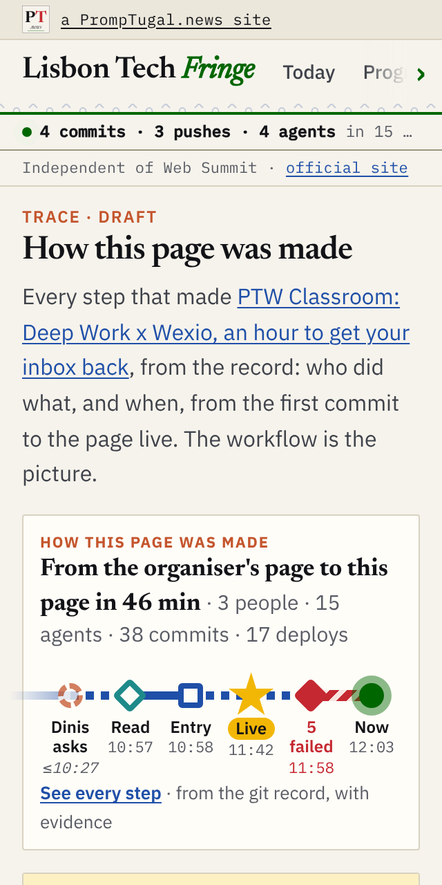
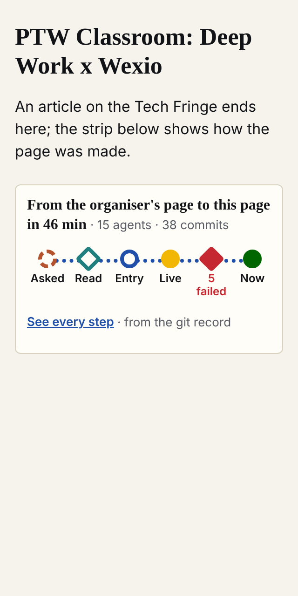

# The flow diagram on small screens

**What breaks today.** Measured on the Tech Fringe's live trace page (v0.1.385, 11 November): every one of the 14 measurements breaks at least one limit.
- **The strip** (the one-line "how this page was made") takes **38% of a 320 px phone screen** and **53% of a landscape phone** (740 x 360). Its smallest text is 11 px at every width, and its stations shrink to **17 px tap targets** at 320 px.
- **The swim lanes** turn vertical below 760 px and become **2 to 2.8 screens tall** on a portrait phone, **4.7 screens** on a landscape phone, and none of it is on the first screen. Lane names are **10 px**; the marks are **24 px** targets.
- On desktop (1280) two strip labels overlap; on a tablet (768) two lane labels are cut off.

**The limits proposed.**

| Limit | Strip | Swim lanes |
|---|---|---|
| Height as a share of the screen | at most 1/3 | at most 0.6, and it starts on the first screen |
| Smallest text | 12 px | 12 px |
| Smallest tap target | 44 px | 44 px |
| Page scrolls sideways | never | never (a scroll inside the diagram is allowed) |
| Labels overlapping or cut | none | none |

**What gives way first, in this order.** Strip: the kicker, then the times under stations, then the lower-ranked stations (6 stations become 5, then 4), and on a short landscape screen the heading moves beside the line. Swim lanes: a "Show the flow" toggle. Closed, it is an overview of the six lanes (one row each, a dot per step, a count); open, the lanes keep their horizontal shape at every width and the diagram scrolls inside its own box, with lane names pinned at the left.

**Recommended:** both, as prototyped below. They pass every limit at all seven sizes. Phone first: today on the left, the fix on the right.

| Today, 320 px | Proposed, 320 px |
|---|---|
|  |  |

## The measurements (today)

`node people/angelo/projects/prod-pipeline/a2-small-screens/test/measure.cjs` on https://lisbontechfringe.com/traces/2026-11-11-ptw-classroom-deep-work-wexio/ at 17:13 UTC. Share: the part's height as a share of the screen's height. 1st screen: the share of the first screen it fills on load. Min tap: the smallest side, with how many of the targets are under 44 px.

| viewport | part | share | 1st screen | min text | min tap (<44) | overlaps | clipped | inner scroll | page scroll | result |
|---|---|---|---|---|---|---|---|---|---|---|
| 320x640 | strip | 0.38 | 0.38 | 11 | 17 (7/7) | 0 | 0 | no | no | FAIL: share 0.38 > 0.33; text 11px < 12; tap 17px < 44 (7/7) |
| 320x640 | plot | 2.82 | 0 | 10 | 24 (42/42) | 0 | 0 | no | no | FAIL: share 2.82 > 0.6; not on the first screen; text 10px < 12; tap 24px < 44 (42/42) |
| 360x760 | strip | 0.29 | 0.29 | 11 | 17 (1/7) | 0 | 0 | no | no | FAIL: text 11px < 12; tap 17px < 44 (1/7) |
| 360x760 | plot | 2.35 | 0 | 10 | 24 (42/42) | 0 | 0 | no | no | FAIL: share 2.35 > 0.6; not on the first screen; text 10px < 12; tap 24px < 44 (42/42) |
| 390x844 | strip | 0.26 | 0.26 | 11 | 17 (1/7) | 0 | 0 | no | no | FAIL: text 11px < 12; tap 17px < 44 (1/7) |
| 390x844 | plot | 2.09 | 0 | 10 | 24 (41/42) | 0 | 0 | no | no | FAIL: share 2.09 > 0.6; not on the first screen; text 10px < 12; tap 24px < 44 (41/42) |
| 430x932 | strip | 0.2 | 0.2 | 11 | 17 (1/7) | 0 | 0 | no | no | FAIL: text 11px < 12; tap 17px < 44 (1/7) |
| 430x932 | plot | 1.87 | 0.05 | 10 | 24 (41/42) | 0 | 0 | no | no | FAIL: share 1.87 > 0.6; text 10px < 12; tap 24px < 44 (41/42) |
| 740x360 | strip | 0.53 | 0.14 | 11 | 17 (1/10) | 0 | 0 | no | no | FAIL: share 0.53 > 0.33; text 11px < 12; tap 17px < 44 (1/10) |
| 740x360 | plot | 4.74 | 0 | 10 | 24 (41/42) | 0 | 0 | no | no | FAIL: share 4.74 > 0.6; not on the first screen; text 10px < 12; tap 24px < 44 (41/42) |
| 768x1024 | strip | 0.18 | 0.18 | 11 | 17 (1/10) | 0 | 0 | no | no | FAIL: text 11px < 12; tap 17px < 44 (1/10) |
| 768x1024 | plot | 0.5 | 0.33 | 10 | 24 (41/42) | 0 | 0 | yes | no | FAIL: text 10px < 12; tap 24px < 44 (41/42) |
| 1280x800 | strip | 0.24 | 0.24 | 11 | 17 (1/15) | 2 | 0 | no | no | FAIL: text 11px < 12; tap 17px < 44 (1/15); 2 overlaps |
| 1280x800 | plot | 0.64 | 0.2 | 10 | 24 (41/42) | 0 | 0 | no | no | FAIL: share 0.64 > 0.6; text 10px < 12; tap 24px < 44 (41/42) |

The 768 px row first counted 2 lane labels as cut off; the final run reads 0, because the check no longer counts a label as cut when it sits inside a scroll box (the fix made for the prototype, see build.md). Seen in the first run: "Live 12:03:48 · v0..." and "5 × failed" run past the plot's edge at 768 px.

Pictures of today: [the lanes at 390 px, two screens tall](shots/today-390-lanes.png); [a landscape phone, where neither part is on the first screen](shots/today-740x360.png).

## The prototypes

Static HTML, not live, colours from the Fringe's tokens.css. The plot uses the 77 steps of the Wexio trace (number, lane, time, kind; no names). Lanes are an approximation of the live page's lanes.

- **proto/strip.htm**, the strip under an article: 5 to 6 stations, every station a 44 px target, 12 px text, at most 0.28 of the screen. [320 px](shots/proto-320-strip.png), [landscape phone](shots/proto-740x360-strip.png).
- **proto/plot.htm**, the swim lanes with the toggle. Closed: [390 px](shots/proto-390-lanes-closed.png), 0.26 to 0.42 of the screen. Open (`plot.htm#open` or the button): [390 px](shots/proto-390-lanes-open.png), [1280 px](shots/proto-1280-lanes-open.png), 0.35 to 0.56, 78 targets all 44 px.

| Prototype | Result at the 7 sizes |
|---|---|
| strip | OK: 7 measurements within the limits (share 0.17 to 0.28) |
| lanes, closed | OK: 7 measurements within the limits (share 0.22 to 0.42) |
| lanes, open | OK: 7 measurements within the limits (share 0.35 to 0.56, scrolls inside) |

**The trade-off.** Open on a phone, the lanes show about 10 steps at a time (one 46 px column per step), so 77 steps take a long sideways scroll. The later build should fold bursts into one column, as the live page already does (16 commits, 22 runs), which brings the 77 steps down to about 40 columns.

## How to run the check

One command, from the repository root. It exits 0 when every limit holds, 1 when one breaks, 2 when it cannot run.

```
node people/angelo/projects/prod-pipeline/a2-small-screens/test/measure.cjs [url or .htm/.html file] [--only strip|plot] [--shots dir] [--json file]
```

With no address it measures the live trace page (fails today, as above). The prototypes:

```
node people/angelo/projects/prod-pipeline/a2-small-screens/test/measure.cjs people/angelo/projects/prod-pipeline/a2-small-screens/proto/strip.htm --only strip
node people/angelo/projects/prod-pipeline/a2-small-screens/test/measure.cjs people/angelo/projects/prod-pipeline/a2-small-screens/proto/plot.htm --only plot
node people/angelo/projects/prod-pipeline/a2-small-screens/test/measure.cjs "people/angelo/projects/prod-pipeline/a2-small-screens/proto/plot.htm#open" --only plot
```

Each printed `OK: 7 measurements within the limits`. A later build finds its parts by the live classes (`.tstrip`, `.tr-fig`) or by `data-flow="strip"` and `data-flow="plot"`; labels by their classes or `data-flow-label`. The limits are at the top of the script.
