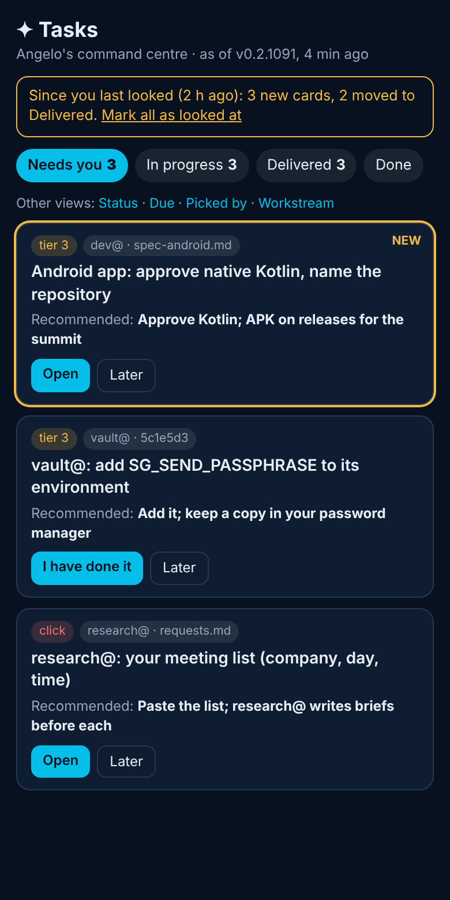
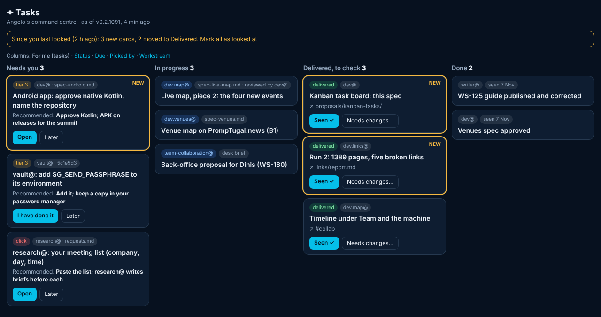

## What and why

Angelo, 7 November about 16:30 UTC: *"I'm unclear on whats planned and what's been delivered ... I have the feeling I am not up-to-speed on what needs my input or what has been delivered and I should check out."* And, on a new board: *"There's no point in creating a new board, let's evolve my kanban board for this."*

So the kanban he already has (`#kanban` in his command centre, `people/angelo/app/kanban-core.js`, BRIEF.md section 1) gains one more way to lay out its columns, **For me**, and that becomes what opens first. The existing columns (status, due, picked by, workstream), filters, sort and the address-as-a-view stay, one tap away as "other views".

## The mock-up

Phone first (390 px), then a wide screen. Made with the command centre's colours; the cards are real items from today, as an example.

## 1. Where the cards come from

One card per item, from two sources, merged at build time by `people/angelo/app/data.mjs` (no network in the browser beyond what it loads today):

| Source | Which items | Already there? |
|---|---|---|
| **The board's issues** (`board/WS-NN-*.md`) | My tasks, as today (Angelo or his agents own or picked it) | Yes |
| **Angelo's backlog** (`people/angelo/backlog.md`) | Every row | New: the backlog gains a status column (section 4) |
| **The desk's "Open with Angelo"** (`people/angelo/conductor/STATE.md`) | Each bullet: a decision or a click only he can make | New: each bullet gains a short id (section 4) |
| **Deliveries** (commits `For: desk.conductor@PrompTugal.angelo` with a `Delivered:` trailer) | Each delivered thing | New: one trailer (section 4) |

A backlog row that names a board issue becomes **one** card with both, not two. Each card shows: what it is, its agent, its brief (the commit or file, a link), what it waits on, and, once delivered, the delivery's link.

## 2. The four columns

| Column | What is in it | Its button(s) |
|---|---|---|
| **Needs you** | Decisions and clicks only Angelo can do: the desk's "Open with Angelo", backlog rows whose "Waits on" names him, board issues with an open stand-up decision for him (today's "Needs me now"). Each shows the desk's or the agent's **recommendation**, and a chip: *tier 3* (needs his words in a session) or *click* (something he does himself, like pasting a list) | **Open** (the question, its spec, where to answer) and **Later** (hides it for a day, in this browser only) |
| **In progress** | Backlog rows and his picked issues being worked on, by agent, with the brief's link | none |
| **Delivered, to check** | Each delivery until he marks it, newest first | **Seen ✓** and **Needs changes…** (one line of text) |
| **Done** | Delivered and seen, and items the desk ticked off; the last 7 days only | none |

**Order inside a column:** Needs you by the cockpit's ranking (it already scores "only you can do it", who it blocks, how long it waited, `admin/build/cockpit.mjs`); the others by last change, newest first.

**What a tier-3 card never does:** its button opens the question; it never sends a "go". A tier-3 go stays Angelo's own words in a session (the kit's protocol). The card says so in one line.

**On a phone:** one column at a time, with the four as tabs (as the kanban does today), Needs you first. **On a wide screen:** the four side by side.

## 3. "What changed since I last looked"

- The browser keeps the time he last looked (localStorage, a per-viewer convenience, wrapped so a private window still works).
- A line at the top says what changed since: *"3 new cards, 2 moved to Delivered"*; new cards and cards that moved carry a gold outline and **NEW**.
- **Mark all as looked at** resets it. Opening the view does not reset it on its own, so a glance on a bad connection does not lose the highlights.
- It is worked out from each card's history (when it appeared, when it last moved), which the build already gives the kanban (`last changed`). Nothing is sent anywhere.

## 4. Who keeps the data (small changes, all in people/angelo/)

| What | Who | How |
|---|---|---|
| **Backlog status** | desk.conductor@ and runner.conductor@ | backlog.md's table gains one column, **Status**: `waiting` (on Angelo), `in progress`, `delivered`, `done`. The desk already keeps the file; it sets the status when it briefs, routes or ticks off. |
| **"Open with Angelo" ids** | desk.conductor@ | each bullet starts with a short id in brackets, e.g. `[A-17]`, so a card keeps its identity when the text changes. A bullet without one is still shown, keyed by its first words. |
| **Deliveries** | each agent, in its own commit | one trailer, `Delivered: <what> <link>`, on the commit that delivers (a spec, a page, a fix), beside `For: desk.conductor@PrompTugal.angelo`. The build reads the trailers of the last 7 days. A delivery without the trailer can be added by the desk with the same trailer on its own commit. |
| **The kit line** | dev@ (me), after approval | one paragraph in the kit: the trailer, and that a delivery is not done until Angelo has seen it. |

**What the build checks:** an unknown status, or a `Delivered:` with no link, is shown as it is with a note, never guessed (as the due dates are today).

## 5. "Seen" and "Needs changes": how a click becomes a fact

Angelo clicks on his phone; the agent must learn it, and it must be recorded. Two ways:

**A. Signed, on the cockpit's lane (recommended).** The command centre already hosts the cockpit's decide part (`assets/cockpit.js`, `WSCockpit.mount`), which signs a click with his key in this browser, seals it and appends it to his conductor's lane; the agent drains it and writes the outcome to a log the next release shows. Seen and Needs changes become two more actions of that same envelope:
- each message names the recipient (desk.conductor@), the card's id, the action (`seen` or `changes`), the line of text, the card's state when he clicked (the old value), a unique id and the time;
- the desk drains the lane, records each one in `people/angelo/tasks/seen.json` (card id, action, text, time) and, for Needs changes, briefs the agent in one commit `For: <agent>` with his line quoted;
- the next release moves the card: Seen to Done; Needs changes back to In progress, with his line on it;
- until the release, the card shows "sent, waiting for the desk" (blue), as the cockpit does.

It is **tier 1 to 2 only**, by the kit's rule for signed messages: a "seen" or a line of feedback, never a go for anything tier 3. A signed "Needs changes" is material for the agent, not an instruction beyond the item it names.

**B. Unsigned, copied to the desk.** The click copies one line ("Seen: A-17" or "Needs changes: A-17, …") for Angelo to paste into the desk session. Nothing to build on the lane, but it needs the desk session open, so it is the fallback only: when his key is not in this browser, the card offers B and says why.

**I recommend A, with B as the fallback.** It needs no new mechanism, only two actions on an envelope that is already reviewed and in use.

## 6. The digest becomes this board

The kit says the desk gives Angelo one visual summary when he asks (no scheduled digest). From approval: that summary is a link to this board (`#kanban`, For me), plus the one or two lines the board cannot say. The board's markdown twin (`summaryMd()` in data.mjs, the no-JavaScript fallback) lists the four columns as text, so the same picture reaches him where scripts do not run.

## 7. What changes, by file

All tier 1 (people/angelo/), built by dev@ with dashboard@ for the look:
- `app/kanban-core.js`: a `tasks` column field (needs you, in progress, delivered, done), the merge of the four sources, the order, and "changed since"; pure functions with tests in its `selfTest()`, so a broken rule fails the build, not the phone.
- `app/data.mjs`: read backlog.md, the desk's "Open with Angelo", the `Delivered:` trailers and `tasks/seen.json`; add them to `kanban`.
- `app/app.js` and `app.css`: the For me layout as the default, the buttons, the NEW outline, the "since you last looked" line; the existing views untouched.
- `app/tests/`: one new test at 390 and 1280 px, light and dark, that the four columns draw from a fixture and that Seen moves a card after a release.
- `backlog.md`, the desk's STATE.md and `kit/README.md`: the status column, the ids and the trailer (the desk keeps the first two; I write the kit line).

## Out of scope

- A new board or page (Angelo's words).
- Any tier-3 action from a click.
- Changing another person's board, or the shared command centre (`assets/cc`): this stays in Angelo's own app, as BRIEF.md says.
- Notifications to his phone: the runner's message already reaches it.

## Risks

- **The backlog and "Open with Angelo" are prose kept by hand.** If the desk forgets a status, a card sits in the wrong column. The build lists rows it could not place, and the desk's runner checks it each hour.
- **Agents forgetting the trailer.** Then a delivery does not show. Mitigated by the kit line, and the desk adding it when it routes the report.
- **Two copies of "needs me"** (the cockpit's ranking and this column). This column uses the cockpit's ranking, imported, not copied.

## How we will know it works

- Angelo opens `#kanban` on his phone and sees, without scrolling past anything else, what needs him, with a recommendation on each.
- Every delivery reported to the desk in the last 7 days is either in Delivered or in Done.
- A Seen click moves the card on the next release; a Needs changes click reaches the agent as a commit with his line.
- The kanban's existing tests still pass, and the new one passes at both widths and themes.

## Questions for Angelo

1. **Approve the four columns and the For me view as the default** (the old layouts one tap away)?
2. **Seen and Needs changes: A, signed on the cockpit's lane (recommended), with B as the fallback?**
3. **Done keeps 7 days**, or longer?
