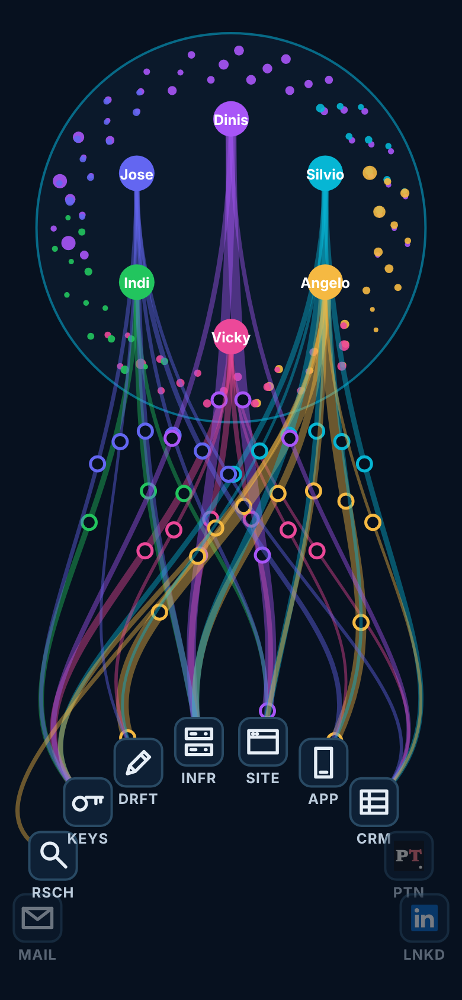
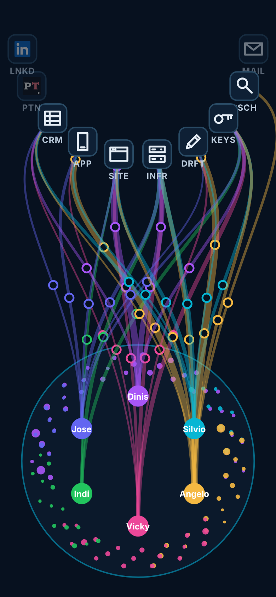
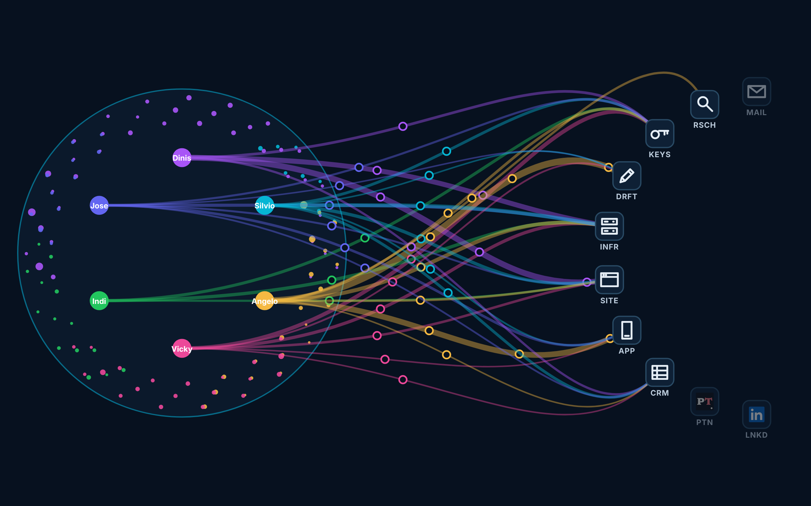
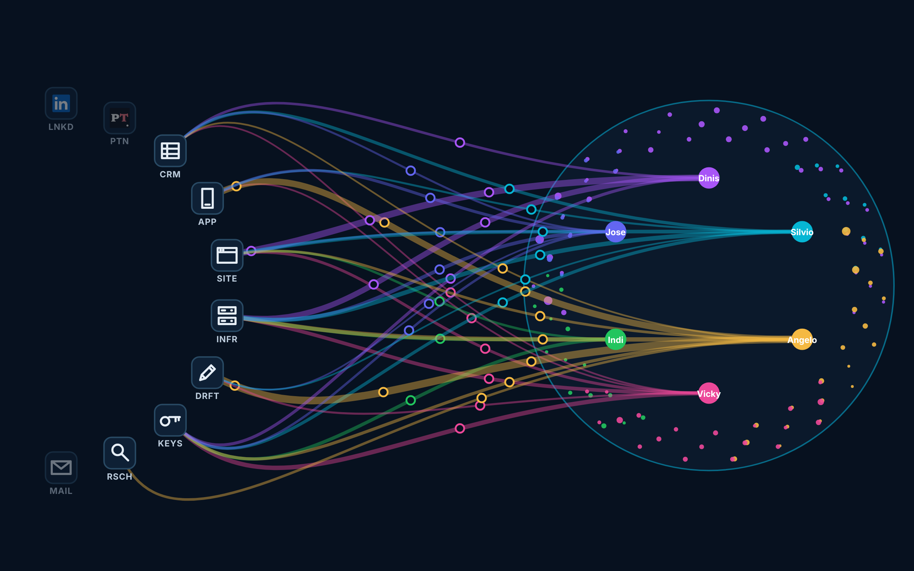

Angelo, 9 November about 17:10 UTC, after the wallpaper's Deliverables level (0.4.0): *"The text labels are awkward and hard to read. We should design a different way to make the deliverables easier to read. Maybe is an entirely new view where people and agents are on one side and then there is a pipeline of deliverables that go from the network to their destinations. Pretty much like a dumbbell, on one end the team and the machine network, on the other end the destinations, in the middle all the routes between the two."*

## Angelo's answers (9 November, about 17:25 to 17:30 UTC)

*"Since this is going to live in devices that are either portrait or landscape, this should be a setting: agents on top or below, right or left. I'm not sure we care for the count, it clutters and it's not that meaningful."* Then: *"The rest is ok."*

- **Orientation is a setting**, on the page and on the wallpaper: the team and the machine **on top, below, on the left or on the right**, the destinations at the other end. Added by me, for him to overrule: a fifth choice, **Automatic** (top on a portrait screen, left on a landscape one), as the default until he picks one.
- **No counts.** The list shows the mark and the full name only; the routes' widths carry how much.
- **Questions 1 to 5 as recommended:** it replaces the rim for Deliverables and Workstreams on the page and the wallpaper; routes by person (tap a person for their agents' routes); widths over the last seven days, icons flying live; the network end a small live graph; dev.work@ builds the page's version, then dashboard@ ports it to the wallpaper with a test holding the two together.

Then, about 17:35: *"I don't like the vertical list, it makes the lines awkward. We don't need to stress on the text labels, if we make the icons significative enough, we can just have the icons and maybe a 3-4 letters abbreviation?"* So **the list is gone**: the destinations are the dumbbell's second bell (below).

## Why the labels are awkward today

The destinations sit on the hexagon's rim among the agents, so their names have to squeeze into pills beside or inside the rim. On a phone there is no room outside the rim, so every name goes inside, cut short, and moved up or down until it clears the others. That is the cause, and no styling fixes it: the names need a place of their own.

## The view

 
 

(Redrawn after Angelo's 17:35 answer: icons and abbreviations, no list, no counts; the four ends of the setting.)

The mock-ups are drawn from this site's own data (`data.json`'s map, and `deliveries.json`'s last seven days), in the dark theme.

- **One end: the team and the machine.** The network as it is now, in a circle: the people, each with their agents beside them.
- **The other end: the destinations, a second bell.** Ten icons on the arc that faces the team, **the busiest in the middle**, the quiet ones (nothing this week) dimmed towards the ends. Each icon says what it is (work-draw.js's marks, no two alike: a browser window for the site, a server rack for infrastructure, a pencil for drafts, a phone for the app, a key, a ledger for the CRM, an envelope, a magnifier; the PT News and LinkedIn logos), with **a 3 to 4 letter abbreviation under it**: PTN, SITE, RSCH, INFR, APP, KEYS, CRM, MAIL, LNKD, DRFT. The full name is the icon's title (a long press on the phone, a hover on the page). No count. For Workstreams, each icon is its WS number in the tile, and the abbreviation the issue's first word. A destination with nothing this week stays in the list, dimmed, so the list does not jump about.
- **The middle: the routes.** One route from each person to each destination they delivered to this week, in the person's colour, **as wide as how much**. Each new delivery flies along its route as its icon (doc, cog, key, record, envelope, post), as today, and the row lights when it lands.
- **Orientation, a setting:** the team on top, below, left or right (and Automatic); the destinations' bell at the other end. Each route leaves its person, crosses the middle and arrives square on at its icon, so the routes fan out from one bell and gather into the other.
- **Workstreams the same way:** its ten as the second bell, by number.
- **What is read:** nothing new. `deliveries.json` and `workstreams.json`, as now; names and times only.

## Questions for Angelo, each with a recommendation

1. **Where it lives.** Recommended: it **replaces the rim** for both levels, Deliverables and Workstreams, on the website's live map (Messages | Workstreams | Deliverables) and on the wallpaper. Messages stays the hexagon as it is.
2. **Routes by person or by agent.** Recommended: **by person** (six colours, at most sixty routes, readable); tap a person to see their agents' own routes.
3. **What the widths count.** Recommended: **the last seven days**, while the icons fly live, a few minutes behind as now. The alternative is the last 24 hours, which is thinner but fresher.
4. **The network end.** Recommended: **a smaller copy of the live graph**, with the messages still flowing inside it, so the view stays alive between deliveries. The alternative is a still circle of people only, which is calmer.
5. **Who builds.** Recommended: **dev.work@** builds the page's version (it owns the work view and `work-draw.js`); then I port it to the wallpaper, as I did the rim, with a test holding the two together. The rim stays until the new view is on dev.

Until the new view is on dev, nothing changes: wallpaper 0.4.0 and the page keep the rim.
