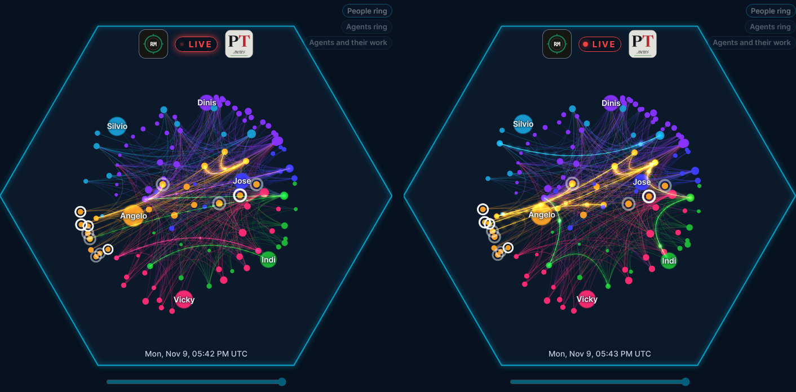

# The live graph glowing all the time

Angelo, 9 November about 17:45 UTC: *"Something weird about the 3D view is that occasionally, maybe after the view changes to 3d after a different view, the view starts with very bright and glowy dots and arcs but then they dim and go back to a previous subtler appearance. Can we have the glowy version all the time? Ideally on all views."*

**Why it happens.** The bright phase is a burst of real exchanges, which are drawn as large glowing heads with trails, lighting their lines at 0.95. The engine stops while the graph is hidden: a tab in the background, the wallpaper behind an app or its settings. When the graph shows again, everything that fell due meanwhile plays at once. Then only the steady flow is left, drawn small (13) at half strength, lighting lines at 0.75. That is the "subtler appearance".

**The change, drawing only (the engine and its timing stay the page's):**
1. The steady flow drawn as a real exchange is: a glowing head (34, alpha 0.55 to 0.95 over its trip) and a three-dot trail (20, 16.5, 13 at 0.6 of the head's alpha, fading), where it was a single small dot.
2. A lit line drawn at `min(1, op * 1.25)`, where it was `op * 1.05`: a line lit by the flow (0.75) now glows nearly as much as one lit by a real exchange.

Left: today. Right: the same two changes applied to a local copy of the page's `live3d.js`, not committed (dashboard@'s check, 9 November).

**Done on the wallpaper** (0.4.1, `MapRenderer.java`, all its views). **For the page:** dev.map@'s `live3d.js` (the two lines in its frame loop: the flow's dot and `lal`'s alpha) and, for the 2D views, `live.js`'s flow pulses in the same spirit. That is for the desk to brief dev.map@.
