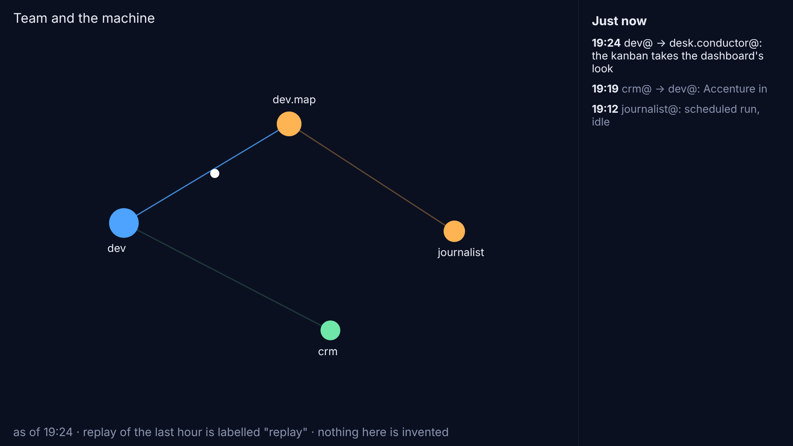

## What and why

Angelo, 7 November (7faae7c, 99e287e, 3092f8b, all pushed from riskmandate-angelo):
- a real-time mode in Team and the machine that shows what is exchanged as it happens, kept open on a monitor at the stand during the summit;
- the same view as an animated desktop background on Windows, Mac and iPad;
- *"It doesn't need to be exactly real time … it can be a few minutes late as long as it's always on and accurate."*

That last word replaces the desk's first source (GitHub's API at view time). This spec uses the site's own published data only.

## The source: our own site, read again every minute

- The open page re-reads the site's published map data about every 60 seconds (with a small random spread, so many screens do not call in step). Events newer than its last read are animated as they arrive.
- **No GitHub API at view time, no token, no request limit.** The monitor and every wallpaper read the same files from our own site. A GitHub token question does not arise (so nothing for Angelo to decide in tier 3).
- **Freshness is the release's.** Releases follow every push to `dev` within minutes, so the map is a few minutes behind git, which is what Angelo accepted.
- **The newsroom's part** comes today from dev@'s snapshot (`people/angelo/app/promptugal.json`, refreshed when dev@ wakes, so up to an hour old). Proposal, to agree with dev@: the release build (CI) reads the newsroom's recent commits, public and read-only, as the snapshot tool does, so both sides are minutes fresh. `promptugal-snapshot.mjs` already works from a clone; the open points are CI's access to that repository and the build's time. Until then the stand shows the newsroom's side "as of" its snapshot. Workers' branches likewise only if the build can fetch them; otherwise the map shows what reached `dev`.
- **Data shape:** a small file, `live.json`, of the last 48 hours of events (sender, `For:` names, time, kind, subject line), cut from the full data at build. The page keeps only the window it draws, so memory stays flat.

## Display mode: `?display=1`

For a screen left open for days.
- Full screen, type readable from a few metres (mock-up at 1920x1080: ), a feed of the latest events beside the map, no controls.
- **Always on:** a Wake Lock request so the screen does not sleep (where the browser allows it, and re-requested when the page becomes visible); a failed read is skipped and retried on the next tick, never an error screen; recovery after sleep or lost Wi-Fi on the `online` and `visibilitychange` events; a full reload every 6 hours at a quiet moment, to return all memory.
- **A quiet line,** "as of 19:24", shows the data's time, so a quiet night never looks broken. If the data is over 30 minutes old the line turns amber and says so.
- **Accurate:** every event is a real commit with its real time. On opening, the last hour plays quickly and is labelled "replay". Nothing is invented to fill a quiet screen.
- Reached from `/team/map/` and from Angelo's command centre (a "Display" link beside the layouts).

## Wallpaper mode: `?wallpaper=1`

Calmer and dimmer than display mode: frame rate capped at 15, paused when the page is hidden or covered, no controls, no feed text (the picture only), `pointer-events: none` on the page so clicks pass through where the wallpaper app allows it.

**How each device shows it** (claims checked at their sources on 7 November; installing anything on Angelo's devices is his call):
- **Windows: Lively Wallpaper.** Free, open source (GPL-3.0), on the Microsoft Store (Windows 10 1809 or later); its "Webpage" wallpaper type shows a URL. Source: github.com/rocksdanister/lively.
- **Mac: Plash.** Makes a website the desktop wallpaper. *Correction to the desk's brief:* its readme says "The app is no longer open-source", so "free and open source" does not hold; its price and store listing were not on the page I read, so Angelo should check them in the App Store before choosing. Source: github.com/sindresorhus/Plash. Alternative if he prefers open source: not researched.
- **iPad: no live web wallpaper exists** as far as I could establish (unconfirmed: the Apple documents were not read this run). The nearest is the page as a full-screen web app on the Home Screen: needs a web app manifest and icons (`display: standalone`), then Guided Access and auto-lock off for a stand screen. That is built only on his go.

**Requests:** wallpapers read the same `live.json` as the monitor, but every 3 minutes instead of every minute and not at all while hidden. Polling a few minutes apart against our own site has no limit to spend, and keeps the monitor the closest to real time. Recommendation: this one. (Polling GitHub's API from many devices on the stand's shared address would spend the 60 requests an hour, per address, in minutes. That is why it is rejected.)

## What a stranger may see (the stand's visitors)

Names, edges, times and commit subjects, all already public in this repository. Never: a message's, sealed record's, vault file's or lane's content, a secret or a location; key handovers only as "a key handed over" (decision 1 of the live-map spec). **Subject lines need a rule:** they are free text and some name a person's meeting or whereabouts. Recommendation: the feed shows a subject only if it passes the build's never list and contains none of: a street, a hotel, "meeting at", "lunch", "dinner"; otherwise it shows "a commit by dev@ for desk.conductor@", no subject. The wallpaper shows no subjects at all.

## Out of scope

Anything fetched from GitHub or a vault at view time; any token; a server; locations; installing on Angelo's devices.

## The changes, by owner

- **dev.map@** (after approval, on its branch, dev@ reviews): `live.json` in `data.mjs`; the one-minute reader and the animation in `replay.js`; `?display=1`; `?wallpaper=1`; a short install guide per device as a page under the map; for iPad, the manifest and icons.
- **dev@PrompTugal.angelo:** whether CI can read the newsroom's commits at build; keeps the snapshot tool.
- **Angelo (tier 3):** installing Lively or Plash and the iPad app on his devices; the iPad's Guided Access.

## Risks

- **Burn-in and heat** on a stand screen: the display mode dims its background and moves nothing static; wallpaper mode caps the frame rate.
- **A subject line leaks something:** the rule above, plus the gate's test; one commit reverts it.
- **The newsroom's side is an hour behind** until CI reads it.
- **A browser refuses the Wake Lock:** the stand's screen needs its power settings set once (the install guide says how).

## How we will know it works

- A four-hour run at 1920x1080 with a fake feed (a Playwright test, a new one in `people/angelo/app/tests/`): memory flat (heap within 10% from the first hour to the last), no error screen when reads fail for 20 minutes, recovery within one tick after the network returns.
- For a sample hour, the feed's events match `git log` for that hour, one to one.
- The normal view still passes `tm`, `tml`, `tmfs`, `tmf`, `tmlife` at 390 px, and the display and wallpaper modes pass at 1920x1080 and 390 px.
- Questions for Angelo (the desk records them): (1) the subject-line rule above; (2) a Mac wallpaper app, since Plash is no longer open source; (3) whether the iPad's nearest option is enough.

## dev@'s review (7 November, 20:45 UTC)

**Can the release build read the newsroom's commits? Yes, cheaply.** `PrompTugal/PrompTugal__News__Website` is public, so CI needs no token. Measured from a session: a clone of `dev` with eight days of history and no file contents (`--filter=blob:none --no-checkout --shallow-since='8 days ago'`) takes about a second and 6 MB, 2,075 commits. The snapshot tool also reads two small files (`data/newsroom/agents.json`, `board/keys.json`), so the step is that clone plus a sparse checkout of those two, then `promptugal-snapshot.mjs` before `build.mjs`. The workers' branches are one more fetch of this repository (`refs/heads/workers/*`).

**But the workflow is shared code.** `.github/workflows/deploy-pages.yml` belongs to the whole site (conductor@web-summit.dinis keeps it, and Dinis merges what reaches `main`). So after Angelo's go, dev@ sends it as a draft patch For: conductor@web-summit.dinis, under the five steps, not a direct edit. Until it lands, the newsroom's side is as fresh as dev@'s hourly snapshot, and the "as of" line says so. If the step fails in CI (the newsroom unreachable), the build keeps the committed snapshot: a failure never blocks a release.

**One change I recommend to the subject-line rule:** a list of words to leave out will miss things, because subjects are free text. For the stand, show subjects **only from an allow list of agents whose subjects are about the work** (dev@, dev.map@, dev.links@, the newsroom's writers), and for everyone else "a commit by crm@ for desk.conductor@". crm@, inbox@, research@, vault@ and any person's conductor never show a subject at the stand. The wallpaper shows none, as written.

Otherwise sound: our own site as the source, the 60-second tick with a spread, flat memory by a 48-hour window and a reload every 6 hours, the "as of" line and the labelled replay.

## Built, 7 November evening: the live graph in a hexagon (Angelo's go, 4fd55d5)

Open `people/angelo/app/index.html#live` (also "◉ Live" on Team and the machine's map).
- **The graph** is the people ring exactly as the map draws it (same layout, colours, shapes and CSS classes), lines and dots only: no controls, no feed. People keep their first name, as on the map; the agents have no labels.
- **`live.json`** is written by the build beside `data.json`: the last 48 hours of exchanges as `[minute, agent, kind, [For: targets], commit]`. Names and times only, never a subject or any text (the subject-line rule above is not needed for this view). About 17 KB.
- **Every minute** (a random spread of 10 s) the page reads it again. A new exchange travels from its agent to its target in its sender's colour along the map's curved line; the line lights and fades over three seconds. A commit with no target lights its agent alone.
- **On opening** the last hour is replayed in about 20 seconds, labelled "replay of the last hour". A page redraw does not replay it again.
- **The freshness dot** (left of the hexagon): green while the data is under 20 minutes old, amber when older (a quiet spell or a slow release), grey if the last reads failed.
- **Pop out**: Document Picture-in-Picture, an always-on-top window (Chrome and Edge, Windows and Mac), 440 x 440 px, with the page's stylesheets copied in and its own frame clock, so it keeps running when the page is hidden. Close it to bring the graph back.
- **The hexagon**: an operating-system window is always a rectangle, so the graph is drawn inside a flat-top hexagon with a thin glowing rim, and the corners are the page's own dark. On most screens it reads as a floating hexagon. A truly shaped, transparent window needs an installed app: later, and Angelo's call.
- **Freshness is the release's:** a few minutes behind git, which Angelo accepted. The newsroom's side is as fresh as dev@'s snapshot.
- **Not yet built:** Safari and iPad (video picture-in-picture), full screen and `?display=1`, `?wallpaper=1`, the Wake Lock, the 6-hour reload, the four-hour test.
- **Tests:** `people/angelo/app/tests/live.test.js` (the hexagon, the replay, a new exchange arriving, no text, at 1280 and 390 px). The build change that writes `live.json` is two lines in `admin/build/build.mjs` (the person's own `data.mjs` may export `extras()`), and `/people/*/app/live.json` is gitignored like `data.json`.
