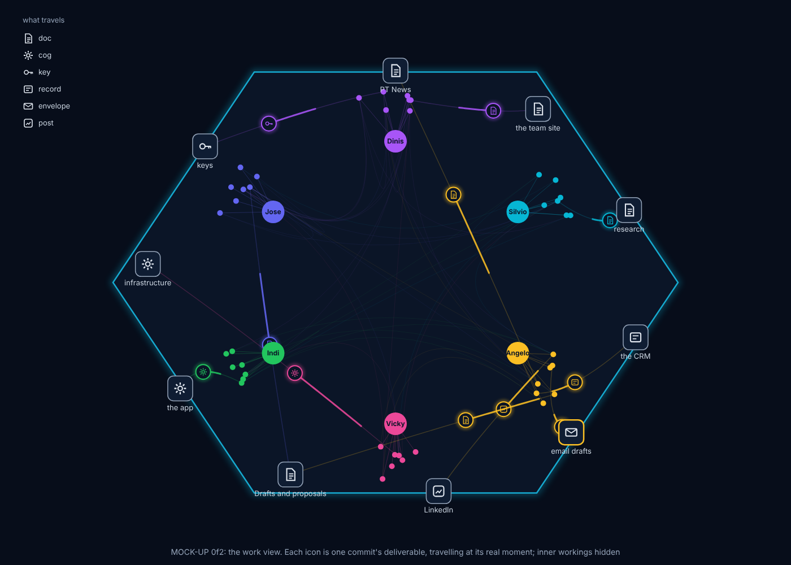

## What and why

Angelo, 8 November (the backlog's rows 0f2 and 0f3, from the desk's 10:00 and 10:10 commits, both pushed from riskmandate-angelo):
- *"we can have the humans, the agents and the destinations: PT news, infrastructure, email drafts, CRM entries, etc and when an agent delivers the finished product for one of these destinations we have a line and an icon travelling from the agent or the human to that destination. The icon should be representative of what's being produced, like a doc, a cog, a key, a record etc."*
- *"this system needs to be able to handle the past for the replay feature so that we can show deliverables there too."*
- *"Maybe we can add a generic destination for everything that is a proposal/draft/html."*
- For replay: a "Download clip" that *"produces a video based on the selected controls. The video should be in a format that when you put it in Whatsapp is automatically shown and playable instead of generating the download button."*

Today the map and the live graph draw **exchanges** (who addressed whom). The work view draws **what was made, and where it went**: the same people and agents, ten destinations at the rim, and at each delivery's real moment a typed icon travelling from its maker to its destination. The clip turns whatever replay is showing into an MP4 that WhatsApp plays inline, so Angelo can send "what the team did today" in one message.

**The mock-up** (drawn from the rules below, positions illustrative): 

## Part 1: the work view (0f2)

### What it looks like

- **The live graph's look, unchanged** (dev.map@ owns live.js and the layouts): the people ring, each person's agents around them, their colours, the hexagon. The work view is a **view** of the same graph (a switch beside the layouts: "Exchanges | Work"), not a new page.
- **Ten destinations at the rim**, in rounded squares like 00b's systems, with plain marks (no company logos): PT News, the team site, research, infrastructure, the app, keys, the CRM, email drafts, LinkedIn, and **Drafts and proposals** (the generic one).
- **Six icons**: doc, cog, key, record, envelope, post (the mock-up's legend). The icon is the kind of thing made; the destination is where it went. A doc can go to PT News, the site, research or Drafts.
- **A delivery** travels from the agent (or the person, for a commit by a human) to its destination along a curved line in the sender's colour, the icon riding at its head, about 3 seconds; the destination's square lights when it lands and keeps a small count for the window shown ("PT News 4").
- **Inner workings are hidden**: seals, snapshots, STATE files, ledgers, estimates, pulses, reviews, release commits and generated pages never travel (the rule table's "hidden" rows).
- **Many at once** (a release of six articles, or replay at speed): deliveries to the same destination within one frame's minute merge into one icon with a small number, so the screen never floods.
- **Exchanges stay**: in the work view they fade to the faint flow, so the graph still breathes; the icons are the bright thing.

### Live and replay, one source

The same list of deliveries feeds both: the live graph plays each at its real moment (4 minutes behind, like exchanges), and the map's playback plays the full history, from the first commit of every repository the map reads. Nothing is drawn that has no commit.

### Where the deliveries come from, in this order

**1. The files each commit changed, by a rule table.** The first rule that matches a file decides; a commit delivers at most one icon per destination. Measured on this repository's `dev` from 2 November to 8 November, 09:50 UTC: 1,978 commits that are not releases; 932 deliver something by these rules (758 one thing, 163 two, 11 three), 1,046 are inner workings only.

| Files (first match wins) | Icon | Destination | Commits, 2 to 8 Nov |
|---|---|---|---|
| `REALITY.md`, `version.txt`, `admin/versions.json`, `admin/metrics.json`; `*/STATE.md`, `*/RUNNER.md`, `*/ledger/`, `*/estimates/`, `*/pulse/`, `*/policy/`, `data/log.json`; `data/sealed/` (vault@'s rule: never a sealed file's name); the generated pages committed before WS-83 (`team/`, `companies/`, `about/` and the rest) | none | hidden | |
| `data/keys.json`, `data/person-keys.json`, `people/*/key.json` | key | keys | 98 |
| `people/*/research/` | doc | research | 4 |
| `data/crm.json`, `data/companies.json`, `*/crm/` | record | the CRM | 13 |
| `people/*/proposals/`, `*/drafts/`, `*.fragment`, other HTML previews under `people/` | doc | Drafts and proposals | 77 |
| `people/*/app/` | cog | the app | 116 |
| `.github/`, `admin/build/`, `admin/tools/`, `people/*/tools/`, other code (`*.mjs`, `*.js`) | cog | infrastructure | 235 |
| `content/**/*.md`, `board/`, `assets/` | doc | the team site | 574 |
| the newsroom: `content/articles/` (a published, signed piece) | doc | PT News | measured at build |
| the newsroom: `desks/*/drafts/`, its proposals | doc | Drafts and proposals | measured at build |
| the newsroom's code, templates, workflows | cog | infrastructure | measured at build |
| the apps' repositories (iOS, Android) | cog | the app | measured at build |

"The team site" is large (574) because people's pages, briefs and board issues are all site content. If that drowns the rest, the first thing to try is drawing only `content/` and `board/` there and treating `people/*/` pages as the site too but at half size; Angelo's call after he sees it (question 2).

**2. "Delivered:" lines** (the kit's protocol, with the kind first: `Delivered: <kind>, <what> <path or link>`). This is the only source for what never touches a repository. Kinds map to icon and destination: article → doc, PT News; brief → doc, research; page → doc, the team site; post → post, LinkedIn; email draft → envelope, email drafts; record → record, the CRM; key → key, keys; tool → cog, infrastructure; app → cog, the app; spec and report → doc, Drafts and proposals. A line whose kind and destination a file rule already gave for the same commit is the same delivery, not a second one. Lines written before the kind-first habit (22 on `dev` so far) are matched by the path they name, through the same rule table; a line with neither a kind nor a path is left out.

**3. The backfill, for the past outside the repositories:** `people/angelo/app/deliveries-backfill.json`, entries `{ at, agent, kind, destination, sha }`, where `sha` is the commit that records the delivery (for example the commit in which an agent reported "an email draft to X is in Gmail's drafts"). No entry without its commit; the test checks every sha exists. It holds names, kinds and times only: never a recipient, a subject or any text.

### The data, and who may see it

- **What is kept per delivery:** `[minute, maker, icon, destination, repository, short sha]`, names by index, as live.json does. Never a subject, a file name, a body, a recipient or any text. The file paths are read at build time to classify and then dropped.
- **Where:** a tool, `people/angelo/tools/deliveries.mjs`, reads the history of every repository in `repos.json` (read-only clones, no token, as repos-snapshot.mjs does) and writes the list. For this repository's own `dev`, the same function runs in the build so the live view is never a snapshot behind (two lines in `data.mjs`'s `extras()`, a shared file: a small change under the five steps, For: dev@PrompTugal.angelo). The other repositories come from a committed snapshot refreshed by the tool, like `repos-events.json` (question 4).
- **Size:** about 150 deliveries a day on this repository; the full history since 28 October in about 40 KB, compressed by the site's server.
- **The email-drafts and LinkedIn squares** show that a draft was made, by whom and when: never to whom or about what. A recipient's or a company's name never appears (vault@'s must-never list, data-and-who-may-see-it.md, applies whole).
- **The metadata point** (vault@'s "one real risk") is unchanged: the team view shows minutes, a public version (spec-live-map.md part 4) would show days or lag, as that spec decides.

### The changes, by owner

- **dev.work@ (mine):** `people/angelo/tools/deliveries.mjs` (the rule table and the reader), `people/angelo/app/work.js` (the view: destinations, icons, flights, merges, counts), `people/angelo/app/deliveries-backfill.json`, their tests (`wv*` in `people/angelo/app/tests/`), this spec and my STATE.
- **dev.map@ (live.js and the layouts):** one hook so the work view can draw on the graph: the positions of people and agents, and a layer to draw in. I send it as a draft For: dev.map@ if live.js does not expose them already.
- **Shared, under the five steps:** two lines in `data.mjs`'s `extras()`; the "Exchanges | Work" switch in `app.js`; `deliveries.json` and `deliveries-repos.json` beside `live.json` (gitignored like it where generated).
- **dev@PrompTugal.angelo:** reviews my branch and brings it onto dev.

## Part 2: "Download clip" (0f3)

### What it does

A button beside the playback controls, **⤓ Download clip**, makes a video of exactly what replay shows (layout, Exchanges or Work view, time range, focus, speed, light or dark) and gives Angelo a file he can drop into WhatsApp, where it plays inline.

### The format WhatsApp plays inline

An MP4 with H.264 video (`avc1`, Main or Baseline profile, `yuv420p`), even width and height, the `moov` box at the start (fast start), no audio track (or AAC, never Opus), under about 16 MB. A WebM, or an MP4 with VP9 or AV1 inside, arrives as a document to download, which is what Angelo does not want. So:

- **Encode in the browser** with WebCodecs' `VideoEncoder` (`avc1.4D0028`, Main profile, level 4.0), 30 frames a second, and an MP4 muxer that writes fast start (mp4-muxer, MIT, vendored under `people/angelo/app/vendor/` at a pinned version, nothing loaded from a CDN at run time). Chrome, Edge and Safari 17 and later have it.
- **Where WebCodecs is missing:** `MediaRecorder` with `video/mp4;codecs=avc1` (Safari's own), checked with `isTypeSupported`. If neither can make H.264 MP4, the button says so and makes nothing; **never a WebM**.
- **Drawing the frames:** the graph is SVG, so each frame is drawn into a canvas the way the live graph's video pop-out already does (live.js `popVideo`): the SVG with the page's styles inlined, drawn as an image; in 3D, the WebGL canvas itself. Frames are rendered as fast as the machine can, on replay's own clock stepped frame by frame, not recorded in real time, so a slow laptop makes the same clip, just more slowly, with a progress bar and a Cancel.
- **Sizes:** square 1080 x 1080 (the default: the hexagon is square), 9:16 at 1080 x 1920 for a phone's full screen (the hexagon centred, a title and the time range above and below), and 16:9 at 1920 x 1080. All even, as H.264 needs.
- **Caps:** at most 60 seconds of video and about 15 MB (the bitrate set from the length: 2 Mbit/s for a minute). A longer selection is sped up to fit, with a warning naming the speed ("8 hours in 60 seconds"); Angelo can shorten the range instead.
- **On the clip:** a small caption at the bottom: the time range in UTC and "web-summit.sgit.ai, Team and the machine". No names beyond those the map already shows, no subject, no text from any commit (the replay's tooltips are not drawn).
- **The file name:** `team-and-the-machine-<from>-<to>.mp4`. On a phone with the share sheet (`navigator.share` with files), "Share" goes straight to WhatsApp; elsewhere it downloads.

### How we will know it works

- **The format, in a test:** `clip` makes a 5-second clip in Chromium, then checks it with ffprobe: `codec_name=h264`, `pix_fmt=yuv420p`, even width and height, `moov` before `mdat`, no audio or AAC, under the size cap; and that no subject or file name from the data appears in the frames' text layer. If ffprobe is missing in the session, the test reads the MP4's boxes itself (ftyp, moov, avcC) and says ffprobe was not run.
- **The proof that counts:** Angelo sends one clip to himself on WhatsApp, on his iPhone, and it plays inline. Until he has, 0f3 stays "delivered, to check".
- **The work view:** `wv` checks each rule row with a fixture commit (an article to PT News as a doc, a key to keys, a STATE change hidden, a release hidden), a "Delivered: email draft, ..." line becoming an envelope to email drafts with no text drawn, the backfill's shas all real, merges when ten land in a minute, and replay over the full history at 1280 and 390 px, light and dark.

## Out of scope

- Any company's logo (plain marks only, unless Angelo decides otherwise: question 3).
- Reading Gmail, LinkedIn, the CRM's vault or any connector at view time: the email-drafts and LinkedIn squares come only from "Delivered:" lines and the backfill.
- Sound in the clip; uploading the clip anywhere (it is made and kept on the viewer's own machine).
- The public map (spec-live-map.md part 4): the work view follows whatever that spec decides.

## Risks

- **Over-drawing the site:** 574 of 932 deliveries go to the team site; the rim's other squares could look idle. Mitigation: the per-destination count and question 2.
- **A rule misreads a commit** (a code change inside `content/` read as a doc): the rule table is one list in deliveries.mjs, tested row by row, and easy to change.
- **"Delivered:" lines are free text**: only the kind and the path are read; everything else in the line is dropped before the data is written.
- **WebCodecs' H.264 is missing on some Linux Chromium builds** (no proprietary codecs): the button says so there; the test session may need the MediaRecorder path or a build with H.264, which I will check first and report.
- **Clip time on a slow machine:** a minute of 1080 x 1080 at 30 fps is 1,800 frames; drawing SVG to canvas costs about 10 to 30 ms a frame, so 20 to 60 seconds to make. The progress bar and Cancel cover it.
- **Shared files** (data.mjs, app.js, live.js): small changes, checked against the last two hours, sent as drafts on a clash.

## Questions for Angelo (via the desk)

1. **Approve the ten destinations and six icons** as in the mock-up, with Drafts and proposals as the generic one?
2. **The team site's volume:** draw every site change (574 in six days), or only `content/` and `board/`, with people's own pages counted but drawn smaller?
3. **Plain marks or logos** for PT News and LinkedIn? (Plain marks recommended: logos are other companies' trademarks.)
4. **The other repositories' deliveries** from a committed snapshot refreshed each run (as repos-events.json is today, a few hours behind at worst), or wait until the build can read them itself? Snapshot recommended.
5. **The clip's default shape:** square (recommended: it fills WhatsApp's bubble and keeps the hexagon whole) or 9:16?
