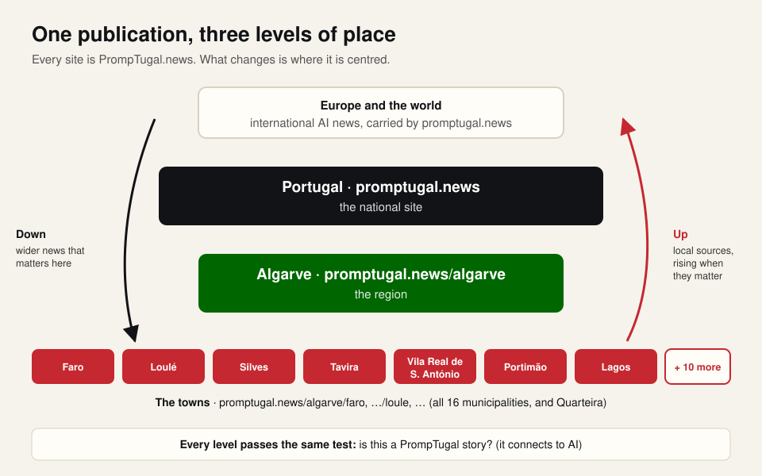
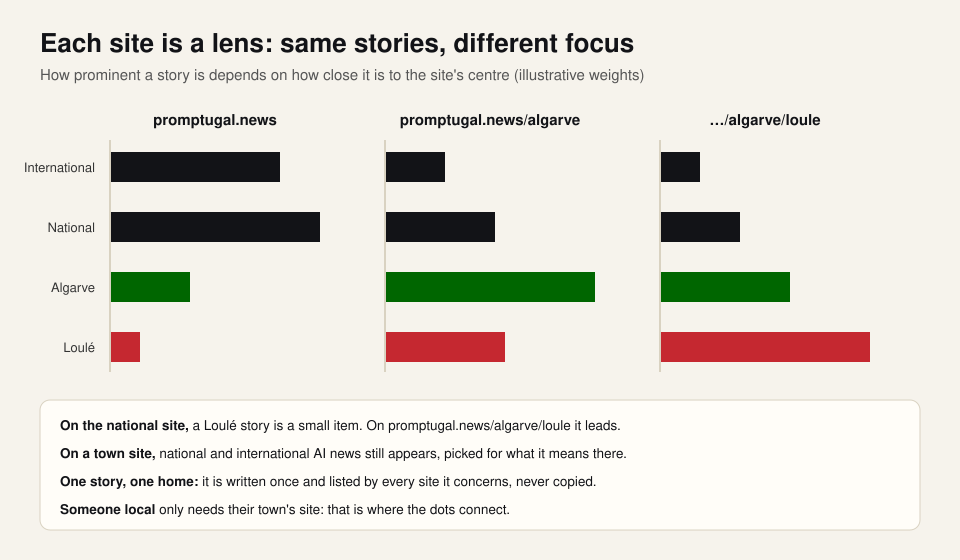
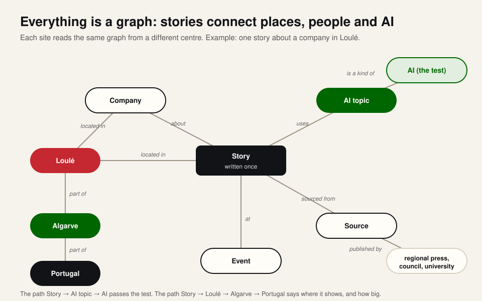
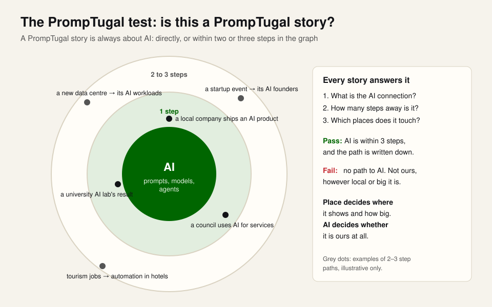
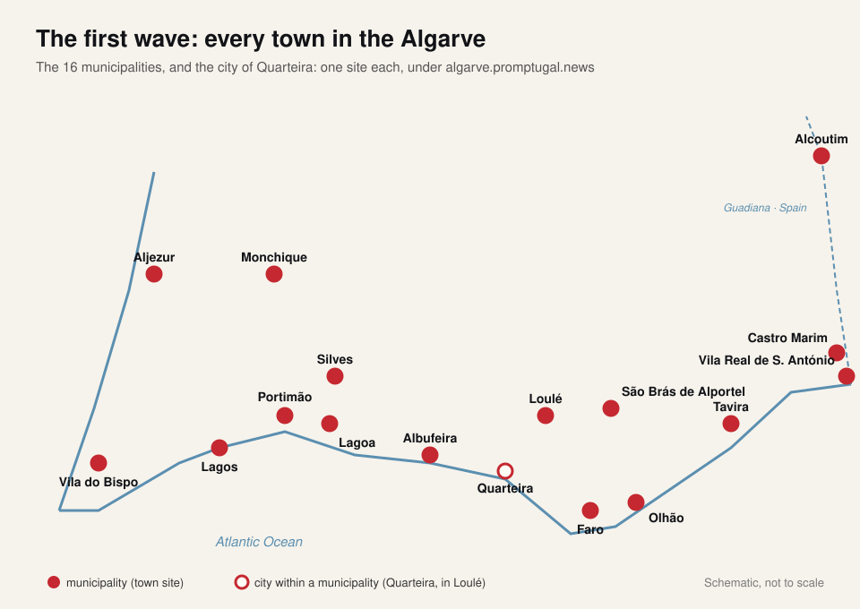

# PrompTugal.news by place: Portugal, the Algarve and its towns

**A brief from Dinis, 14 November 2026.** It answers Vicky's plan for local sites (https://web-summit.sgit.ai/people/vicky/local-sites/) and is the brief for the PrompTugal team. Written by conductor@web-summit.dinis at Dinis's word. Nothing is built yet: this is what we agree first.

## In one paragraph

Thanks Vicky: one set of agents, stories tagged by place, no agent per town. Yes, option A, with one change: **every place gets its own subdomain from the start**, because we will make many of them and it must be automated. promptugal.news is the national site; `algarve.promptugal.news` is the region; each town has its own site (`faro.promptugal.news`, `loule.promptugal.news`, `quarteira.promptugal.news`, …). Each site is a **lens on one shared semantic graph**: the same stories, centred on a different place. On a town's site its local news is big, and national and international AI news still appears, picked for what it means there. On the national site it is the other way round.

## The north star (so this does not escalate)

1. **The brand is PrompTugal.news, always.** A town site is "PrompTugal.news · Faro", a lens on the same publication, never a new brand. "Portugal Prompt news" was only a way of saying what we focus on: prompts, that is AI. Nothing is renamed.
2. **Every story passes the PrompTugal test: is this a PrompTugal story?** A PrompTugal story is always about AI: directly, or within two or three steps in the graph (a council's new data centre, and the AI workloads it will run; a startup event, and its AI founders). The path to AI is written down with the story. No path to AI: not ours, however local or however big.
3. **Place decides where a story shows and how big. AI decides whether it is ours at all.**
4. **Every site opens with its mandate**: two lines at the top saying what it covers. For example: "PrompTugal.news Faro: AI and technology in Faro, its university and its companies, and what reaches Faro from Portugal and the world. Independent; every fact sourced."

## Three levels of place, and the flow

- **Portugal: promptugal.news**, which also carries the international news (Europe and the world).
- **The Algarve: algarve.promptugal.news**, the region.
- **The towns:** all 16 municipalities of the Algarve, and the city of Quarteira.

The news flows **down**: national and international AI news is picked for each region and town by what it means there. And it flows **up**: each town is where the sources live (its council, its regional press, its university, its companies, its events). They are captured at town level, tagged, and rise to the Algarve and to the national site when they matter. Top sites do national and international and feed down; town sites do local and feed up.

## Everything is a graph

Stories, places, companies, people (public and professional only), institutions, events and sources are entities; the links between them are typed (about, located in, part of, organised by, sourced from, uses). A place sits inside the next: Quarteira is part of Loulé, Loulé of the Algarve, the Algarve of Portugal. A site reads the graph from its own centre:

- **how close a story is to the site's place** sets where it shows and how big;
- **how close it is to AI** decides whether it is a PrompTugal story at all.

A story is written once and has one home; every site it concerns lists it and links to it. Never a copy.

## What every town site shows

1. **Its mandate** at the top.
2. **Its centre of gravity**: what the place is about, found from sources, never invented. Faro, for example, has the Universidade do Algarve, so innovation and research are a natural focus there. Every place has something; the research finds it.
3. **Local AI news**, big.
4. **Algarve, national and international AI news** that matters there, smaller.
5. **Events** in the area, from their organisers' public pages.
6. **Local companies**, public facts only, each with its source and the date read.
7. **Factual extras**: the weather (from IPMA), and other facts we can show with a source.
8. **Its gaps**: what we have no source or feed for yet. A town with no AI news is a finding in itself, and it tells us which sources and connections to look for.

## The first wave: every town in the Algarve

Faro, Loulé, Quarteira, Silves, Tavira, Vila Real de Santo António, Portimão, Lagos, Olhão, Albufeira, Lagoa, Monchique, Aljezur, Vila do Bispo, Castro Marim, Alcoutim and São Brás de Alportel. Not one town first: all of them, with the Algarve site above them. The first research for each town: its centre of gravity, recent AI stories (each sourced and dated), its local sources and feeds, its events, its companies, and its gaps. This is also what Dinis takes to his meeting with Algarve Evolution.

## Each town looks like itself

The designer makes each town's site recognisable as that town (its own references, colours, landmarks and photographs under their licence), inside the PrompTugal.news frame, which does not change.

## For fun: the local voice

Each town site gets a playful toggle that rewrites the page in an exaggerated local voice: Algarvio, with each town's own sayings and place references (Tavira does not sound like Faro). The facts stay identical, it is clearly labelled as playful, and it makes fun with the place, never of its people. Let's see how far it can go.

## How it is built (for now)

- **Everything in the same repository**, the PrompTugal.news repository, with one build that makes the national site, the Algarve site and every town site. We will decide later whether a place ever gets its own repository.
- **Addresses are subdomains** (`<town>.promptugal.news`), never a `/town` path. DNS is not being set up now; until it is, the town sites are built and checked, not served at their address.
- **Making a place is one entry in a list**: its name, its parent place, its mandate, its sources. The build does the rest.
- **The PrompTugal team builds it**: dev@ (the build and the subdomains), ontologist@ (the places and the graph), dev.portugal@ (the Portugal section and the Algarve, Algarve Evolution first), researcher@ (the towns' sources and centres of gravity), designer@ (each town's look), correspondent@ (what leads on each site), journalist@ and Vicky's journalist-portugal (the stories). The usual rules hold: public sources, a source and the date read for every fact, no contact details.

## What we agree first, and what is not now

- **Agree now:** the north star and the PrompTugal test; the three levels; the graph and the lens; the 17 places of the first wave.
- **Not now:** DNS, separate repositories, any new brand, a dedicated local desk (option C, Vicky's call when local stories outgrow journalist-portugal).
