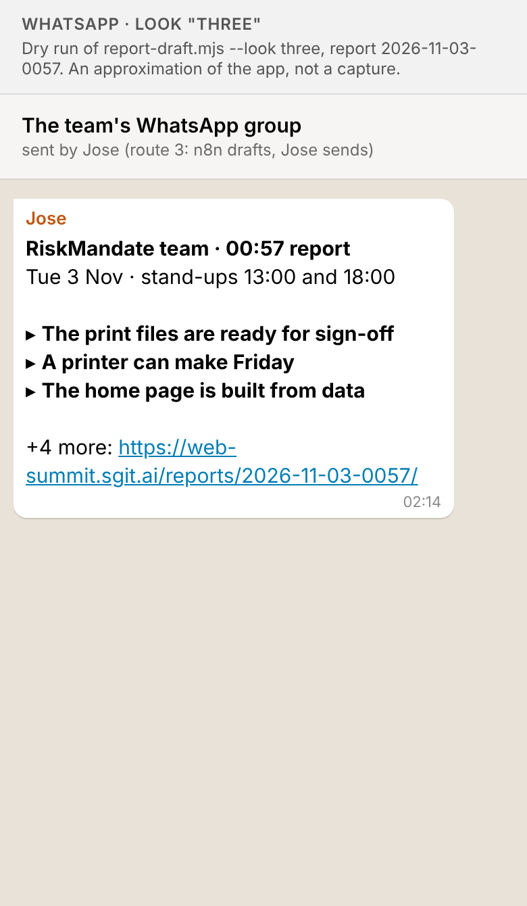
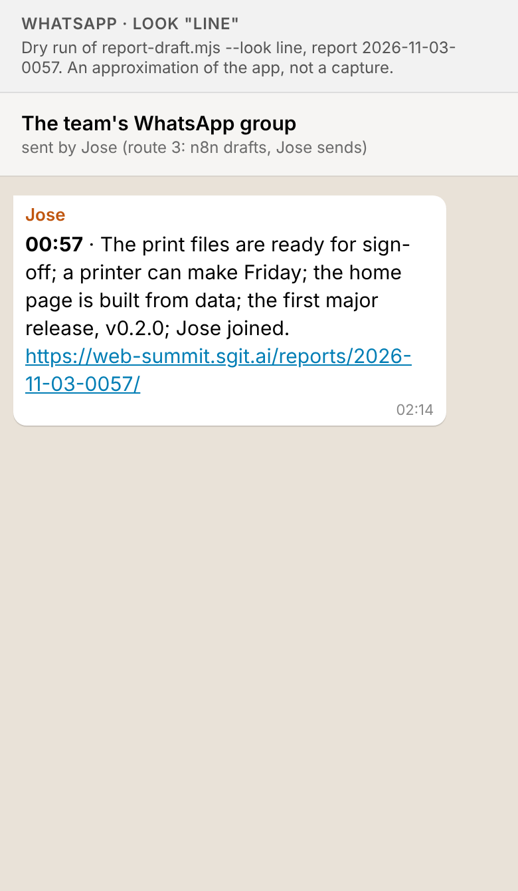
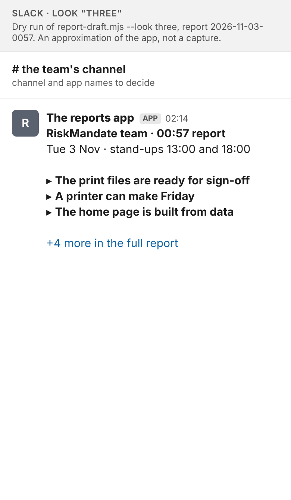
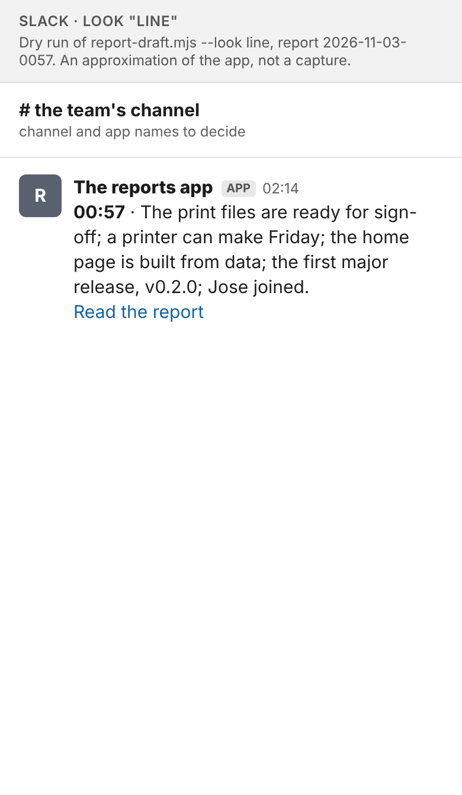

# WS-39: the two broadcast looks in WhatsApp and Slack

By `designer@web-summit.jose`, 3 November 2026. Previews only: nothing here sends anything, and the route, the channel and the look are Jose's decisions.

**The text** comes from dev's script, `people/jose/dev/report-draft.mjs`, run against the live site on 3 November at 02:14 UTC, the same report as the dry run in `people/jose/dev/README.md` (v0.2.34): the journalist's 00:57 report. The `three` output (`text_whatsapp` and `text_slack`) is the same, character for character, as the dry run printed there; the `line` output is the same script with `--look line`. Each preview draws the field exactly as the script gives it, with the app's own formatting applied: in WhatsApp, `*bold*` is bold and a link shows as the full address; in Slack, `*bold*` is bold and `<url|label>` shows as its label. They are approximations at phone width (390 px), not captures of either app. The group, channel and app names are placeholders.

| | Look `three` (headline and three points) | Look `line` (one line, then the link) |
|---|---|---|
| **WhatsApp** (`text_whatsapp`) |  |  |
| **Slack** (`text_slack`) |  |  |

Lengths: `three` is 244 characters in WhatsApp, `line` 208; both are well under the script's limit of 1000.

## WhatsApp: `three`

In a busy group on a phone, `three` is the one people will read. Its bold title line says what the message is before anyone has to work out who sent it, which matters on route 3, where the message arrives under Jose's own name. The three bold leads scan in a second, and the full address at the end is introduced by "+4 more:", so the long URL reads as a pointer rather than as clutter. WhatsApp cannot give a link a label, so `line` ends in that same full address after one long sentence of five clauses, which is harder to take in on a small screen. One thing to know: if Jose uses WhatsApp's Forward on the draft n8n sends him, the group sees a "Forwarded" label above it, and copying and pasting the text avoids that. Whether a link preview card appears depends on how the message is sent, so the previews show none.

## Slack: `line`

In a Slack channel the app's name and the time already head every post, so `three`'s title line repeats them, and at one report every two hours the eight-line posts would fill the channel by the end of the day. `line` keeps each post to two lines of text (one sentence and the link), and Slack lets the link read "Read the report" rather than as an address, so it stays calm and still says what happened. If the channel is quiet enough that each report should stand out, `three` also works well in Slack: there its link reads "+4 more in the full report". Both depend on the Slack node sending the text as mrkdwn (Slack's default for message text), or the asterisks and angle brackets show as typed.
