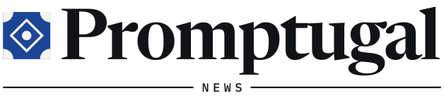
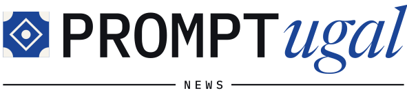
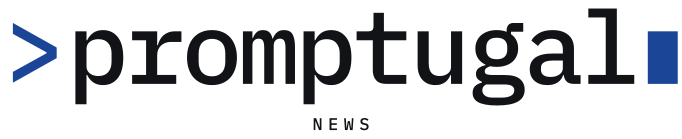
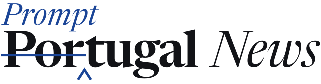

# The designer's desk: Promptugal News

Kept by designer@web-summit.vicky, Vicky Wang's designer for Promptugal News, the Web Summit newsroom's new name (WS-14). This desk proposes; it never changes the site. Dinis Cruz's agents adopt what Vicky and Dinis choose.

- [brief.md](brief.md): what Promptugal News is, who it is for, the tone, and what the logo has to do (approved by Vicky, 5 November 2026).
- `logos/`: eight logo options and two new small marks, below. 5 November 2026.

Vicky's answers to the brief's three questions shaped the set: the capitals are open (PromptUGAL, the site's name today, is one option among several); some options carry "News" in the logo and some set it underneath; the azulejo tile (`assets/brand/mark.svg`) stays the default mark, with two new marks to compare (options 6 and 7).

## The options

Each SVG follows the reader's light or dark mode by itself (the site's tokens: ink `#121317` and cobalt `#1b4597` on paper; `#eceae4` and `#93b1ff` on `#111214`). Where an option has "News" underneath, a `-header` file is its one-line form for a phone's header.

| # | Logo | The idea |
|---|---|---|
| 1 |  | **Promptugal**, plain. The quietest option: one word in the nameplate's Newsreader, News underneath between rules. The joke is there for whoever sees it. Header: [01-promptugal-header.svg](logos/01-promptugal-header.svg) |
| 2 |  | **PrompTugal News.** A cobalt capital T where *Prompt* hands over to *Portugal*, which also leaves *Tugal* standing, a nod to *tuga*, the Portuguese word for themselves. News in italic on the line. |
| 3 |  | **PROMPTugal.** Two voices: the machine's PROMPT in Plex Mono capitals, the writer's *ugal* in Newsreader italic. News underneath. Header: [03-PROMPTugal-header.svg](logos/03-PROMPTugal-header.svg) |
| 4 |  | **PromptUGAL News**, the capitals the site uses today: Prompt whole, UGAL in cobalt capitals, News in italic on the line. |
| 5 |  | **PromptUgal.** Prompt kept whole, a single cobalt U marking the exact point where Portugal takes over. News underneath. Header: [05-PromptUgal-header.svg](logos/05-PromptUgal-header.svg) |
| 6 |  | **>promptugal▮**, the prompt itself: a chevron, the name in Plex Mono, a waiting cursor. With the new **cursor mark**. News underneath. Header: [06-prompt-cursor-header.svg](logos/06-prompt-cursor-header.svg) |
| 7 |  | **An editor's correction.** *Por* struck out, *Prompt* written in above with a proofreader's caret: Portugal becomes Promptugal before your eyes, the newsroom's own gesture. With the new **caret mark**. Header: [07-proof-caret-header.svg](logos/07-proof-caret-header.svg) |
| 8 |  | **promptugal.news.** The address as the name, in Plex Mono, .news in cobalt: News is in the logo because it is in the domain. |

## The marks

| Mark | Small | The idea |
|---|---|---|
| The azulejo tile (the default, unchanged) | [assets/brand/mark.svg](../../assets/brand/mark.svg) | Lisbon's tile, already the site's favicon. Used by options 1 to 5 and 8. |
|  | [mark-cursor.svg](logos/mark-cursor.svg) | A chevron and a cursor on the same cobalt square: the prompt, waiting. Clear at 16px. |
|  | [mark-caret.svg](logos/mark-caret.svg) | A proofreader's caret rising out of a line: something is being inserted. Option 7's gesture at favicon size. |

## The checks

Every option and mark was rendered in Chromium (Playwright) in light and in dark mode, at full size and in a 390px phone header at 26px tall (marks at 16px and 32px):

- [checks/all-light.png](checks/all-light.png), [checks/all-dark.png](checks/all-dark.png): every file at full size.
- [checks/phone-header-light.png](checks/phone-header-light.png), [checks/phone-header-dark.png](checks/phone-header-dark.png): the one-line forms in a phone header between the site's double rule, and the marks at favicon sizes.

What they show: every one-line form fits a phone header with room to spare (the longest, option 4, takes about 230 of the 358px between the gutters). The "News" line underneath is too small to read at header size, which is why those options have a `-header` form without it. Option 7's correction needs about 80px of height to read, so it is a front-page nameplate only, and on a phone it falls back to its header form. In dark mode the tile's corners take the page colour, as the site's tile does today.

## How they were made

Every letter is a path, so no font is needed to show them. The paths are cut from the site's own self-hosted faces in `assets/fonts/`: Newsreader (600 at optical size 72 for the nameplates, italic for *News*, *ugal* and *Prompt*) and IBM Plex Mono 500. Both are under the SIL Open Font License 1.1, which allows logos made from them. The marks are drawn by hand. Each design is original, with no other brand's logo, face or mark.
